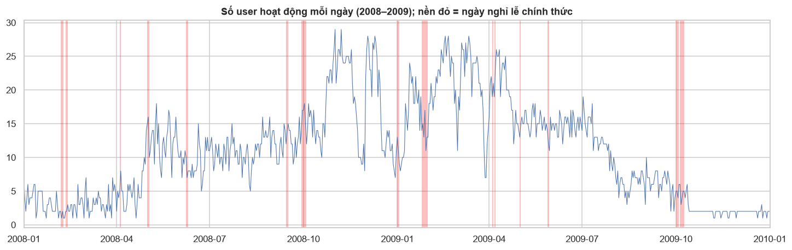
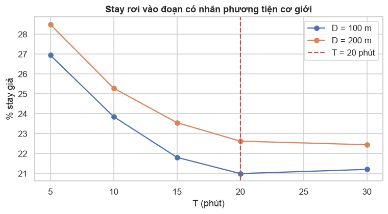
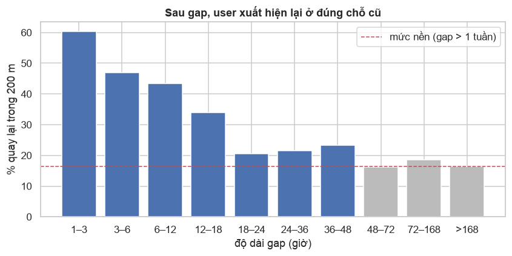
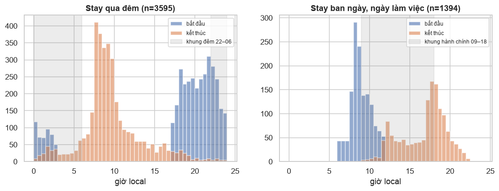
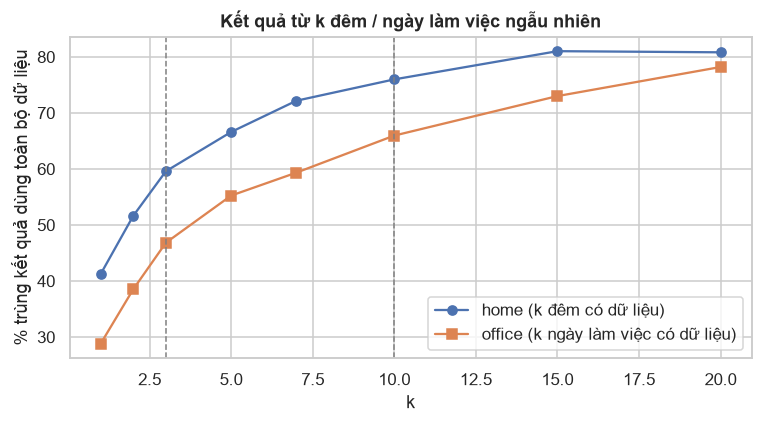
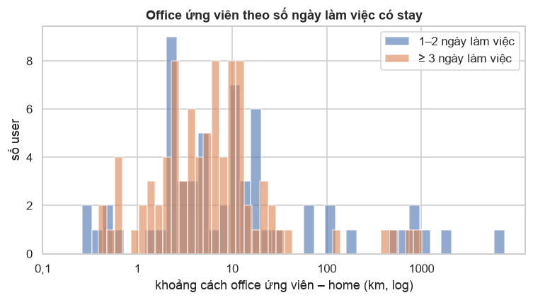

# Tổng kết EDA bộ dữ liệu GeoLife Trajectories

Tài liệu này chỉ giữ những insight quan trọng từ quá trình EDA. 

- **Notebook:** [`EDA/`](../EDA/), từ `01` đến `06`. Mọi notebook đọc thẳng file `.plt` gốc.
- **Hình gốc:** [`EDA/figures/`](../EDA/figures/).
- **Quy ước:**
  - "giờ local" là giờ địa phương theo timezone chính xác của toạ độ (mục 7);
  - "ngày làm việc" theo lịch chính thức của Trung Quốc, có ngày nghỉ lễ và ngày làm bù (mục 11); ngoài Trung Quốc là T2–T6;
  - "khung đêm" là 22:00–06:00;
  - "khung hành chính" là 09:00–18:00 của ngày làm việc.

| Chỉ số tổng quan | Giá trị |
| --- | --- |
| Số user / số user có nhãn phương tiện | 182 / 69 |
| Số trajectory (file `.plt`) / số điểm GPS | 18.670 / 24.876.978 |
| Khoảng thời gian (UTC) | 2007-04 → 2012-07, giai đoạn dày nhất là 10/2008 – 7/2009 |

---

## 1. Dữ liệu tập trung vào một nhóm nhỏ user

| Chỉ số | Giá trị |
| --- | --- |
| Số user chiếm 50% / 80% số điểm | 15 user (8,2%) / 40 user |
| User nhiều điểm nhất | user 153: 2,16 triệu điểm (8,7%), 1.273 ngày có dữ liệu |
| Median theo user | 35.182 điểm · 27,5 trajectory · 19,5 ngày có dữ liệu |

**Insight:**
- Phân bố số điểm theo user có đuôi rất dài. User 153 có số điểm gấp khoảng 60 lần user ở vị trí trung vị.
- Mọi thống kê gộp theo điểm đều bị khoảng chục power user chi phối.
- Một nửa số user có dưới 20 ngày dữ liệu.

## 2. Cấu trúc file đồng nhất, các file của cùng một user ghép nối được

| Kiểm tra | Kết quả (18.670 file) |
| --- | --- |
| Header 6 dòng | Giống nhau ở 100% file |
| Cột thứ 3 | Luôn bằng `0` |
| Cột `days` so với `date + time` | Khớp tuyệt đối, lệch 0 giây |
| Tên file so với timestamp của điểm đầu | Khớp 100% |
| Timestamp đi lùi trong một file | 0 lần |
| Điểm trùng giữa hai file khác nhau của cùng user | 0 |
| Hai trajectory của cùng user chồng lấn thời gian | 0 cặp |

**Insight:**
- Toàn bộ file của một user có thể ghép thành **một chuỗi thời gian liên tục** mà không xảy ra xung đột.
- Cột `zero` và cột `days` không chứa thông tin mới.

## 3. Lỗi giá trị: phổ biến nhất là trùng timestamp, còn altitude không đáng tin

| Vấn đề | Số lượng | Tỉ lệ |
| --- | --- | --- |
| Trùng timestamp trong cùng file (dt = 0) | 698.900 điểm | **2,81%** |
| … trong đó trùng cả toạ độ | 146.914 | 0,59% |
| Khoảng cách từ điểm trùng giây tới điểm đầu tiên cùng giây | median 0,5 m · p99 8,5 m | 99,5% điểm cách < 10 m |
| `lat` ngoài khoảng [−90, 90] | 1 | ~0 |
| Điểm năm 2000 (user 163, lỗi đồng hồ thiết bị) | 3 | ~0 |
| Altitude = `−777` (không hợp lệ) | 55.484 | 0,22% |
| Altitude < −1000 ft hoặc > 30.000 ft | 71.065 | 0,29% |
| Altitude median / p99 / max | 45 ft / 3.446 ft / 32.767 ft | — |

**Insight:**
- Lỗi về toạ độ gần như không có.
- Khoảng 2,8% điểm trùng giây với điểm khác, nên tốc độ tính tại các điểm này bị chia cho 0.
- Các điểm trùng giây gần như trùng vị trí (99,5% cách nhau dưới 10 m). Giữ điểm nào trong nhóm trùng cũng không đổi vị trí dừng.
- Altitude không đáng tin:
  - Bắc Kinh cao khoảng 40–60 m, nhưng p99 của altitude lên tới khoảng 1 km.
  - Giá trị max 32.767 là dấu hiệu tràn kiểu `int16`.

## 4. Khoảng 12% dữ liệu là file được chép y hệt sang thư mục của user khác

Hai file ở hai thư mục user khác nhau được coi là cùng một file khi trùng tên, số điểm, điểm đầu và thời điểm cuối. Hai user có chung ít nhất một file được nối với nhau thành nhóm.

| Chỉ số | Giá trị |
| --- | --- |
| File trùng giữa các user | 1.679 file · 2.966.117 điểm (**11,9%**) |
| Số nhóm có > 1 user | 18 nhóm, gồm 52 user |
| Nhóm lớn nhất | 15 user (có các power user 128, 153, 163), chiếm 25,1% số điểm |
| User có 100% dữ liệu là bản sao | 11 user, ví dụ user 57 và 94 giống hệt nhau |
| Cặp có nhiều file chung nhất | 153 & 163: 225 file · 126 & 167: 145 · 0 & 3: 129 |

**Insight:**
- Không có cách nào xác định ai là chủ thật của một file trùng.
- Nếu chia train/test theo từng user, cùng một trajectory sẽ nằm ở cả hai phía. Muốn không rò rỉ thì phải chia theo **nhóm user**.
- Nhóm lớn nhất chiếm 1/4 dữ liệu, nên phía nào chứa nhóm này sẽ bị vài power user chi phối (mục 1).

## 5. Ghi dày nhưng mật độ không đồng đều giữa các user

| Chỉ số | Giá trị |
| --- | --- |
| Sampling interval | median 2 s · p95 5 s · p99 19 s |
| Tỉ lệ khoảng ≤ 5 s | 93,7% |
| Số user có median dt > 5 s | 39/182 |
| Tỉ lệ dt ≤ 5 s theo năm | 2007: 73% · 2008–2010: 90–97% · 2011–2012: > 99% |
| Gap > 1 giờ ngay trong một file | 7.342 lần, ở 4.274 file (23% số file) |

**Insight:**
- Cùng một khoảng thời gian dừng, số điểm GPS ghi được có thể chênh nhau vài lần, tuỳ thiết bị và năm.
- Gap dài vẫn xuất hiện ngay trong một file: thiết bị vẫn bật nhưng không ghi được.

## 6. Khoảng trống giữa hai trajectory thường là một lần dừng dài

| Chỉ số | Giá trị |
| --- | --- |
| Gap giữa hai file liên tiếp của cùng user | median **11,2 h** · p25 6,5 h · p75 16,5 h |
| Với gap 4–24 h: điểm cuối file trước cách điểm đầu file sau < 0,5 km | **60%** |

**Insight:** gap giữa hai file tập trung quanh khoảng 12 giờ, tương ứng một đêm hoặc một ngày làm việc. Trong 60% trường hợp, người dùng "xuất hiện lại" ngay tại nơi đã dừng ghi. Đây là dấu vết rõ nhất của thời gian ở nhà và ở nơi làm việc, dù trong khoảng đó không có điểm GPS nào.

## 7. Timestamp là UTC; 97% dữ liệu ở UTC+8 nhưng không phải toàn bộ

| Chỉ số | Giá trị |
| --- | --- |
| % điểm thuộc `Asia/Shanghai` | 96,90% (181 user) |
| % điểm có offset +8 | 97,48% |
| Số timezone xuất hiện | 41, offset từ −12 đến +13. Các timezone `Etc/GMT±n` là điểm trên biển, thuộc các chuyến bay |
| Timezone ngoài Trung Quốc lớn nhất | `America/Los_Angeles`: 0,90%, 7 user, có DST (−7/−8) |
| DST ở `Asia/Shanghai` | Không có (chỉ một offset +8) |

Có hai cách gán timezone: tra polygon timezone (`timezonefinder`) cho từng toạ độ, hoặc tra trên lưới 0,05° (~5 km) rồi gán cho mọi điểm trong ô. So sánh trên 300.000 toạ độ ngẫu nhiên:

| Chỉ số | Giá trị |
| --- | --- |
| Số toạ độ duy nhất (làm tròn 4 chữ số, ~11 m) | 4,73 triệu |
| Thời gian tra chính xác toàn bộ | khoảng 4 giây |
| Lưới 0,05° gán khác tra chính xác | 0,10% số toạ độ; **196/300.000 bị sai offset** |
| Chỗ sai của lưới | Toạ độ ở Trung Quốc gần biên giới bị gán `Asia/Pyongyang`, `Asia/Chita`, `Asia/Hong_Kong`… |

**Insight:**
- Theo giờ UTC, dữ liệu trông như hoạt động mạnh lúc 0–2h. Đổi sang giờ local thì pattern trở về đúng nhịp sinh hoạt: thấp nhất lúc 3–5h, đỉnh lúc 8–9h và 17–19h.
- Khung "đêm" theo UTC (22–06h) thực chất là **06–14h ở Bắc Kinh**.
- Khoảng 2,5% số điểm nằm ở timezone khác +8, có nơi dùng DST.
- Lưới thô sai đúng ở chỗ khó (biên giới), trong khi tra chính xác chỉ tốn vài giây. Các notebook EDA đều dùng tra chính xác.

## 8. Dữ liệu tập trung ở Bắc Kinh, với một hotspot chung ở Haidian

| Chỉ số | Giá trị |
| --- | --- |
| % điểm trong bbox Bắc Kinh (39,6–40,3N; 115,9–116,8E) | 78,06% |
| Số user có ≥ 90% / < 50% số điểm ở Bắc Kinh | 98 / 31 |
| Ô ~500 m có nhiều user nhất (39,975N; 116,33E) | **165/182 user** đã từng đi qua |
| Radius of gyration trong Bắc Kinh | median 6,7 km · p90 13,8 km |

**Insight:**
- Gần như mọi user đều từng đi qua cùng một khu ở Haidian (Zhongguancun, Tsinghua, PKU, MSRA). Điều này khớp với việc người tham gia chủ yếu là nhân viên và sinh viên liên quan tới MSRA.
- Trong thành phố, user di chuyển trong bán kính khoảng 5–10 km.
- Header file ghi hệ toạ độ WGS 84, khớp trực tiếp với OpenStreetMap. Bản đồ AMap/Baidu thì lệch khoảng 300–700 m.

## 9. Dữ liệu được ghi theo chuyến đi, không ghi liên tục

| Chỉ số | Giá trị |
| --- | --- |
| Số giờ có ghi GPS mỗi (user, ngày) | median **1,43 h** · mean 2,31 h · p90 5,6 h |
| Tỉ lệ ngày có dữ liệu trên span (theo user) | median 0,52 |
| % trajectory kéo qua nửa đêm | 5,5% |

**Insight:**
- Mỗi ngày người dùng chỉ bật ghi khoảng 1–2 giờ, khi đang di chuyển.
- Phần lớn thời gian trong ngày (ngủ, làm việc, học) **không có điểm GPS nào**.

## 10. Nhịp sinh hoạt rõ: hai đỉnh đi làm / về ngày thường, thứ Bảy đi chơi

| Ngày | T2 | T3 | T4 | T5 | T6 | T7 | CN |
| --- | --- | --- | --- | --- | --- | --- | --- |
| % điểm | 13,1 | 12,3 | 13,2 | 13,9 | 14,8 | **18,0** | 14,6 |

**Insight:**
- Ngày thường có hai đỉnh rõ lúc 8–9h và 17–19h, ứng với đi làm và về nhà.
- Thứ Bảy có hoạt động dàn trải 10–18h, và mật độ điểm cao nhất tuần.
- Từ 0h đến 6h gần như không có dữ liệu.

## 11. Lịch làm việc của Trung Quốc có ngày làm bù; ngày nghỉ lễ làm user rời Bắc Kinh

Trung Quốc có **ngày làm bù**: thứ Bảy hoặc Chủ nhật phải đi làm để bù cho kỳ nghỉ dài. Lịch chính thức lấy từ thư viện `holidays.China`, đã đối chiếu tay với hai kỳ nằm trong giai đoạn dữ liệu dày nhất:

| Kỳ nghỉ | Nguồn chính thức | Lịch của thư viện |
| --- | --- | --- |
| Quốc khánh 2008 | [NDRC 2007-12-18](https://www.ndrc.gov.cn/xwdt/xwfb/200712/t20071218_957836.html): nghỉ 29/9–5/10, làm bù T7 27/9 và CN 28/9 | Khớp |
| Quốc khánh + Trung thu 2009 | [China Briefing](https://www.china-briefing.com/news/china-announces-2009-holiday-schedule/): nghỉ 1–8/10, làm bù CN 27/9 và T7 10/10 | Khớp |

| Chỉ số | Giá trị |
| --- | --- |
| Điểm ở Trung Quốc có `is_workday` khác quy tắc T2–T6 | **9,47%** |
| % điểm ở Bắc Kinh: ngày làm việc / cuối tuần thường / ngày nghỉ lễ | 85,7% / 80,7% / **41,8%** |

**Insight:**
- Quy tắc "T2–T6 là ngày làm việc" sai ở cả hai chiều: ngày lễ rơi vào T2–T6, và ngày làm bù rơi vào T7–CN. Gần 1/10 số điểm bị đổi trạng thái.
- Trong ngày nghỉ lễ, hơn một nửa số điểm nằm ngoài Bắc Kinh: người dùng về quê hoặc đi du lịch. Nơi ngủ trong các ngày này không phải nơi ở thường ngày.

## 12. Chỉ khoảng 1/3 user có đủ dữ liệu cả ban đêm lẫn giờ hành chính

| Ngưỡng k | Số user có ≥ k đêm có dữ liệu | Số user có ≥ k ngày làm việc có dữ liệu | Có cả hai |
| --- | --- | --- | --- |
| 1 | 168 | 165 | 152 |
| 3 | 126 | 139 | **107** |
| 5 | 105 | 118 | 97 |
| 10 | 74 | 92 | **64** |
| 20 | 49 | 61 | 44 |

**Insight:**
- "Đêm có dữ liệu": đêm có ít nhất một điểm GPS trong khung 22–06 local, đêm được gán cho ngày bắt đầu. "Ngày làm việc có dữ liệu": ngày làm việc có ít nhất một điểm trong khung 09–18.
- 14,55% số điểm nằm trong khung đêm và 29,05% nằm trong khung hành chính.
- Số user có dữ liệu ở cả hai khung giảm rất nhanh khi tăng ngưỡng k.

## 13. Tốc độ theo phương tiện tách biệt rõ, nhưng tốc độ giữa hai điểm liên tiếp rất nhiễu

| Mode | Median (km/h) | p95 | p99 | % điểm < 1 km/h |
| --- | --- | --- | --- | --- |
| walk | 4,1 | 14,8 | 42 | 14,7% |
| bike | 11,2 | 23,5 | 41,7 | 6,0% |
| bus | 16,9 | 58 | 90,5 | 10,9% |
| car / taxi | 30–32 | 73–94 | 105–120 | 5,7–9,3% |
| subway | 50,3 | 74,6 | 94,4 | 3,7% |
| train | 92,9 | 165 | **210** | 0,8% |
| airplane | 624 | 881 | 939 | 7,4% |

**Insight:**
- Có thứ tự tốc độ rõ ràng: walk < bike < bus < car ≈ taxi < subway < train ≪ airplane.
- Tàu cao tốc có p99 khoảng 210 km/h.
- Ngay khi đang dùng phương tiện vẫn có 9–11% điểm gần như đứng yên (bus, taxi), do đèn đỏ, kẹt xe hoặc chờ xe.
- 4,9% điểm có nhãn `walk` có tốc độ trên 15 km/h.

## 14. Nhãn phương tiện ít và không khớp chặt với log GPS

| Chỉ số | Giá trị |
| --- | --- |
| Số user có nhãn | 69/182 (38%) |
| % điểm có nhãn | 21,8% toàn bộ · 43,4% trong nhóm user có nhãn |
| % đoạn nhãn không có điểm GPS nào | 34,7% (riêng taxi: 56%) |
| Đoạn nhãn chồng lấn nhau / dài hơn 12 h | 149 / 230 |
| Lớp hiếm | airplane 17 đoạn, boat 7, run 6, motorcycle 2 |
| Nhãn nơi ở / nơi làm việc | **Không có** |

**Insight:**
- Nhãn phương tiện được ghi độc lập với GPS: hơn 1/3 số đoạn nhãn không có điểm nào.
- Dataset không có ground truth cho nơi ở và nơi làm việc.

## 15. Outlier lớn tập trung trong vài file

| Chỉ số | Giá trị |
| --- | --- |
| Điểm có tốc độ > 300 km/h | 53.453 (0,22%) |
| File chuyến bay không có nhãn: user 144 · `20090324004422` | 22.192 điểm > 300 km/h, tốc độ median 677 km/h, vĩ độ 1N → 40N |
| File chuyến bay không có nhãn: user 10 · `20070923144426` | 3.002 điểm > 300 km/h, tốc độ median 838 km/h |
| Spike A → B → A (tốc độ vào và ra > 150 km/h, điểm trước và sau gần nhau) | 710 điểm · 109 file · 48 user, biên độ median 857 km |
| Tỉ lệ spike nằm trong một file (user 62 · `20080926000623`) | **81%** |
| Trajectory dài nhất "đo được" (do outlier) | 551.558 km |

**Insight:**
- Outlier chiếm tỉ lệ nhỏ nhưng có biên độ cực lớn và gom vào vài file.
- Phần lớn điểm > 300 km/h nằm trong các chuyến bay không có nhãn.
- File của user 62 có toạ độ nhảy qua lại giữa Bắc Kinh và Tây An cứ vài giây một lần. Hiện tượng này giống hai luồng vị trí bị trộn lẫn hơn là nhiễu ngẫu nhiên.

## 16. Khi đứng yên, GPS dao động vài chục mét, đuôi phân bố tới hàng trăm mét

Mẫu đo gồm 13.236 cửa sổ 10 phút đứng yên. Với mỗi cửa sổ, đo bán kính chứa 90% số điểm quanh tâm (gọi là bán kính p90). Bảng dưới cho phân vị của bán kính p90 trên tất cả các cửa sổ:

| Phân vị | p50 | p75 | p90 | p95 | p99 |
| --- | --- | --- | --- | --- | --- |
| Bán kính p90 (m) | 16 | 32 | 71 | **149** | 746 |

**Insight:**
- Với 95% cửa sổ đứng yên, 90% số điểm nằm trong khoảng 150 m quanh tâm.
- Phần đuôi dài có thể do ở trong nhà hoặc do multipath giữa các nhà cao tầng.

## 17. Phần lớn thời gian dừng nằm vắt qua khoảng không ghi giữa hai file

Stay-point được tính bằng thuật toán Li et al. (2008) với D = 200 m và T = 20 phút. Thuật toán chạy trên chuỗi điểm của cả user (ghép mọi file theo thời gian), sau khi đã bỏ điểm trùng timestamp. Stay có khoảng không ghi bên trong dài hơn 48 h bị bỏ (mục 21).

| Chỉ số | Giá trị |
| --- | --- |
| Số stay / số user có stay | 23.944 / 177 |
| Thời lượng stay | median 1,23 h · p75 5,6 h · p90 12,5 h |
| Stay kéo qua ≥ 2 file ("gap stay") | 30% số stay |
| Phần thời gian stay thuộc gap stay | **77,9%** |

**Insight:**
- Stay nằm trong một file phần lớn chỉ dài 20–60 phút.
- Gap stay có đỉnh quanh khoảng 10 giờ, ứng với thời gian ở nhà qua đêm hoặc ở nơi làm việc.
- Nếu chỉ tìm stay bên trong từng file, khoảng 4/5 thời gian dừng sẽ không được tính.

## 18. Số stay nhạy với T hơn nhiều so với D

| D \ T | 5' | 10' | 20' | 30' | 60' |
| --- | --- | --- | --- | --- | --- |
| 50 m | 41.724 | 23.590 | 13.634 | 10.032 | 6.229 |
| 100 m | 48.442 | 29.474 | 18.814 | 14.667 | 9.853 |
| 200 m | 55.981 | 34.924 | 23.944 | 19.587 | 13.974 |
| 500 m | 57.644 | 38.036 | 27.803 | 23.789 | 18.249 |

**Insight:**
- Ở D = 200 m, số stay giảm khoảng 4 lần khi T tăng từ 5 lên 60 phút.
- Ở T = 20 phút, số stay chỉ tăng khoảng 2 lần khi D tăng từ 50 lên 500 m.
- Tỉ lệ gap stay tăng theo cả D lẫn T: từ 6,6% (50 m, 5 phút) lên 52% (500 m, 60 phút).

## 19. Nơi ở và nơi làm việc nhìn thấy được, nhưng có nhiều trường hợp đặc biệt

Phép thử đơn giản gồm 3 bước:
1. Gom stay thành "place" bằng DBSCAN với bán kính 200 m.
2. Nơi ở là place có nhiều giờ stay nhất trong khung đêm.
3. Nơi làm việc là place khác nơi ở, có nhiều giờ stay nhất trong khung hành chính của ngày làm việc.

| Chỉ số | Giá trị |
| --- | --- |
| Số place | 6.209 (median 13 place/user · max 571) |
| Place có ≥ 2 lượt đến / có ≥ 1 giờ dừng | 2.145 / 3.284 |
| User có nơi ở ≥ 3 đêm / có nơi làm việc ≥ 10 giờ hành chính / có cả hai | 111 / 91 / **84** |
| Tỉ lệ giờ đêm tại nơi ở | median 0,68 |
| Khoảng cách nơi ở – nơi làm việc | median 6,7 km · p25 2,4 km · max 7.515 km |
| Ô (39,975N; 116,33E) | là nơi làm việc của 26 user và nơi ở của 15 user |
| Số nơi ở khác nhau theo quý | user 153: 3 nơi / 18 quý · user 163: 7 / 18 · user 142: 4 / 8 |

**Insight:**
- Với user đủ dữ liệu, nơi ở thường rất rõ: một place chiếm khoảng 2/3 số giờ đêm. Nơi ở và nơi làm việc thường cách nhau vài km.
- Có "nơi làm việc" cách nơi ở hàng trăm đến hàng nghìn km. Đó là các chuyến công tác hoặc du lịch.
- Nơi ở trùng nơi làm việc là trường hợp có thật: nhiều user vừa sống vừa làm việc trong cùng khu campus ở Haidian.
- User có dữ liệu nhiều năm có nơi ở thay đổi theo quý, tức đã chuyển nhà.

## 20. D = 200 m và T = 20 phút: thêm T quá 20 phút không làm sạch thêm

Notebook `06`, mục 1. Nhãn phương tiện được dùng làm kiểm tra chéo: một stay là "giả" khi ≥ 50% số điểm của nó có nhãn phương tiện cơ giới, tức là đang ngồi trên xe mà bị coi là dừng. Chỉ xét stay có ≥ 50% điểm được gán nhãn.

| T | 5' | 10' | 15' | **20'** | 30' |
| --- | --- | --- | --- | --- | --- |
| % stay giả, D = 100 m | 26,9% | 23,9% | 21,8% | 21,0% | 21,2% |
| % stay giả, D = 200 m | 28,5% | 25,3% | 23,6% | **22,6%** | 22,4% |
| Số stay, D = 200 m | 56.259 | 35.211 | 28.148 | 24.235 | 19.881 |

Một lần dừng có bị chẻ thành nhiều stay không? Hai stay liên tiếp được coi là mảnh của cùng một lần dừng khi stay sau bắt đầu ≤ 15 phút sau stay trước và hai tâm cách nhau ≤ 250 m. Đo ở T = 20 phút:

| D | 50 m | 100 m | **200 m** | 300 m |
| --- | --- | --- | --- | --- |
| % stay là mảnh của lần dừng trước | 18,2% | 16,1% | **14,1%** | 12,6% |
| % stay giả | 22,6% | 21,0% | **22,6%** | 24,0% |
| Thời lượng stay median | 0,79 h | 1,00 h | 1,27 h | 1,46 h |

**Insight:**
- Tỉ lệ stay giả **đi ngang từ T = 20 phút**: lên 30 phút gần như không sạch hơn, nhưng mất thêm 18% số stay.
- Khoảng 22% stay "giả" còn lại không phải do kẹt xe: 88,2% trong số đó có khoảng mất tín hiệu > 10 phút bên trong. Nguyên nhân là đoạn nhãn quá thô (mục 14): cả một đoạn dài gồm lúc đỗ xe và lúc mất sóng đều bị gắn nhãn `car`. Tăng T không sửa được.
- D tăng thì ít bị chẻ hơn nhưng nhiều stay giả hơn. Từ 100 m lên 200 m, hai chỉ số chỉ đổi khoảng 2 điểm %, nên chọn giữa hai giá trị này không quan trọng lắm. 200 m bao được dao động GPS khi đứng yên ở p95 (149 m, mục 16), còn 100 m thì không.

## 21. max_gap: gap càng dài càng ít thông tin, home chỉ đổi ở khoảng 1/10 user khi đổi max_gap

Notebook `06`, mục 2. Với mỗi cặp điểm liên tiếp của user cách nhau ≥ 1 giờ: điểm sau có nằm trong 200 m quanh điểm trước không? Gap dài hơn 1 tuần cho **mức nền**, tức tỉ lệ tình cờ xuất hiện lại ở chỗ cũ (thường là nhà) mà không hề ở yên đó.

| Gap | 1–3 h | 6–12 h | 12–18 h | 18–24 h | 24–36 h | 36–48 h | 48–72 h | > 168 h (mức nền) |
| --- | --- | --- | --- | --- | --- | --- | --- | --- |
| % quay lại trong 200 m | 60,4% | 43,4% | 34,0% | 20,5% | 21,6% | 23,3% | 16,2% | 16,3% |

Ảnh hưởng thực tế: home (place có nhiều giờ đêm nhất) tìm với max_gap = 24 h và 72 h, so với max_gap = 48 h:

| So với 48 h | Số user so được | Home trùng (≤ 200 m) |
| --- | --- | --- |
| 24 h | 165 | 90,3% |
| 72 h | 168 | 91,7% |

**Insight:**
- Gap dưới 18 h mang nhiều thông tin: tỉ lệ quay lại cao hơn mức nền 2–4 lần.
- Gap 18–48 h chỉ cao hơn mức nền 4–7 điểm %. Từ 48 h trở đi thì bằng mức nền. Như vậy, giả định "gap dài mà quay lại đúng chỗ thì đã ở yên đó" yếu dần theo độ dài gap, và hết căn cứ sau 48 h.
- Gap > 48 h chỉ chiếm 5,7% số gap ≥ 1 h.
- Đổi max_gap trong khoảng 24–72 h làm home thay đổi ở khoảng 1/10 số user. Đây là mức nhạy cần nhớ khi đánh giá.

## 22. Khung đêm 22–06 và khung hành chính 09–18 khớp giờ của các stay dài

Notebook `06`, mục 3. Stay tính với D = 200 m, T = 20 phút, max_gap = 48 h.

| Loại stay | n | Giờ bắt đầu p25 / p50 / p75 | Giờ kết thúc p25 / p50 / p75 |
| --- | --- | --- | --- |
| Qua đêm (≥ 6 h, bắt đầu 17h–3h) | 3.595 | 19:16 / 21:08 / 22:44 | 07:52 / 09:02 / 10:55 |
| Ban ngày, ngày làm việc (3–12 h, bắt đầu 6–11h) | 1.394 | 08:07 / 08:43 / 09:53 | 14:33 / 17:37 / 18:42 |

**Insight:**
- 75% stay qua đêm đã bắt đầu trước 22:44 và 75% kết thúc sau 07:52. Khung 22–06 nằm trong lõi của chúng, nên giờ trong khung gần như chắc chắn là ở nơi ngủ.
- Stay ban ngày bắt đầu với median 08:43 và kết thúc với median 17:37, khớp khung 09–18.

## 23. Cần khoảng 3 đêm để tìm được home quá nửa số lần, 10 đêm thì đạt gần mức trần

Notebook `06`, mục 4. Đơn vị là **số đêm có dữ liệu** và **số ngày làm việc có dữ liệu** như mục 12, vì đây là con số biết được trước khi chạy stay-point.

Phép thử lấy mẫu con trên các user có ≥ 20 đêm (49 user) hoặc ≥ 20 ngày làm việc (61 user):
- **Đáp án tham chiếu:** home là place có nhiều giờ đêm nhất khi dùng toàn bộ dữ liệu; office là place khác home có nhiều giờ hành chính nhất.
- Lấy ngẫu nhiên k đêm (hoặc k ngày làm việc) có dữ liệu, chỉ dùng giờ stay của các đêm/ngày đó để tìm lại home (office), lặp 30 lần.
- Đo tỉ lệ kết quả trùng đáp án. Vì so trên cùng một user, phép thử không bị lẫn với khác biệt giữa user nhiều và ít dữ liệu.

| k | 1 | 2 | **3** | 5 | 7 | **10** | 15 | 20 |
| --- | --- | --- | --- | --- | --- | --- | --- | --- |
| Home trùng đáp án | 41% | 52% | **60%** | 67% | 72% | **76%** | 81% | 81% |
| Office trùng đáp án | 29% | 39% | **47%** | 55% | 59% | **66%** | 73% | 78% |

Home có thay đổi theo thời gian không? Chia thời gian của mỗi user làm hai nửa, tìm home của từng nửa rồi so sánh:

| Nhóm user | n | Home hai nửa trùng nhau |
| --- | --- | --- |
| Tất cả user có home ở cả hai nửa | 162 | 60,5% |
| User có ≥ 10 đêm có dữ liệu | 74 | 63,5% |

**Insight:**
- Với 1–2 đêm, home tìm được chỉ trùng đáp án 41–52%. Từ 3 đêm mới quá nửa (60%).
- Đường của home tăng nhanh tới 10 đêm (76%), sau đó chỉ thêm khoảng 5 điểm % rồi đi ngang ở khoảng 81%.
- Mức trần khoảng 81% chứ không phải 100%, vì nhiều user có hơn một nơi ngủ thường xuyên. Phép chia đôi thời gian cho thấy cùng điều đó: kể cả user có ≥ 10 đêm, home của hai nửa chỉ trùng 63,5%.
- Office khó hơn home ở mọi k và vẫn còn tăng ở k = 20.

## 24. Khoảng 1/3 user không có nơi làm việc tách khỏi nhà; office ứng viên chỉ có 1–2 ngày thường là chuyến đi

Notebook `06`, mục 5. Xét 156 user có home và có giờ hành chính. Office ứng viên là place khác home có nhiều giờ hành chính nhất.

| Chỉ số | Giá trị |
| --- | --- |
| User mà home giữ > 50% số giờ hành chính | 46 / 156 (29%) |
| User không có place nào khác home có giờ hành chính | 7 |

| Số ngày làm việc có stay ở office ứng viên | 1–2 | 3–4 | 5–9 | ≥ 10 |
| --- | --- | --- | --- | --- |
| Số user | 61 | 26 | 18 | 44 |
| Khoảng cách tới home, median | 7,9 km | 5,9 km | 8,1 km | 5,1 km |
| % cách home > 50 km | **19,7%** | 7,7% | 5,6% | 4,5% |

**Insight:**
- Gần 1/3 user ở home trong phần lớn giờ hành chính: sinh viên ở ký túc xá trong campus, người làm việc ở nhà, hoặc user chỉ bật GPS những ngày không đi làm. Với họ, "place khác home có nhiều giờ hành chính nhất" là một chỗ ghé qua, không phải nơi làm việc.
- Office ứng viên chỉ có 1–2 ngày làm việc thì cứ 5 user có 1 user cách home hơn 50 km (công tác, du lịch). Từ 3 ngày trở lên, tỉ lệ này giảm xuống 5–8%.
