# Tổng kết EDA bộ dữ liệu GeoLife Trajectories

Tài liệu này chỉ giữ những insight quan trọng từ quá trình EDA. 

- **Notebook:** [`EDA/`](../EDA/). Mọi notebook chạy trên toàn bộ dữ liệu.
- **Hình gốc:** [`EDA/figures/`](../EDA/figures/).
- **Quy ước:**
  - "giờ local" là giờ địa phương theo timezone của toạ độ;
  - "khung đêm" là 22:00–06:00;
  - "khung hành chính" là T2–T6, 09:00–18:00.

| Chỉ số tổng quan | Giá trị |
| --- | --- |
| Số user / số user có nhãn phương tiện | 182 / 69 |
| Số trajectory (file `.plt`) / số điểm GPS | 18.670 / 24.876.978 |
| Khoảng thời gian (UTC) | 2007-04 → 2012-07, giai đoạn dày nhất là 10/2008 – 7/2009 |

---

## 1. Dữ liệu tập trung vào một nhóm nhỏ user

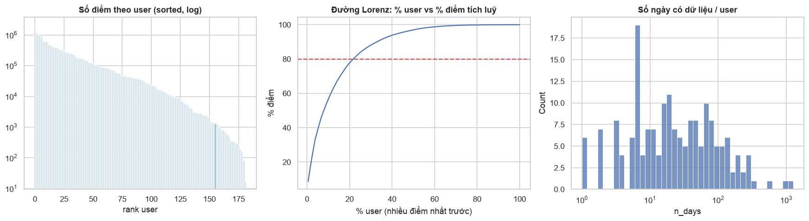

| Chỉ số | Giá trị |
| --- | --- |
| Số user chiếm 50% / 80% số điểm | 15 user (8,2%) / 40 user |
| User nhiều điểm nhất | user 153: 2,16 triệu điểm (8,7%), 1.273 ngày có dữ liệu |
| Median theo user | 35.182 điểm · 27,5 trajectory · 19,5 ngày có dữ liệu |

**Insight:**
- Phân bố số điểm theo user có đuôi rất dài. User 153 có số điểm gấp khoảng 60 lần user ở vị trí trung vị.
- Mọi thống kê gộp theo điểm đều bị khoảng chục power user chi phối.
- Một nửa số user có dưới 20 ngày dữ liệu.

## 2. Cấu trúc file đồng nhất, các file của cùng một user ghép nối được

| Kiểm tra | Kết quả (18.670 file) |
| --- | --- |
| Header 6 dòng | Giống nhau ở 100% file |
| Cột thứ 3 | Luôn bằng `0` |
| Cột `days` so với `date + time` | Khớp tuyệt đối, lệch 0 giây |
| Tên file so với timestamp của điểm đầu | Khớp 100% |
| Timestamp đi lùi trong một file | 0 lần |
| Điểm trùng giữa các file khác nhau | 0 |
| Hai trajectory của cùng user chồng lấn thời gian | 0 cặp |

**Insight:**
- Toàn bộ file của một user có thể ghép thành **một chuỗi thời gian liên tục** mà không xảy ra xung đột.
- Cột `zero` và cột `days` không chứa thông tin mới.

## 3. Lỗi giá trị: phổ biến nhất là trùng timestamp, còn altitude không đáng tin

| Vấn đề | Số lượng | Tỉ lệ |
| --- | --- | --- |
| Trùng timestamp trong cùng file (dt = 0) | 698.900 điểm | **2,81%** |
| … trong đó trùng cả toạ độ | 146.914 | 0,59% |
| `lat` ngoài khoảng [−90, 90] | 1 | ~0 |
| Điểm năm 2000 (user 163, lỗi đồng hồ thiết bị) | 3 | ~0 |
| Altitude = `−777` (không hợp lệ) | 55.484 | 0,22% |
| Altitude < −1000 ft hoặc > 30.000 ft | 71.065 | 0,29% |
| Altitude median / p99 / max | 45 ft / 3.446 ft / 32.767 ft | — |

**Insight:**
- Lỗi về toạ độ gần như không có.
- Khoảng 2,8% điểm trùng giây với điểm khác, nên tốc độ tính tại các điểm này bị chia cho 0.
- Altitude không đáng tin:
  - Bắc Kinh cao khoảng 40–60 m, nhưng p99 của altitude lên tới khoảng 1 km.
  - Giá trị max 32.767 là dấu hiệu tràn kiểu `int16`.

## 4. Ghi dày nhưng mật độ không đồng đều giữa các user

| Chỉ số | Giá trị |
| --- | --- |
| Sampling interval | median 2 s · p95 5 s · p99 19 s |
| Tỉ lệ khoảng ≤ 5 s | 93,7% |
| Số user có median dt > 5 s | 39/182 |
| Tỉ lệ dt ≤ 5 s theo năm | 2007: 73% · 2008–2010: 90–97% · 2011–2012: > 99% |
| Gap > 1 giờ ngay trong một file | 7.342 lần, ở 4.274 file (23% số file) |

**Insight:**
- Cùng một khoảng thời gian dừng, số điểm GPS ghi được có thể chênh nhau vài lần, tuỳ thiết bị và năm.
- Gap dài vẫn xuất hiện ngay trong một file: thiết bị vẫn bật nhưng không ghi được.

## 5. Khoảng trống giữa hai trajectory thường là một lần dừng dài

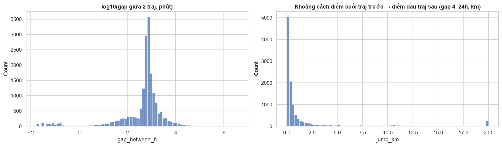

| Chỉ số | Giá trị |
| --- | --- |
| Gap giữa hai file liên tiếp của cùng user | median **11,2 h** · p25 6,5 h · p75 16,5 h |
| Với gap 4–24 h: điểm cuối file trước cách điểm đầu file sau < 0,5 km | **60%** |

**Insight:** gap giữa hai file tập trung quanh khoảng 12 giờ, tương ứng một đêm hoặc một ngày làm việc. Trong 60% trường hợp, người dùng "xuất hiện lại" ngay tại nơi đã dừng ghi. Đây là dấu vết rõ nhất của thời gian ở nhà và ở nơi làm việc, dù trong khoảng đó không có điểm GPS nào.

## 6. Timestamp là UTC; 97% dữ liệu ở UTC+8 nhưng không phải toàn bộ

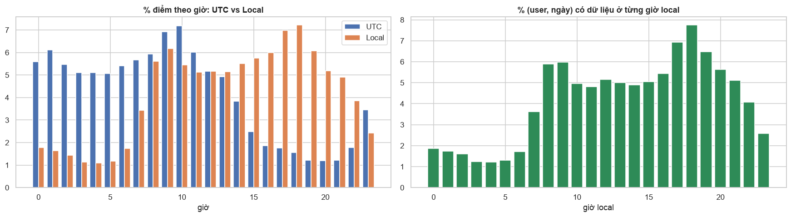

| Chỉ số | Giá trị |
| --- | --- |
| % điểm thuộc `Asia/Shanghai` | 96,86% (181 user) |
| % điểm có offset +8 | 97,44% |
| Số timezone xuất hiện | khoảng 40, offset từ −12 đến +13 |
| Timezone ngoài Trung Quốc lớn nhất | `America/Los_Angeles`: 0,90%, 7 user, có DST (−7/−8) |
| DST ở `Asia/Shanghai` | Không có (chỉ một offset +8) |

**Insight:**
- Theo giờ UTC, dữ liệu trông như hoạt động mạnh lúc 0–2h. Đổi sang giờ local thì pattern trở về đúng nhịp sinh hoạt: thấp nhất lúc 3–5h, đỉnh lúc 8–9h và 17–19h.
- Khung "đêm" theo UTC (22–06h) thực chất là **06–14h ở Bắc Kinh**.
- Khoảng 2,6% số điểm nằm ở timezone khác +8, có nơi dùng DST.

## 7. Dữ liệu tập trung ở Bắc Kinh, với một hotspot chung ở Haidian

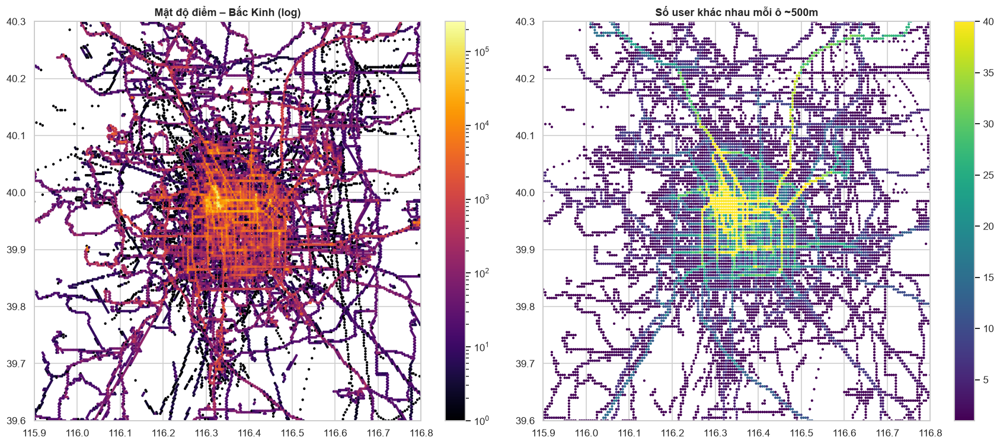

| Chỉ số | Giá trị |
| --- | --- |
| % điểm trong bbox Bắc Kinh (39,6–40,3N; 115,9–116,8E) | 78,06% |
| Số user có ≥ 90% / < 50% số điểm ở Bắc Kinh | 98 / 31 |
| Ô ~500 m có nhiều user nhất (39,975N; 116,33E) | **165/182 user** đã từng đi qua |
| Radius of gyration trong Bắc Kinh | median 6,7 km · p90 13,8 km |

**Insight:**
- Gần như mọi user đều từng đi qua cùng một khu ở Haidian (Zhongguancun, Tsinghua, PKU, MSRA). Điều này khớp với việc người tham gia chủ yếu là nhân viên và sinh viên liên quan tới MSRA.
- Trong thành phố, user di chuyển trong bán kính khoảng 5–10 km.
- Header file ghi hệ toạ độ WGS 84, khớp trực tiếp với OpenStreetMap. Bản đồ AMap/Baidu thì lệch khoảng 300–700 m.

## 8. Dữ liệu được ghi theo chuyến đi, không ghi liên tục

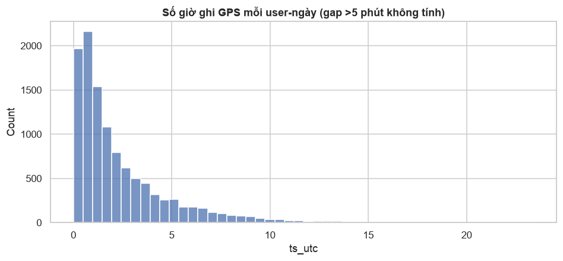

| Chỉ số | Giá trị |
| --- | --- |
| Số giờ có ghi GPS mỗi (user, ngày) | median **1,43 h** · mean 2,31 h · p90 5,6 h |
| Tỉ lệ ngày có dữ liệu trên span (theo user) | median 0,52 |
| % trajectory kéo qua nửa đêm | 5,5% |

**Insight:**
- Mỗi ngày người dùng chỉ bật ghi khoảng 1–2 giờ, khi đang di chuyển.
- Phần lớn thời gian trong ngày (ngủ, làm việc, học) **không có điểm GPS nào**.

## 9. Nhịp sinh hoạt rõ: hai đỉnh đi làm / về ngày thường, thứ Bảy đi chơi

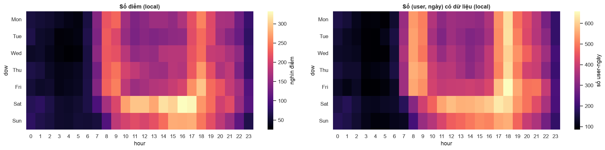

| Ngày | T2 | T3 | T4 | T5 | T6 | T7 | CN |
| --- | --- | --- | --- | --- | --- | --- | --- |
| % điểm | 13,1 | 12,3 | 13,2 | 13,9 | 14,8 | **18,0** | 14,6 |

**Insight:**
- Ngày thường có hai đỉnh rõ lúc 8–9h và 17–19h, ứng với đi làm và về nhà.
- Thứ Bảy có hoạt động dàn trải 10–18h, và mật độ điểm cao nhất tuần.
- Từ 0h đến 6h gần như không có dữ liệu.

## 10. Kỳ nghỉ lớn làm thay đổi vị trí của user

| Giai đoạn | % điểm ở Bắc Kinh |
| --- | --- |
| Ngày thường | 80,0% |
| Tết, Quốc khánh, Olympics 2008 | **43,6%** |

**Insight:** trong các kỳ nghỉ lớn, hơn một nửa số điểm nằm ngoài Bắc Kinh. Người dùng về quê hoặc đi du lịch, nên nơi ngủ trong các ngày này không phải nơi ở thường ngày.

## 11. Chỉ khoảng 1/3 user có đủ dữ liệu cả ban đêm lẫn giờ hành chính

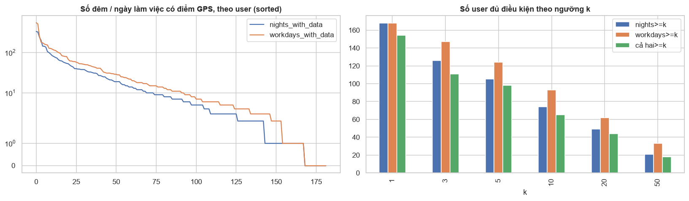

| Ngưỡng k | Số user có ≥ k đêm có dữ liệu | Số user có ≥ k ngày làm việc có dữ liệu | Có cả hai |
| --- | --- | --- | --- |
| 3 | 126 | 147 | 111 |
| 5 | 105 | 124 | 98 |
| 10 | 74 | 93 | **65** |
| 20 | 49 | 62 | 44 |

**Insight:**
- 14,55% số điểm nằm trong khung đêm và 32,37% nằm trong khung hành chính.
- Số user có dữ liệu ở cả hai khung giảm rất nhanh khi tăng ngưỡng k.

## 12. Tốc độ theo phương tiện tách biệt rõ, nhưng tốc độ giữa hai điểm liên tiếp rất nhiễu

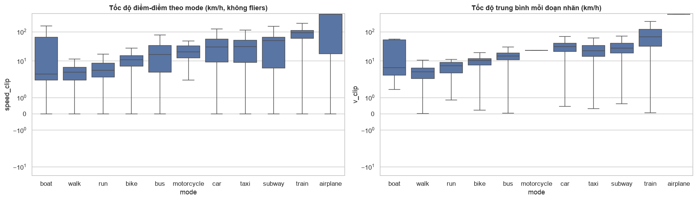

| Mode | Median (km/h) | p95 | p99 | % điểm < 1 km/h |
| --- | --- | --- | --- | --- |
| walk | 4,1 | 14,8 | 42 | 14,7% |
| bike | 11,2 | 23,5 | 41,7 | 6,0% |
| bus | 16,9 | 58 | 90,5 | 10,9% |
| car / taxi | 30–32 | 73–94 | 105–120 | 5,7–9,3% |
| subway | 50,3 | 74,6 | 94,4 | 3,7% |
| train | 92,9 | 165 | **210** | 0,8% |
| airplane | 624 | 881 | 939 | 7,4% |

**Insight:**
- Có thứ tự tốc độ rõ ràng: walk < bike < bus < car ≈ taxi < subway < train ≪ airplane.
- Tàu cao tốc có p99 khoảng 210 km/h.
- Ngay khi đang dùng phương tiện vẫn có 9–11% điểm gần như đứng yên (bus, taxi), do đèn đỏ, kẹt xe hoặc chờ xe.
- 4,9% điểm có nhãn `walk` có tốc độ trên 15 km/h.

## 13. Nhãn phương tiện ít và không khớp chặt với log GPS

| Chỉ số | Giá trị |
| --- | --- |
| Số user có nhãn | 69/182 (38%) |
| % điểm có nhãn | 21,8% toàn bộ · 43,4% trong nhóm user có nhãn |
| % đoạn nhãn không có điểm GPS nào | 34,7% (riêng taxi: 56%) |
| Đoạn nhãn chồng lấn nhau / dài hơn 12 h | 149 / 230 |
| Lớp hiếm | airplane 17 đoạn, boat 7, run 6, motorcycle 2 |
| Nhãn nơi ở / nơi làm việc | **Không có** |

**Insight:**
- Nhãn phương tiện được ghi độc lập với GPS: hơn 1/3 số đoạn nhãn không có điểm nào.
- Dataset không có ground truth cho nơi ở và nơi làm việc.

## 14. Outlier lớn tập trung trong vài file

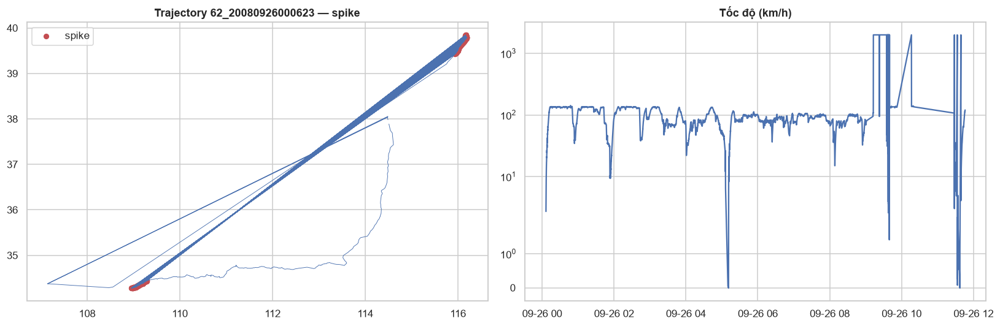

| Chỉ số | Giá trị |
| --- | --- |
| Điểm có tốc độ > 300 km/h | 53.453 (0,22%) |
| File chuyến bay không có nhãn: user 144 · `20090324004422` | 22.192 điểm > 300 km/h, tốc độ median 677 km/h, vĩ độ 1N → 40N |
| File chuyến bay không có nhãn: user 10 · `20070923144426` | 3.002 điểm > 300 km/h, tốc độ median 838 km/h |
| Spike A → B → A (tốc độ vào và ra > 150 km/h, điểm trước và sau gần nhau) | 710 điểm · 109 file · 48 user, biên độ median 857 km |
| Tỉ lệ spike nằm trong một file (user 62 · `20080926000623`) | **81%** |
| Trajectory dài nhất "đo được" (do outlier) | 551.558 km |

**Insight:**
- Outlier chiếm tỉ lệ nhỏ nhưng có biên độ cực lớn và gom vào vài file.
- Phần lớn điểm > 300 km/h nằm trong các chuyến bay không có nhãn.
- File của user 62 có toạ độ nhảy qua lại giữa Bắc Kinh và Tây An cứ vài giây một lần. Hiện tượng này giống hai luồng vị trí bị trộn lẫn hơn là nhiễu ngẫu nhiên.

## 15. Khi đứng yên, GPS dao động vài chục mét, đuôi phân bố tới hàng trăm mét

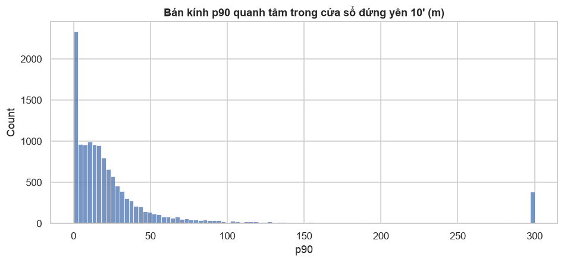

Mẫu đo gồm 13.236 cửa sổ 10 phút đứng yên. Với mỗi cửa sổ, đo bán kính chứa 90% số điểm quanh tâm (gọi là bán kính p90). Bảng dưới cho phân vị của bán kính p90 trên tất cả các cửa sổ:

| Phân vị | p50 | p75 | p90 | p95 | p99 |
| --- | --- | --- | --- | --- | --- |
| Bán kính p90 (m) | 16 | 32 | 71 | **149** | 746 |

**Insight:**
- Với 95% cửa sổ đứng yên, 90% số điểm nằm trong khoảng 150 m quanh tâm.
- Phần đuôi dài có thể do ở trong nhà hoặc do multipath giữa các nhà cao tầng.

## 16. Phần lớn thời gian dừng nằm vắt qua khoảng không ghi giữa hai file

Stay-point được tính bằng thuật toán Li et al. (2008) với D = 200 m và T = 20 phút. Thuật toán chạy trên chuỗi điểm của cả user (ghép mọi file theo thời gian), sau khi đã bỏ điểm trùng timestamp.

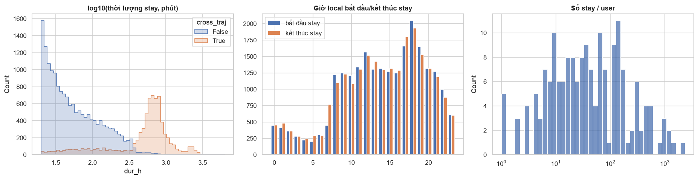

| Chỉ số | Giá trị |
| --- | --- |
| Số stay / số user có stay | 23.944 / 177 |
| Thời lượng stay | median 1,23 h · p75 5,6 h · p90 12,5 h |
| Stay kéo qua ≥ 2 file ("gap stay") | 30% số stay |
| Phần thời gian stay thuộc gap stay | **77,9%** |

**Insight:**
- Stay nằm trong một file phần lớn chỉ dài 20–60 phút.
- Gap stay có đỉnh quanh khoảng 10 giờ, ứng với thời gian ở nhà qua đêm hoặc ở nơi làm việc.
- Nếu chỉ tìm stay bên trong từng file, khoảng 4/5 thời gian dừng sẽ không được tính.

## 17. Số stay nhạy với T hơn nhiều so với D

| D \ T | 5' | 10' | 20' | 30' | 60' |
| --- | --- | --- | --- | --- | --- |
| 50 m | 41.724 | 23.590 | 13.634 | 10.032 | 6.229 |
| 100 m | 48.442 | 29.474 | 18.814 | 14.667 | 9.853 |
| 200 m | 55.981 | 34.924 | 23.944 | 19.587 | 13.974 |
| 500 m | 57.644 | 38.036 | 27.803 | 23.789 | 18.249 |

**Insight:**
- Ở D = 200 m, số stay giảm khoảng 4 lần khi T tăng từ 5 lên 60 phút.
- Ở T = 20 phút, số stay chỉ tăng khoảng 2 lần khi D tăng từ 50 lên 500 m.
- Tỉ lệ gap stay tăng theo cả D lẫn T: từ 6,6% (50 m, 5 phút) lên 52% (500 m, 60 phút).

## 18. Nơi ở và nơi làm việc nhìn thấy được, nhưng có nhiều trường hợp đặc biệt

Phép thử đơn giản gồm 3 bước:
1. Gom stay thành "place" bằng DBSCAN với bán kính 200 m.
2. Nơi ở là place có nhiều giờ stay nhất trong khung đêm.
3. Nơi làm việc là place khác nơi ở, có nhiều giờ stay nhất trong khung hành chính.

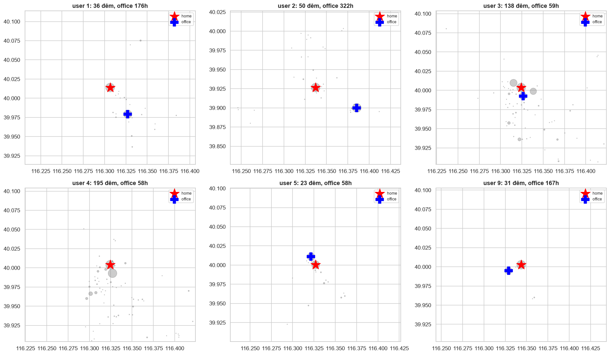

| Chỉ số | Giá trị |
| --- | --- |
| Số place | 6.209 (median 13 place/user · max 571) |
| Place có ≥ 2 lượt đến / có ≥ 1 giờ dừng | 2.145 / 3.284 |
| User có nơi ở ≥ 3 đêm / có nơi làm việc ≥ 10 giờ hành chính / có cả hai | 111 / 91 / **84** |
| Tỉ lệ giờ đêm tại nơi ở | median 0,68 |
| Khoảng cách nơi ở – nơi làm việc | median 6,8 km · p25 2,4 km · max 7.515 km |
| Ô (39,975N; 116,33E) | là nơi làm việc của 26 user và nơi ở của 15 user |
| Số nơi ở khác nhau theo quý | user 153: 3 nơi / 18 quý · user 163: 7 / 18 · user 142: 4 / 8 |

**Insight:**
- Với user đủ dữ liệu, nơi ở thường rất rõ: một place chiếm khoảng 2/3 số giờ đêm. Nơi ở và nơi làm việc thường cách nhau vài km.
- Có "nơi làm việc" cách nơi ở hàng trăm đến hàng nghìn km. Đó là các chuyến công tác hoặc du lịch.
- Nơi ở trùng nơi làm việc là trường hợp có thật: nhiều user vừa sống vừa làm việc trong cùng khu campus ở Haidian.
- User có dữ liệu nhiều năm có nơi ở thay đổi theo quý, tức đã chuyển nhà.
