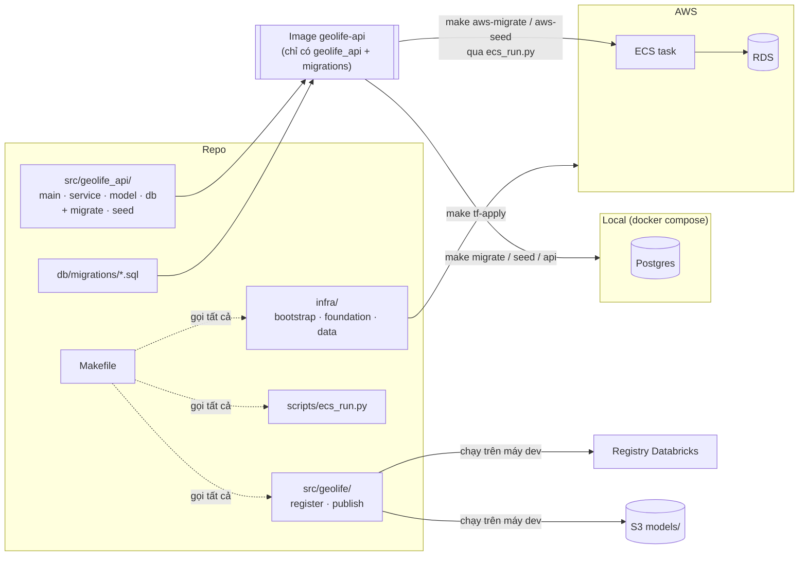
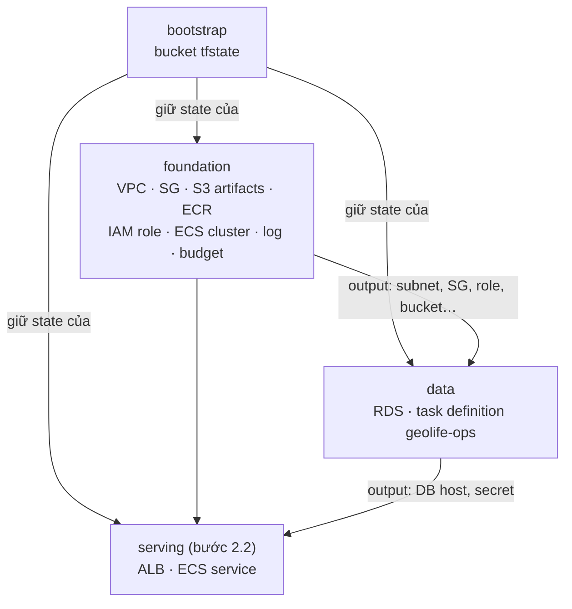
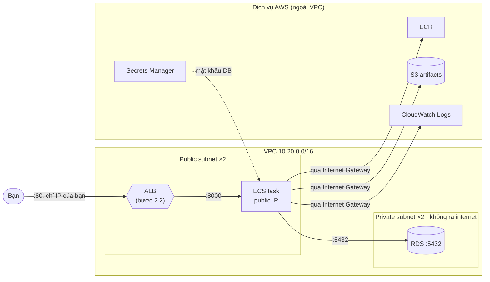
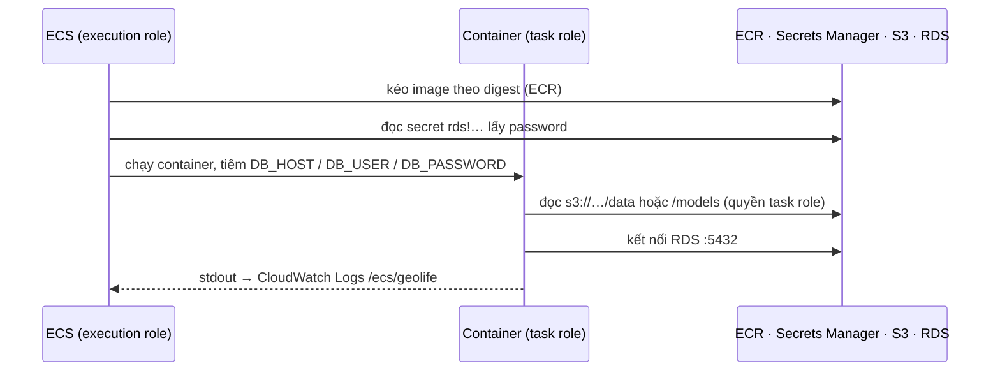
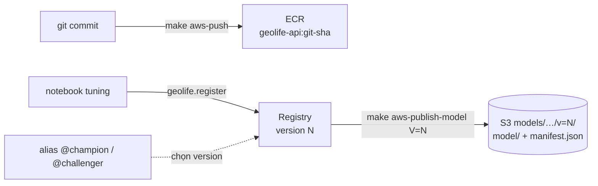
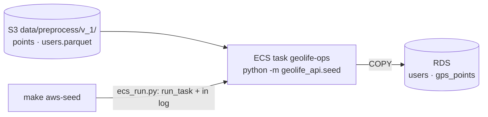

# Hạ tầng AWS: tổng quan

Trang này chỉ vẽ các khái niệm và quan hệ. Giá trị cấu hình chi tiết (CIDR, quyền IAM, lifecycle…) ở [`config_relation.md`](config_relation.md); số đo RAM / thời gian ở [`../task_sizing.md`](../task_sizing.md).

## 1. Code nằm đâu, chạy ở đâu

Cùng một code Python chạy ở hai nơi; chỉ khác **cái khởi chạy nó**.

| Thư mục / file | Vai trò | Chạy ở đâu |
| --- | --- | --- |
| `src/geolife_api/` | API (`main`, `service`, `model`, `db`) và hai lệnh DB (`migrate`, `seed`) | Trong image: compose ở local, ECS trên AWS |
| `db/migrations/` | Schema Postgres | Được `migrate` đọc, có trong image |
| `src/geolife/register.py`, `publish.py` | Đăng ký model vào registry; sao version sang S3 | Máy dev (cần code thuật toán + token Databricks) |
| `scripts/ecs_run.py` | Chạy một lệnh bất kỳ của image thành ECS task một lần, in log | Máy dev, điều khiển AWS |
| `infra/<stack>/` | Terraform, mỗi thư mục một stack | Máy dev |
| `Makefile` | Lối vào duy nhất: `make <lệnh>` cho local, `make aws-*` / `make tf-*` cho AWS | Máy dev |

`migrate` và `seed` nằm trong package API vì chúng phải có trong image để chạy được bên trong VPC (RDS không mở ra internet).

## 2. Các stack Terraform

Chia theo **vòng đời và chi phí**. Stack sau đọc output của stack trước qua `terraform_remote_state`.

| Stack | Tính phí | Vòng đời |
| --- | --- | --- |
| `bootstrap` | ~0 | Tạo một lần; state ở local |
| `foundation` | ~0 | Luôn bật |
| `data` | RDS theo giờ khi chạy | `make aws-db-stop` sau mỗi phiên |
| `serving` | ALB + task theo giờ | Destroy sau mỗi phiên |

## 3. Mạng và ai nói chuyện với ai

Chuỗi security group: `alb` → `task` → `rds`; mỗi nhóm chỉ nhận từ nhóm đứng trước. Không có NAT: task ra internet bằng public IP của chính nó.

## 4. Một task khởi động như thế nào

Hai role, hai việc khác nhau:

- **Execution role:** quyền của ECS *trước khi* code chạy (image, secret, log).
- **Task role:** quyền của code *trong* container (S3). Không ghi được `models/`.
- Không có access key nào nằm trong image hay biến môi trường.

## 5. Ba luồng chính

**Phát hành** — chạy trên máy dev, tạo ra thứ bất biến có số version:

**Nạp dữ liệu** — `make aws-seed`:

**Phục vụ** (bước 2.2) — API nạp model từ S3 lúc khởi động, đọc điểm GPS từ RDS mỗi request.

## 6. Lệnh theo vòng đời

| Khi nào | Lệnh |
| --- | --- |
| Một lần | `make tf-init S=<stack>` → `make tf-apply S=<stack>` (bootstrap → foundation → data) |
| Có code / model mới | `make aws-push`, `make aws-publish-model V=<n>` |
| Lần đầu có RDS | `make aws-migrate`, `make aws-seed` |
| Đầu phiên | `aws login --profile geolife-dev`, `make aws-db-start` |
| Cuối phiên | `make aws-db-stop` |
| Kiểm nhanh | `make aws-whoami`, `make aws-db-count` |
