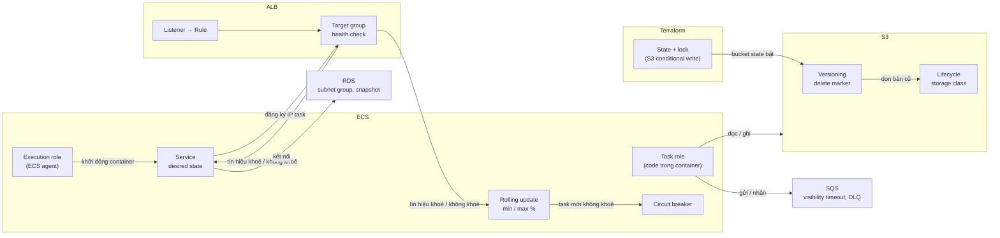
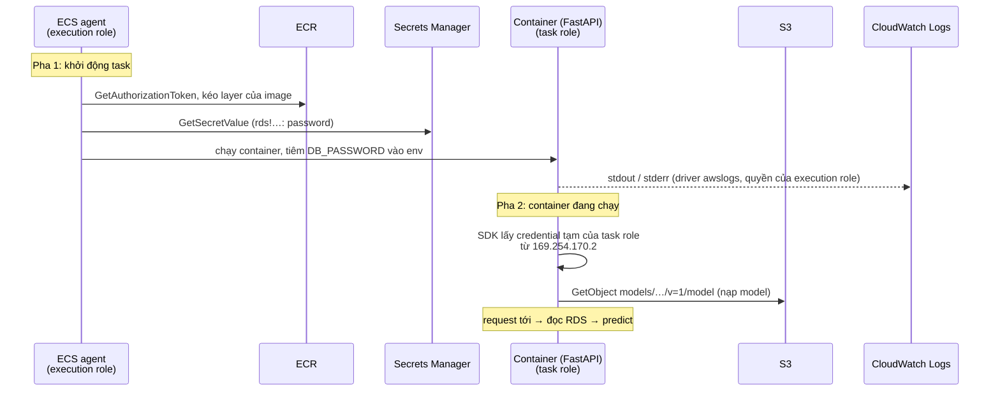
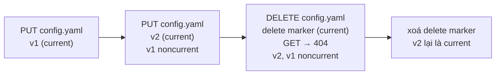
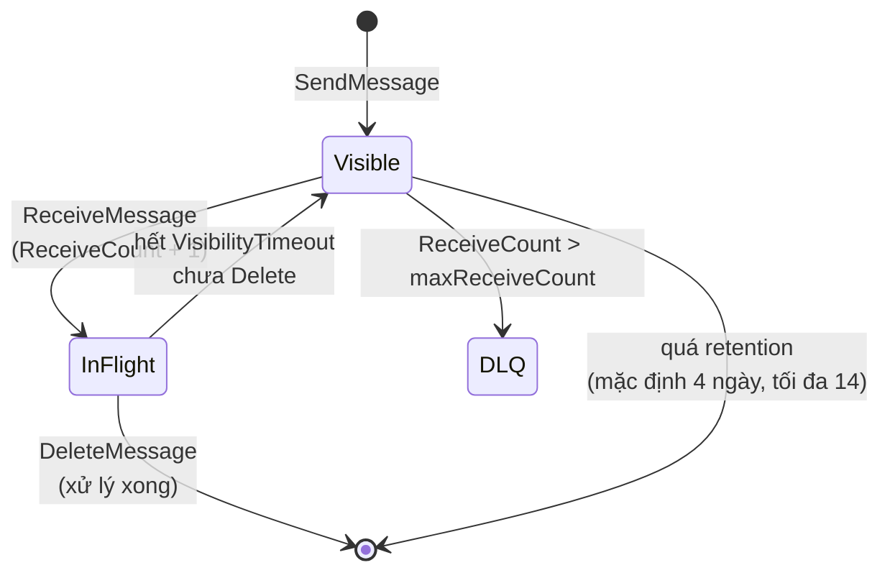
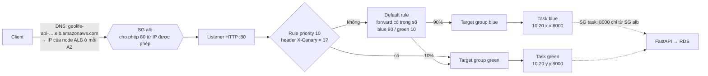
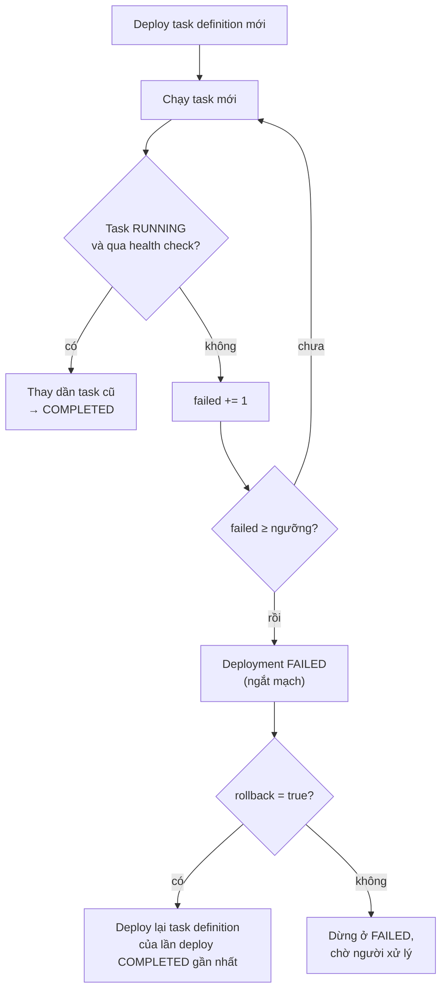

# Kiến thức nền: Terraform, IAM, S3, SQS, RDS, ALB, ECS

Tài liệu ghi lại các concept đứng sau hạ tầng của dự án. Mỗi mục theo thứ tự: **là gì → vì sao cần → ví dụ → dự án dùng thế nào**. Giá trị cấu hình cụ thể của từng resource nằm ở [config_relation.md](config_relation.md); kiến trúc tổng thể ở [overview.md](overview.md).

## Bản đồ liên hệ



Ba sợi dây xuyên suốt:

- **Conditional write của S3** (`If-None-Match: *`) vừa là cơ chế lock của Terraform state, vừa là cách ghi `manifest.json` của model một lần duy nhất.
- **Health check của target group** là tín hiệu chung cho ba thứ: ALB chọn target, ECS service thay task hỏng, và circuit breaker quyết định rollback.
- **Hai IAM role** tách quyền theo thời điểm: trước khi container chạy (execution role) và trong lúc code chạy (task role).

---

## 1. Terraform state: local hay remote

**Là gì.** State là file JSON ánh xạ địa chỉ resource trong code (`aws_lb.api`) sang ID thật trên AWS (`arn:aws:elasticloadbalancing:…`) cùng các thuộc tính đã biết. `terraform plan` so ba thứ: code, state, và trạng thái thật (refresh) để tính ra diff.

**Vì sao không để ở local:**

| | State ở local (`terraform.tfstate` trên máy) | State ở remote (S3 backend) |
| --- | --- | --- |
| Mất máy / xoá nhầm file | Terraform "quên" mọi resource: lần `apply` sau tạo bản trùng hoặc lỗi trùng tên; resource cũ thành mồ côi, vẫn tính tiền | File nằm trong bucket có versioning, khôi phục được bản trước |
| Hai lệnh `apply` cùng lúc | Không có lock: hai tiến trình cùng ghi, state hỏng | Lock: lệnh thứ hai bị từ chối tới khi lệnh đầu xong |
| Stack khác cần đọc output | Phải chép tay ID | `terraform_remote_state` đọc trực tiếp output của stack khác |
| Dữ liệu nhạy cảm | State chứa thuộc tính dạng plaintext, nằm trên laptop | Bucket mã hoá phía server, chặn truy cập công khai, quyền theo IAM |
| Lịch sử | Không có | Mỗi lần ghi là một version của object |

**Lock bằng S3 (`use_lockfile = true`, Terraform ≥ 1.10).** Trước khi ghi, Terraform tạo object `<key>.tflock` bằng `PutObject` kèm `If-None-Match: *`. S3 chỉ chấp nhận nếu object chưa tồn tại; nếu đã có, trả `412 PreconditionFailed`. Xong lệnh, Terraform xoá file lock. Trước đây cần thêm một bảng DynamoDB để lock; nay không cần.

**Ví dụ.** Chạy `terraform apply` ở terminal thứ hai khi terminal thứ nhất vẫn đang apply:

```
Error: Error acquiring the state lock
api error PreconditionFailed: At least one of the pre-conditions you specified did not hold
Lock Info:
  Path:      geolife-<account>-tfstate/serving/terraform.tfstate
  Operation: OperationTypeApply
```

Đây là lock đang làm đúng việc. Không dùng `force-unlock` khi lệnh kia còn chạy; chỉ dùng khi tiến trình giữ lock đã chết (mất mạng, Ctrl+C giữa chừng).

**Bài toán con gà – quả trứng.** Bucket chứa state cũng là một resource. Stack `bootstrap` tạo bucket này và giữ state của chính nó ở local; mọi stack khác dùng bucket đó làm backend.

**Dự án:** bucket `geolife-<account>-tfstate` (versioning, mã hoá, chặn public), mỗi stack một key (`foundation/`, `data/`, `serving/`), stack sau đọc output stack trước qua `terraform_remote_state`.

---

## 2. ECS: Task execution role và Task role

**Là gì.** Một ECS task có hai IAM role, dùng ở hai thời điểm khác nhau và bởi hai chủ thể khác nhau.

| | Task execution role | Task role |
| --- | --- | --- |
| Ai dùng | ECS agent (trên Fargate do AWS quản lý) | Code của bạn trong container (qua AWS SDK) |
| Khi nào | Trước khi container chạy và để ghi log | Trong suốt lúc container chạy |
| Quyền điển hình | `ecr:GetAuthorizationToken`, `ecr:BatchGetImage`, `ecr:GetDownloadUrlForLayer`; `logs:CreateLogStream`, `logs:PutLogEvents`; `secretsmanager:GetSecretValue` (và `kms:Decrypt` nếu secret dùng KMS key riêng) | Tuỳ ứng dụng: `s3:GetObject`, `sqs:SendMessage`… |
| Lỗi khi thiếu quyền | Task dừng trước khi chạy: `CannotPullContainerError`, `ResourceInitializationError: unable to pull secrets` | Container chạy được, nhưng log ứng dụng báo `AccessDenied` |

**Vì sao tách.** Least privilege: code ứng dụng không cần (và không nên có) quyền kéo image hay đọc mọi secret; ECS agent không cần quyền đọc dữ liệu ứng dụng. Secret được ECS lấy rồi tiêm vào biến môi trường, nên code không cần quyền Secrets Manager.

**Code lấy credential của task role thế nào.** ECS đặt biến `AWS_CONTAINER_CREDENTIALS_RELATIVE_URI` trong container. Credential provider chain của SDK (boto3, AWS SDK C++ trong pyarrow) gọi endpoint `169.254.170.2$AWS_CONTAINER_CREDENTIALS_RELATIVE_URI` để lấy credential tạm thời; SDK tự làm mới trước khi hết hạn. Không có access key dài hạn nào nằm trong image hay biến môi trường.



**Trust policy.** Cả hai role tin `ecs-tasks.amazonaws.com` (`sts:AssumeRole`). Điều kiện `aws:SourceAccount = <account>` chặn kiểu tấn công confused deputy: một tài khoản khác không thể khiến ECS assume role của mình.

**Dự án:**

- Execution role: managed policy `AmazonECSTaskExecutionRolePolicy` (ECR + Logs) và `GetSecretValue` trên `secret:rds!*` (secret do RDS sinh).
- Task role: đọc `data/`, `models/`, `monitoring/`; ghi `monitoring/`, `exports/`. Không ghi được `models/`: bản phát hành model chỉ do người phát hành ghi.

---

## 3. S3: versioning, lifecycle, storage class

### 3.1 Versioning

**Là gì.** Khi bucket bật versioning, mỗi lần `PUT` vào cùng một key tạo một **version** mới có `VersionId` riêng; bản trước trở thành *noncurrent* chứ không bị ghi đè.

| Thao tác | Bucket không versioning | Bucket có versioning |
| --- | --- | --- |
| `PUT` key đã có | Ghi đè, bản cũ mất | Thêm version mới; bản cũ thành noncurrent |
| `DELETE key` (không chỉ định version) | Xoá vĩnh viễn | Thêm một **delete marker** làm version hiện tại: `GET key` trả 404, nhưng mọi version cũ còn nguyên |
| `DELETE key?versionId=…` | — | Xoá vĩnh viễn đúng version đó |
| Khôi phục | Không được | Xoá delete marker (hoặc copy version cũ lên làm version hiện tại) |



**Vì sao cần.** Chống ghi đè và xoá nhầm (do người hoặc do bug), có lịch sử để rollback. Với state Terraform, đây là cách cứu một state bị ghi hỏng.

**Lưu ý kỹ thuật:**

- Ba trạng thái: chưa bật, `Enabled`, `Suspended`. Đã bật thì không quay về "chưa bật" được, chỉ tạm dừng.
- Mọi version đều tính tiền lưu trữ, kể cả version nằm sau delete marker. Cần lifecycle để dọn bản cũ.
- Versioning chống *mất* dữ liệu chứ không chống *thay đổi*: ai có quyền `PutObject` vẫn tạo được version mới. Muốn "ghi một lần" thì dùng conditional write (`If-None-Match: *`) hoặc Object Lock (WORM, có chế độ governance / compliance).

**Dự án:** bucket state và bucket artifacts đều bật versioning. `manifest.json` của mỗi model version ghi bằng `If-None-Match: *`, nên một version đã phát hành không bị ghi đè; versioning là lớp bảo vệ thứ hai.

### 3.2 Lifecycle

**Là gì.** Quy tắc S3 tự áp lên object theo tuổi, lọc theo prefix / tag:

- **Transition:** chuyển object sang storage class rẻ hơn sau N ngày.
- **Expiration:** xoá object hiện tại sau N ngày (trên bucket versioning: thêm delete marker).
- **NoncurrentVersionExpiration:** xoá vĩnh viễn version noncurrent sau N ngày kể từ khi nó thành noncurrent.
- **AbortIncompleteMultipartUpload:** dọn các phần upload dang dở (vẫn tính tiền dù không thấy trong listing).

**Ví dụ:** `log/` chuyển sang Standard-IA sau 30 ngày, sang Glacier Instant Retrieval sau 90 ngày, xoá sau 365 ngày; mọi prefix xoá bản noncurrent sau 30 ngày.

**Dự án:** bản noncurrent xoá sau 30 ngày, multipart dang dở dọn sau 7 ngày, `exports/` xoá sau 90 ngày, không có rule nào xoá `models/` (version đã phát hành luôn còn để rollback). Chưa dùng transition vì dữ liệu nhỏ (dưới 1 GB).

### 3.3 Storage class và Glacier Instant Retrieval

**Là gì.** Cùng độ bền 11 số 9, khác nhau ở giá lưu trữ, giá đọc, độ trễ và thời gian lưu tối thiểu. Giá ở Singapore (`ap-southeast-1`, AWS Price List ngày 2026-11-21):

| Storage class | Lưu trữ (USD/GB-tháng) | Đọc (USD/GB) | Độ trễ đọc | Lưu tối thiểu | Dùng cho |
| --- | --- | --- | --- | --- | --- |
| Standard | 0,025 | 0 | ms | — | Dữ liệu đọc thường xuyên |
| Standard-IA | 0,0138 | 0,01 | ms | 30 ngày | Đọc vài lần mỗi tháng |
| One Zone-IA | 0,011 | 0,01 | ms | 30 ngày | Như IA nhưng chỉ 1 AZ, tạo lại được |
| **Glacier Instant Retrieval** | **0,005** | **0,03** | **ms** | **90 ngày** | Lưu trữ lâu, đọc khoảng một lần mỗi quý, nhưng khi cần là cần ngay |
| Glacier Flexible Retrieval | 0,0045 | tuỳ tốc độ | phút – giờ | 90 ngày | Archive, chờ được |
| Glacier Deep Archive | thấp nhất | tuỳ tốc độ | 12 – 48 giờ | 180 ngày | Lưu theo quy định, gần như không đọc |

IA và Glacier IR còn tính tối thiểu 128 KB mỗi object, và xoá trước hạn lưu tối thiểu vẫn bị tính đủ hạn.

**Glacier Instant Retrieval làm gì.** Giá lưu trữ **rẻ hơn Standard 80%** (0,005 so với 0,025), vẫn đọc được tức thì như Standard; đổi lại mỗi GB đọc ra tốn 0,03 USD.

**Ví dụ tính điểm hoà vốn.** 100 GB snapshot cũ:

- Standard: 100 × 0,025 = 2,50 USD/tháng.
- Glacier IR: 100 × 0,005 = 0,50 USD/tháng, tiết kiệm 2,00 USD/tháng.
- Đọc toàn bộ 100 GB một lần tốn 100 × 0,03 = 3,00 USD.

Glacier IR có lợi khi trung bình mỗi tháng đọc ít hơn 2,00 / 3,00 ≈ 0,67 lần toàn bộ dữ liệu, tức đọc thưa hơn khoảng 6 tuần một lần.

**Dự án:** chưa dùng. Ứng viên nếu dữ liệu lớn lên: các version model cũ (chỉ đọc khi rollback) và `exports/`.

---

## 4. SQS: queue, visibility timeout, DLQ

**Là gì.** Hàng đợi message được quản lý: producer `SendMessage`, consumer `ReceiveMessage` rồi `DeleteMessage` khi xử lý xong. Producer và consumer không cần biết nhau, không cần chạy cùng lúc.

**Vì sao cần.** Tách việc nặng khỏi request đồng bộ: API nhận request, đẩy job vào queue, trả `202` ngay; worker xử lý theo tốc độ của nó. Queue hấp thụ đợt tăng tải, và job không mất khi worker chết giữa chừng.

### 4.1 Standard queue và FIFO queue

| | Standard | FIFO (tên kết thúc bằng `.fifo`) |
| --- | --- | --- |
| Giao message | **At-least-once**: hiếm khi, một message có thể tới hai lần | **Exactly-once processing**: trùng trong cửa sổ 5 phút bị loại theo `MessageDeduplicationId` (hoặc hash nội dung) |
| Thứ tự | Best-effort, có thể đảo | Đúng thứ tự trong cùng một `MessageGroupId`; các group khác nhau xử lý song song |
| Throughput | Gần như không giới hạn | 300 thao tác/giây mỗi API, 3 000 message/giây khi gửi theo batch 10 (high throughput mode cao hơn) |
| Hệ quả cho consumer | Phải **idempotent**: xử lý lại cùng message không sinh kết quả sai | Vẫn nên idempotent (visibility timeout hết vẫn giao lại) |

**Ví dụ:** cập nhật số dư tài khoản theo thứ tự giao dịch: FIFO, `MessageGroupId = account_id`. Tính lại kết quả cho một user (ghi đè cùng một dòng kết quả): Standard là đủ vì xử lý hai lần cho cùng kết quả.

### 4.2 Visibility timeout

**Là gì.** Khi consumer nhận một message, SQS không xoá nó mà **ẩn** nó khỏi các consumer khác trong `VisibilityTimeout` giây (mặc định 30 giây, tối đa 12 giờ). Consumer xoá message khi xong; nếu hết thời gian mà chưa xoá (consumer chết, xử lý quá lâu), message hiện lại và được giao cho consumer khác. Mỗi lần nhận, `ApproximateReceiveCount` tăng 1.



**Chọn giá trị:** lớn hơn thời gian xử lý dài nhất (thường gấp vài lần). Quá ngắn: message hiện lại khi worker đầu vẫn đang xử lý, hai worker làm cùng một job. Quá dài: worker chết thì job phải chờ lâu mới được thử lại. Job dài bất thường thì gọi `ChangeMessageVisibility` để gia hạn trong lúc xử lý.

### 4.3 Dead-letter queue (DLQ)

**Là gì.** Queue thứ hai nhận các message xử lý thất bại quá nhiều lần. Queue nguồn có **redrive policy** `{deadLetterTargetArn, maxReceiveCount}`: khi một message bị nhận quá `maxReceiveCount` lần mà chưa bị xoá, SQS chuyển nó sang DLQ.

**Vì sao cần.** Một "poison message" (dữ liệu hỏng, bug với một input cụ thể) sẽ thất bại mãi; không có DLQ thì nó quay vòng tới hết retention, tốn công worker và chặn các message phía sau (với FIFO, chặn cả group). DLQ cô lập nó để xem lại, sửa bug, rồi redrive về queue nguồn.

**Lưu ý:** DLQ cùng loại với queue nguồn (FIFO đi với FIFO); retention của DLQ nên dài hơn queue nguồn, vì với Standard queue tuổi message tính từ lúc gửi vào queue nguồn. Đặt alarm khi `ApproximateNumberOfMessagesVisible` của DLQ > 0.

**Ví dụ:** `maxReceiveCount = 3`, visibility timeout 5 phút. Một job làm worker crash: lần 1, 2, 3 đều hết timeout mà không xoá; lần nhận thứ 4 bị thay bằng chuyển sang DLQ, khoảng 15 phút sau lần gửi đầu.

**Dự án:** chưa dựng. Dùng ở luồng async: API nhận job, đẩy vào queue Standard kèm DLQ; worker nhận, chạy model, ghi kết quả vào bảng `jobs`. Ghi kết quả theo `job_id` nên xử lý lặp vẫn ra cùng kết quả.

---

## 5. RDS: subnet group, stop, snapshot, restore

### 5.1 DB subnet group

**Là gì.** Tập các subnet (ở ít nhất 2 AZ) mà RDS được phép đặt instance vào. Bắt buộc phải có, kể cả khi chạy Single-AZ, để RDS có chỗ dựng lại instance ở AZ khác (Multi-AZ failover, hoặc khi AZ hiện tại gặp sự cố).

**Vì sao cần.** Quyết định instance nằm ở lớp mạng nào. Đặt vào **private subnet** (route table không có đường tới Internet Gateway) cùng `publicly_accessible = false` thì DB không có địa chỉ công khai; chỉ ai trong VPC và được security group cho phép mới kết nối được.

**Dự án:** subnet group gồm 2 private subnet; security group `rds` chỉ nhận 5432 từ security group của task.

### 5.2 Stop, snapshot, restore

| Thao tác | Điều gì xảy ra | Tính tiền | Lưu ý |
| --- | --- | --- | --- |
| **Stop** | Dừng compute; ổ đĩa, endpoint, cấu hình giữ nguyên | Không tính giờ instance; vẫn tính ổ đĩa và backup | Tự bật lại sau **7 ngày**; start mất vài phút |
| **Automated backup** | Snapshot hằng ngày + transaction log, giữ 0–35 ngày | Miễn phí tới bằng dung lượng DB, vượt thì tính | Cho phép **point-in-time restore** tới một thời điểm bất kỳ trong khoảng giữ (thường trễ tối đa 5 phút so với hiện tại) |
| **Manual snapshot** | Bản chụp do bạn tạo | Tính theo dung lượng | Còn tới khi bạn xoá, kể cả khi xoá instance |
| **Final snapshot** | Snapshot tự tạo lúc xoá instance | Như manual | Bỏ qua bằng `skip_final_snapshot = true` |
| **Restore** | Luôn tạo **instance mới** (endpoint mới) từ snapshot hoặc PITR | Như instance thường | Không ghi đè vào instance cũ; phải trỏ ứng dụng sang endpoint mới |

**Ví dụ:** lỡ `DELETE` nhầm bảng lúc 14:05. PITR về 14:04 tạo instance `db-restored`, lấy lại dữ liệu từ đó rồi copy về instance chính, hoặc chuyển ứng dụng sang instance mới.

**Parameter group.** Cấu hình của Postgres trên RDS nằm trong parameter group chứ không ở `postgresql.conf`. Tham số *dynamic* áp dụng ngay; tham số *static* cần reboot. Gắn một parameter group **mới** vào instance luôn cần reboot (hoặc stop / start) mới có hiệu lực.

**Dự án:** backup giữ 1 ngày, `skip_final_snapshot = true`, stop sau mỗi phiên làm việc. Bảng `gps_points` nạp lại được từ `points.parquet` trên S3 nên không cần snapshot thủ công. Parameter group riêng đặt `random_page_cost = 1.1` (ổ gp3 là SSD; giá trị mặc định 4 dành cho ổ quay).

---

## 6. Đường đi của một request qua ALB



| Thành phần | Chứa gì | Ghi chú kỹ thuật |
| --- | --- | --- |
| **Listener** | Protocol + port (`HTTP:80`, `HTTPS:443` kèm certificate ACM), danh sách rule, default action | Mỗi ALB có thể có nhiều listener |
| **Listener rule** | Priority (số nhỏ xét trước), condition, action | Condition: `host-header`, `path-pattern`, `http-header`, `http-request-method`, `query-string`, `source-ip`. Action: `forward`, `redirect`, `fixed-response`, `authenticate-oidc`. Default rule luôn xét cuối |
| **Forward có trọng số** | Tới 5 target group, mỗi cái một weight | ALB chọn target group **cho từng request** theo trọng số. Muốn một client dính vào một target group thì bật target group stickiness (cookie, có thời hạn) |
| **Target group** | Target type, protocol / port, health check, deregistration delay, thuật toán (`round_robin` hoặc `least_outstanding_requests`) | Fargate dùng network mode `awsvpc`: mỗi task có ENI và IP riêng, nên target type phải là `ip` |
| **Target** | IP:port của task | ECS service tự đăng ký / huỷ đăng ký (mục 7) |

**Ví dụ phân tích tỉ lệ.** Trọng số 90 / 10, 200 request: số request tới green tuân theo phân phối nhị thức (n = 200, p = 0,1), kỳ vọng 20, độ lệch chuẩn √(200 × 0,1 × 0,9) ≈ 4,2. Ra 17 hay 26 đều bình thường; gộp càng nhiều request, tỉ lệ càng sát 10%.

**Dự án:** listener `HTTP:80`, rule priority 10 bắt header `X-Canary: 1` để gọi thử version mới khi trọng số còn bằng 0, default rule chia theo `canary_weight`. Không bật stickiness, nên trong lúc canary cùng một user có thể nhận kết quả của hai model ở hai lần gọi; trường `model` trong response cho biết request đó do model nào trả. Demo 10%: 600 request, 63 tới green (10,5%).

---

## 7. ECS service: giữ trạng thái mong muốn

**Là gì.** Service khai báo *desired state*: "luôn có N task của task definition X, gắn vào target group Y". ECS scheduler chạy vòng lặp đối chiếu (reconciliation): đếm task đang chạy, thiếu thì chạy thêm, thừa thì dừng bớt.

**Vì sao cần.** Chạy tay `run-task` thì task chết là mất; phải tự theo dõi, tự chạy lại, tự đăng ký vào load balancer. Service lo các việc đó:

| Cơ chế | Cách hoạt động |
| --- | --- |
| **Self-healing** | Task dừng (process thoát, bị giết vì hết RAM, essential container dừng) hoặc bị target group báo không khoẻ → ECS dừng task đó và chạy task thay thế để giữ đủ N |
| **Gắn với ALB** | Task chuyển `RUNNING` → ECS đăng ký IP:port vào target group; trước khi dừng task → ECS huỷ đăng ký, ALB ngừng gửi request mới và chờ `deregistration_delay` cho request đang xử lý (*draining*), rồi ECS mới gửi `SIGTERM` cho container |
| **Phân bổ** | Mặc định trải task đều qua các AZ của các subnet được khai báo |
| **Deploy** | Đổi task definition → rolling update (mục 9) |

**Auto scaling.** Service không tự đổi N; việc đó do **Application Auto Scaling** làm, với scalable target `ecs:service:DesiredCount` (min / max):

| Policy | Cơ chế | Ví dụ |
| --- | --- | --- |
| **Target tracking** | Giữ một metric quanh giá trị đích; AWS tự tạo CloudWatch alarm và tính số task cần thêm / bớt | `ECSServiceAverageCPUUtilization = 60%`, hoặc `ALBRequestCountPerTarget = 100` |
| **Step scaling** | Alarm do bạn định nghĩa; mỗi khoảng vượt ngưỡng ứng với một bước thay đổi | CPU 70–85% thêm 1 task, > 85% thêm 3 task |
| **Scheduled** | Đổi min / max theo lịch | 8:00 đặt min = 4, 20:00 đặt min = 1 |

Scale-out nhanh, scale-in thận trọng (cooldown dài hơn) để tránh dao động. Chọn metric đúng với điểm nghẽn: dịch vụ nặng về RAM theo kích thước request thì CPU trung bình không phải tín hiệu tốt.

**Dự án:** mỗi slot (`api-blue`, `api-green`) là một service, `desired_count = 1`, không dùng auto scaling. RAM của task tăng theo tổng số điểm đang xử lý chứ không theo CPU, nên giới hạn tải nằm trong ứng dụng (ngân sách số điểm đang xử lý) thay vì dựa vào scale theo CPU.

---

## 8. Health check: ba lớp

| Lớp | Ai chạy | Kiểm gì | Khi thất bại |
| --- | --- | --- | --- |
| **Target group health check** | ALB, từ mỗi node ALB | HTTP `GET path` mỗi `interval` giây; khoẻ nếu trả mã trong `matcher` trước `timeout` | Target thành `unhealthy` sau `unhealthy_threshold` lần liên tiếp: ALB ngừng gửi request tới nó; ECS service thấy và thay task |
| **Container health check** (`healthCheck` trong task definition) | ECS agent, chạy lệnh **bên trong** container | `CMD-SHELL curl -f localhost:8000/health` mỗi `interval`, `retries` lần, bỏ qua lỗi trong `startPeriod` | Container `UNHEALTHY`; nếu là essential container, task bị dừng và service thay task khác |
| **Health check grace period** (của service) | ECS service | Không kiểm gì: là khoảng thời gian **bỏ qua** kết quả health check của ALB (và container) sau khi task khởi động | Không áp dụng; hết grace period mới tính |

Các con số rút ra từ cấu hình target group:

- Thời gian để một target bị coi là hỏng ≈ `interval × unhealthy_threshold`.
- Thời gian để target mới được nhận traffic ≈ `interval × healthy_threshold`.
- Nếu **mọi** target trong target group đều không khoẻ, ALB *fail open*: vẫn gửi request tới tất cả, vì gửi tới target có thể hỏng còn hơn trả lỗi chắc chắn.

**Vì sao cần grace period.** Task cần thời gian khởi động (tải model, biên dịch JIT, mở connection pool). Không có grace period, ALB báo không khoẻ ngay trong lúc khởi động, ECS giết task, task mới lại khởi động… vòng lặp không bao giờ có task khoẻ.

```mermaid
gantt
  dateFormat  ss
  axisFormat  %S s
  title Một task mới (interval 15 s, healthy_threshold 2, grace 120 s)
  section Task
  Kéo image, start container      :a1, 00, 10s
  Tải model, warm-up JIT           :a2, after a1, 25s
  /v1/health trả 200               :milestone, m1, after a2, 0s
  section ALB
  2 lần check liên tiếp OK → healthy :a3, after a2, 30s
  section ECS
  Grace period: bỏ qua health check :crit, g1, 00, 120s
```

**Liveness và readiness.** Một endpoint chỉ kiểm "process còn sống" (liveness) khác với endpoint kiểm "sẵn sàng phục vụ" (readiness: model đã nạp, DB kết nối được). Dùng readiness làm health check của ALB thì không bao giờ gửi request tới task chưa sẵn sàng, nhưng khi phụ thuộc chung (DB) sập, **mọi** task cùng báo không khoẻ và ECS thay task liên tục mà không giải quyết được gì.

**Dự án:** `/v1/health` là readiness (model + DB), trả 503 khi chưa sẵn sàng. Target group: interval 15 giây, timeout 5, healthy 2, unhealthy 3 → khoảng 30 giây để nhận traffic, 45 giây để bị loại. Grace period 120 giây, khoảng 6 lần thời gian khởi động đo ở local (20–22 giây). Không khai báo container health check: ALB đã kiểm cùng endpoint. Thứ tự tắt: service trước, RDS sau.

---

## 9. Rolling update: desired count, minimum / maximum percent

**Là gì.** Khi service đổi task definition (image mới, biến môi trường mới), ECS thay task cũ bằng task mới từng phần, trong giới hạn:

- `minimumHealthyPercent`: số task **khoẻ** tối thiểu phải giữ trong lúc deploy = ⌈desired × min% / 100⌉.
- `maximumPercent`: tổng số task (cũ + mới, mọi trạng thái) tối đa = ⌊desired × max% / 100⌋.

Hai số này đánh đổi giữa **dung lượng phục vụ trong lúc deploy** và **tài nguyên dư phải có**.

**Ví dụ 1: desired = 4, min = 75%, max = 125%** → giữ tối thiểu 3 task khoẻ, tối đa 5 task.

| Bước | Task cũ | Task mới | Tổng | Ghi chú |
| --- | --- | --- | --- | --- |
| 0 | 4 | 0 | 4 | Bắt đầu |
| 1 | 4 | 1 (đang khởi động) | 5 | Chạm max, không thêm được nữa |
| 2 | 3 | 1 (khoẻ) | 4 | Task mới khoẻ → dừng 1 task cũ |
| 3 | 3 | 2 | 5 | Lặp lại |
| … | … | … | … | |
| 8 | 0 | 4 | 4 | Xong: deployment `COMPLETED` |

**Ví dụ 2: các tổ hợp hay gặp với desired = 4:**

| min / max | Cách ECS làm | Đánh đổi |
| --- | --- | --- |
| 100 / 200 | Chạy 4 task mới cùng lúc (tổng 8), đợi khoẻ, rồi dừng 4 task cũ | Nhanh, không giảm dung lượng; cần gấp đôi tài nguyên trong lúc deploy |
| 50 / 100 | Dừng 2 task cũ trước, chạy 2 task mới, rồi lặp | Không cần tài nguyên dư; dung lượng giảm còn một nửa |
| 0 / 100 | Dừng hết task cũ rồi mới chạy task mới | Có downtime; chỉ dùng khi hai bản không được chạy song song |

**Dự án:** desired = 1, min = 100%, max = 200%. Thứ tự: chạy 1 task mới (tổng 2) → task mới qua health check → ECS huỷ đăng ký task cũ, chờ deregistration delay 30 giây → dừng task cũ. Không có lúc nào service mất task khoẻ. Rolling update dùng khi đổi image (cùng model); đổi model đi qua canary giữa hai slot.

---

## 10. Deployment circuit breaker

**Là gì.** Cơ chế của ECS theo dõi một lần rolling update và tự đánh dấu nó **thất bại** khi task mới liên tục không lên được, thay vì thử lại mãi.

**Vì sao cần.** Không có circuit breaker, một image hỏng khiến ECS chạy task mới → task chết → chạy lại → chết…, vô thời hạn. Với min = 100%, task cũ vẫn phục vụ nên người dùng chưa thấy lỗi, nhưng deploy không bao giờ kết thúc và tốn tiền cho task chết liên tục.

**Failure detection, hai giai đoạn:**

1. Task mới không vào được `RUNNING`: kéo image lỗi, thiếu quyền đọc secret, container thoát ngay khi khởi động.
2. Task đã `RUNNING` nhưng không qua health check (target group, hoặc container health check) và bị thay.

Mỗi task thất bại tăng bộ đếm. Ngưỡng = ⌈0,5 × desired⌉, kẹp trong khoảng **[3, 200]**.

**Ngắt và rollback:**



- **Ngắt (break):** ECS dừng thử task mới và phát sự kiện `SERVICE_DEPLOYMENT_FAILED` (EventBridge).
- **Rollback:** ECS tạo một deployment mới với task definition của lần deploy thành công gần nhất. Khác với rollback của canary: ở đây quay về *bản code cũ*, do ECS tự làm.
- Circuit breaker chỉ thấy lỗi khởi động và health check. Lỗi logic (task khoẻ nhưng trả kết quả sai, latency tăng) cần cơ chế khác: rollback theo CloudWatch alarm (`deployment_alarms`) hoặc canary.

**Ví dụ:** desired = 6 → ngưỡng ⌈3⌉ = 3. Image mới thiếu một thư viện, container thoát ngay: 3 task thất bại liên tiếp → `FAILED` → ECS deploy lại task definition cũ; 6 task cũ vẫn chạy suốt quá trình nhờ min = 100%.

**Dự án:** bật `enable = true, rollback = true` cho cả hai slot. Với desired = 1, ngưỡng là 3 task. Task không khoẻ chỉ bị tính sau grace period 120 giây, nên một bản hỏng kiểu giai đoạn 2 mất vài phút mới rollback. Terraform đặt `wait_for_steady_state = true`, nên lệnh `apply` báo lỗi khi deployment thất bại thay vì báo thành công giả.
