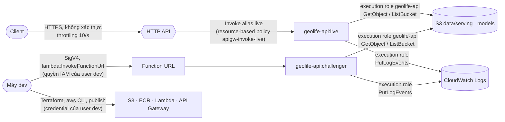

# Cấu hình và quan hệ hạ tầng AWS

Nguồn: [`infra/`](../../../infra) (ba stack `bootstrap`, `foundation`, `app`) và [`Makefile`](../../../Makefile). Các giá trị dưới đây là giá trị code đang khai báo. Sơ đồ và các luồng: [`overview.md`](overview.md); các concept (version, alias, quyền, throttling…): [`knowledges.md`](knowledges.md).

| Mục | Nội dung |
| --- | --- |
| 1 | Stack, state, cấu hình chung |
| 2 | `bootstrap`: bucket state |
| 3 | `foundation`: bucket artifacts, ECR, budget, output |
| 4–8 | `app`: function, quyền, alias, HTTP API, log |
| 9 | Biến của `app` và file tfvars |
| 10 | Output của `app` |
| 11 | Ai gọi ai, bằng quyền gì |
| 12 | Makefile: các lệnh AWS |

## 1. Stack, state, cấu hình chung

| Stack | Tạo gì | State lưu ở đâu |
| --- | --- | --- |
| `bootstrap` | Bucket `geolife-<account_id>-tfstate` | Local: `infra/bootstrap/terraform.tfstate` (bucket chưa tồn tại lúc tạo) |
| `foundation` | Bucket artifacts, ECR, budget | `foundation/terraform.tfstate` trong bucket trên |
| `app` | Function, alias, Function URL, HTTP API, role, log group | `app/terraform.tfstate` |

Stack `app` đọc output của `foundation` qua `terraform_remote_state`, nên người chạy Terraform cần quyền đọc bucket state.

| Cấu hình chung | Giá trị |
| --- | --- |
| Terraform | `>= 1.10` |
| AWS provider | `hashicorp/aws ~> 6.0` (từ 6.0 tới dưới 7.0) |
| Backend (trừ `bootstrap`) | S3; `use_lockfile = true` (khoá state bằng file `.tflock` trong bucket, không cần DynamoDB); `encrypt = true`. Tên bucket truyền lúc `make tf-init S=<stack>` |
| Region | `ap-southeast-1` (biến `region` của mọi stack; `AWS_REGION` của Makefile cho backend và lệnh `aws`) |
| Default tags | `Project = geolife`, `Stack = <tên stack>` |
| Tên dùng chung | `local.name = "geolife"` |
| Profile | `AWS_PROFILE = geolife-dev` (Makefile; đổi bằng `make <lệnh> AWS_PROFILE=…`) |

`var.region` của provider và region của backend là hai cấu hình riêng; đổi region phải đổi cả hai.

## 2. `bootstrap`: bucket state

| Cấu hình | Giá trị |
| --- | --- |
| Bucket | `geolife-<account_id>-tfstate` |
| Versioning | Bật: khôi phục được state về bản trước khi state hỏng hay bị ghi nhầm |
| Chặn public | Cả bốn cờ bật |
| Mã hoá | SSE-S3 (`AES256`) |
| Lifecycle | Bản cũ (noncurrent) xoá sau 90 ngày |

Mất file state local của `bootstrap` thì nhập lại: `terraform -chdir=infra/bootstrap import aws_s3_bucket.state geolife-<account_id>-tfstate`.

## 3. `foundation`: bucket artifacts, ECR, budget

### Bucket `geolife-<account_id>-artifacts`

```text
geolife-<account_id>-artifacts
├── data/preprocess/v_<n>/            output của preprocess
├── data/serving/v_<n>/               điểm theo user cho API (make aws-export-points)
│   ├── points/user=<id>.parquet
│   └── manifest.json
└── models/<model>/v=<n>/             bản phát hành bất biến của registry version n (geolife.publish)
    ├── model/                        thư mục MLflow model: code thuật toán, config, signature
    └── manifest.json                 ghi sau cùng: có manifest là bản phát hành đã đủ file
```

| Cấu hình | Giá trị |
| --- | --- |
| Versioning | Bật |
| Chặn public | Cả bốn cờ bật |
| Mã hoá | SSE-S3 (`AES256`) |
| Bucket policy | Từ chối mọi request không qua TLS (`aws:SecureTransport = false`) |
| Lifecycle | Bản cũ (noncurrent) xoá sau 30 ngày; multipart upload dở dang dọn sau 7 ngày; `exports/` hết hạn sau 90 ngày |
| `models/` | Không có rule xoá bản hiện hành: version đã phát hành luôn còn để rollback |

Mọi đường dẫn gắn với số version; vai trò của version (alias) chỉ nằm trên registry và trong tfvars của stack `app`.

### ECR `geolife-api`

| Cấu hình | Giá trị |
| --- | --- |
| Tag | Git SHA 12 ký tự; `IMMUTABLE` (không ghi đè được tag đã có) |
| Scan on push | Bật |
| Lifecycle | Giữ 5 image có tag mới nhất; manifest không tag xoá sau 7 ngày |
| `force_delete` | `true` (destroy được repo khi còn image) |

Mỗi Lambda version ghim image theo digest. Image bị lifecycle xoá thì Lambda version dùng nó không chạy được nữa, nên chỉ rollback được về các version có image nằm trong 5 build gần nhất.

### Budget

| Cấu hình | Giá trị |
| --- | --- |
| Tên | `geolife-monthly`, `COST`, `MONTHLY`, USD |
| Ngưỡng | `monthly_budget_usd = 20` |
| Thông báo | Email tới `alert_email` khi chi phí thực tế vượt 50% và 100% |
| Credit, refund | Không tính (`include_credit = false`): chi phí trước khi trừ credit |

Budget chỉ gửi email, không dừng tài nguyên; số liệu chi phí trễ khoảng một ngày. `alert_email` đặt trong `infra/foundation/terraform.tfvars` (không commit; mẫu ở `terraform.tfvars.example`).

### Output

| Output | Stack `app` dùng để |
| --- | --- |
| `artifacts_bucket`, `artifacts_bucket_arn` | Dựng `MODEL_URI`, `POINTS_URI`; giới hạn quyền S3 của role |
| `ecr_repository_url` | Tìm image mới nhất và ghim theo digest |
| `region`, `account_id` | |

## 4. `app`: function `geolife-api`

Nguồn: [`infra/app/function.tf`](../../../infra/app/function.tf), [`main.tf`](../../../infra/app/main.tf).

| Cấu hình | Giá trị | Vì sao |
| --- | --- | --- |
| Loại | Container image, `arm64` | Thư viện vượt 250 MB của gói zip; Graviton rẻ hơn x86 cùng RAM |
| Image | `<ecr_repository_url>@<digest>` của image mới nhất trong ECR (`data.aws_ecr_image`, `most_recent = true`) | Ghim theo digest: mỗi Lambda version ghi đúng một image |
| `image_config` | `entry_point = ["python", "-m", "awslambdaric"]`, `command = ["geolife_api.lambda_handlers.api"]` | Cùng giá trị với `ENTRYPOINT` / `CMD` của image; khai báo ở đây để function khác dùng cùng image với handler khác |
| RAM | `api_memory = 2048` MB (~1,15 vCPU) | Request lớn nhất dùng 1,5 GB ([`sizing.md`](sizing.md)) |
| Timeout | `api_timeout = 29` giây | Dưới 30 giây của API Gateway, để request quá hạn được ghi lỗi ở Lambda |
| Reserved concurrency | `api_reserved_concurrency = 10`; 0 khi `paused = true` | Trần số request chạy cùng lúc, tức trần chi phí mỗi giờ |
| `publish` | `true` | Mỗi lần cấu hình (`$LATEST`) đổi, Lambda đóng một version mới bất biến |
| Ngoài VPC | Không khai báo `vpc_config` | Function đọc S3 qua endpoint công khai của AWS, không cần NAT hay VPC endpoint |

**Biến môi trường** (của `$LATEST`; mỗi Lambda version giữ bản chụp của nó):

| Biến | Giá trị | Đặt ở |
| --- | --- | --- |
| `MODEL_URI` | `s3://<bucket>/models/geolife_home_office/v=<latest_model_version>/model` | Terraform; `latest_model_version` do `make aws-promote` ghi |
| `POINTS_URI` | `s3://<bucket>/data/serving/v_<data_version>` (`data_version = 1`) | Terraform |
| `INIT_BUDGET_S` | Không đặt, mặc định 8,5 giây (`geolife_api.config.Settings`) | Code |
| `HOME`, `NUMBA_CACHE_DIR` | `/tmp`, `/tmp/numba` | Image: trên Lambda chỉ `/tmp` ghi được |

**Log:**

| Cấu hình | Giá trị |
| --- | --- |
| Log group | `/aws/lambda/geolife-api`, tạo trước function, retention `api_log_retention_days = 30` |
| Định dạng | `JSON`: dòng `platform.report` (thời gian, RAM, `initDurationMs`) và log của code truy vấn được bằng Logs Insights |
| Mức log | Ứng dụng `INFO`, hệ thống `INFO` |

## 5. `app`: quyền

Hai loại quyền, trả lời hai câu hỏi khác nhau ([`knowledges.md`](knowledges.md) mục 9).

**Execution role `geolife-api`** (code của function được gọi gì). Trust: `lambda.amazonaws.com`.

| Quyền | Phạm vi | Vì sao |
| --- | --- | --- |
| `s3:GetObject` | `data/serving/*`, `models/geolife_home_office/*` | Đọc điểm và model |
| `s3:ListBucket` | Bucket artifacts, điều kiện `s3:prefix` ∈ {`data/serving/*`, `models/geolife_home_office/*`} | Để S3 trả `404` (không phải `403`) cho user không tồn tại ([`knowledges.md`](knowledges.md) mục 3); MLflow liệt kê thư mục model khi tải |
| `logs:CreateLogStream`, `logs:PutLogEvents` | Log group của function | Ghi log |

Role không ghi được vào bucket: function không sửa được model hay dữ liệu.

**Resource-based policy của function** (ai được gọi function):

| Statement | Principal | Qualifier | Điều kiện |
| --- | --- | --- | --- |
| `apigw-invoke-live` | `apigateway.amazonaws.com` | `live` | `source_arn = <execution_arn của HTTP API>/*` |

Function URL của alias `challenger` dùng `AWS_IAM`: không có statement cho người ngoài; chỉ identity trong tài khoản có `lambda:InvokeFunctionUrl` (vd. user dev chạy Terraform) gọi được.

## 6. `app`: alias và Function URL

| Alias | Trỏ vào | Chia traffic |
| --- | --- | --- |
| `live` | `live.lambda_version` trong `models.auto.tfvars.json` | Khi `challenger` khác `live` và `canary_weight > 0`: `routing_config.additional_version_weights = { <version của challenger> = canary_weight / 100 }`. Ngược lại không có `routing_config`, 100% vào version của `live` |
| `challenger` | `challenger.lambda_version`; không có thì trùng `live` | Không |

| Function URL | Giá trị |
| --- | --- |
| Gắn vào | Alias `challenger` |
| `authorization_type` | `AWS_IAM`: request phải ký SigV4 (service `lambda`, region `ap-southeast-1`) |
| Invoke mode | `BUFFERED` (trả response một lần) |
| Gọi | `make aws-call-challenger P=<path> [M=GET]` |

Hiện tại: `live` → version 9 (registry v1), chia 20% sang version 8 (registry v3); `challenger` → version 8.

## 7. `app`: HTTP API

Nguồn: [`infra/app/api.tf`](../../../infra/app/api.tf).

| Thành phần | Cấu hình |
| --- | --- |
| API | `geolife-api`, `protocol_type = HTTP` |
| Integration | `AWS_PROXY` tới `invoke_arn` của alias `live`; payload `2.0`; timeout 30 000 ms (tối đa của HTTP API) |
| Route | Một route `$default`: mọi method, mọi path tới FastAPI, nên path lạ trả `404` đúng contract |
| Stage | `$default` (URL không có tiền tố stage), `auto_deploy = true` |
| Throttling | `throttle_rate = 10` request/giây, `throttle_burst = 20`; vượt thì trả `429` mà không gọi Lambda |
| URL | `https://<api-id>.execute-api.ap-southeast-1.amazonaws.com`; `make aws-url` in ra. Không ghi vào repo |

**Access log** (`/aws/apigateway/geolife-api`, 14 ngày), mỗi request một dòng JSON:

| Trường | Nguồn | Dùng để |
| --- | --- | --- |
| `requestId` | `$context.requestId` | Trùng header `apigw-requestid` của response |
| `status`, `method`, `path`, `time` | | |
| `latencyMs` | `$context.responseLatency` | Tổng thời gian ở API Gateway |
| `integrationMs` | `$context.integrationLatency` | Thời gian chờ Lambda |
| `integrationStatus`, `integrationError` | | Lỗi khi gọi Lambda (vd. thiếu permission) |
| `lambdaRequestId` | `$context.integration.requestId` | Nối sang dòng `platform.report` của function (`canary_check` dùng để biết Lambda version của từng request) |
| `sourceIp`, `responseLength` | | |

## 8. `app`: data source và local

| Tên | Giá trị |
| --- | --- |
| `data.terraform_remote_state.foundation` | State `foundation/terraform.tfstate` trong bucket `geolife-<account_id>-tfstate` |
| `data.aws_ecr_image.api` | Image mới nhất (`most_recent`) của repo `geolife-api` |
| `local.model_prefix` | `models/geolife_home_office` (`model_name`) |
| `local.points_uri` | `s3://<bucket>/data/serving/v_1` |
| `local.live_version`, `local.challenger_version`, `local.canary` | Version của hai alias và có chia traffic hay không (mục 6) |

## 9. Biến của `app` và file tfvars

| Biến | Mặc định | Đặt ở | Ai sửa |
| --- | --- | --- | --- |
| `latest_model_version` | Bắt buộc | `models.auto.tfvars.json` | `make aws-promote` |
| `live` = `{lambda_version, model_version}` | Bắt buộc | `models.auto.tfvars.json` | `make aws-promote` |
| `challenger` = `{lambda_version, model_version}` | `null` | `models.auto.tfvars.json` | `make aws-promote` |
| `canary_weight` | 20; phải trong `[0, 100)` | `canary.auto.tfvars` | Sửa tay rồi `make aws-deploy` |
| `paused` | `false` | `pause.auto.tfvars` (không commit) | `make aws-pause` / `aws-resume` |
| `model_name` | `geolife_home_office` | | |
| `data_version` | 1 | | |
| `api_memory` | 2 048 | | |
| `api_timeout` | 29 | | |
| `api_reserved_concurrency` | 10 | | |
| `api_log_retention_days` | 30 | | |
| `throttle_rate`, `throttle_burst` | 10, 20 | | |

Terraform tự nạp mọi file `*.auto.tfvars(.json)` trong thư mục stack. `models.auto.tfvars.json` và `canary.auto.tfvars` được commit, nên `git log` của hai file này là lịch sử deploy:

```json
{
  "latest_model_version": 1,
  "live": { "lambda_version": 9, "model_version": 1 },
  "challenger": { "lambda_version": 8, "model_version": 3 }
}
```

`latest_model_version` là model của `$LATEST`, tức model mà Lambda version đóng tiếp theo sẽ chứa; nó không quyết định traffic. Traffic chỉ đi theo `live` và `challenger`.

`canary_weight = 100` bị từ chối: chuyển hết traffic sang version mới là chốt canary, làm bằng cách đổi alias trên registry rồi `make aws-promote` ([`deploy_strategies.md`](deploy_strategies.md)).

## 10. Output của `app`

| Output | Nội dung | Ai đọc |
| --- | --- | --- |
| `url` | URL của HTTP API, bỏ `/` cuối | `make aws-url`, `aws-smoke`, `canary_check.py` |
| `challenger_url` | Function URL của alias `challenger`, bỏ `/` cuối | `make aws-call-challenger` |
| `live` | `lambda_version`, `model_version`, `canary_weight` đang áp dụng (0 khi không chia) | `canary_check.py` |
| `challenger` | `lambda_version`, `model_version` | `canary_check.py` |
| `published_version` | Version vừa đóng từ `$LATEST` | `promote.py` |
| `image`, `function_name`, `api_reserved_concurrency` | | `make aws-resume` đọc `api_reserved_concurrency` |

## 11. Ai gọi ai, bằng quyền gì



Không có access key nào trong image hay biến môi trường: function dùng credential tạm của execution role do Lambda cấp.

## 12. Makefile: các lệnh AWS

| Lệnh | Việc |
| --- | --- |
| `make aws-whoami` | Tài khoản và user đang dùng |
| `make aws-build` | Build `docker/api.Dockerfile` cho `linux/arm64`, không provenance / SBOM (Lambda chỉ nhận image một nền tảng), tag `geolife-api:<git-sha>` |
| `make aws-push` | Build rồi push lên ECR; từ chối khi còn thay đổi chưa commit (tag phải đúng với code) |
| `make aws-export-points` | Dựng `data/serving/v_1/` từ `data/preprocess/v_1/` nếu chưa có, upload, ghi manifest sau cùng; đã có thì không ghi gì |
| `make aws-publish-model V=<n>` | Sao registry version n sang S3 kèm manifest |
| `make aws-promote [ARGS=--champion-only\|--auto-approve]` | Đọc `@champion` / `@challenger`, phát hành lên S3 nếu thiếu, chọn hoặc đóng Lambda version, ghi `models.auto.tfvars.json`, apply ([`deployment.md`](deployment.md)) |
| `make aws-deploy` | `terraform apply` stack `app` theo tfvars hiện có |
| `make aws-url` | In URL của HTTP API |
| `make aws-smoke` | Gọi health, dự đoán, user không tồn tại, `start` sai định dạng, path lạ; kiểm mã trả về |
| `make aws-call-challenger P=<path> [M=GET]` | Gọi Function URL của alias `challenger`, ký SigV4 bằng `curl --aws-sigv4` và credential của profile |
| `make aws-canary-check [N=100]` | `scripts/canary_check.py`: N request tuần tự qua HTTP API, thống kê và kiểm điều kiện chốt theo Lambda version |
| `make aws-pause` | Reserved concurrency về 0 bằng `aws lambda put-function-concurrency` (có hiệu lực ngay), ghi `paused = true` để lần apply sau không bật lại |
| `make aws-resume` | Ngược lại: `paused = false`, reserved concurrency về `api_reserved_concurrency` |
| `make tf-init / tf-plan / tf-apply / tf-output S=<stack>` | Terraform cho một stack; `tf-init` truyền tên bucket state (trừ `bootstrap`) |
