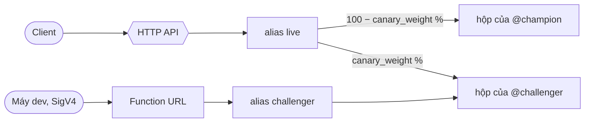
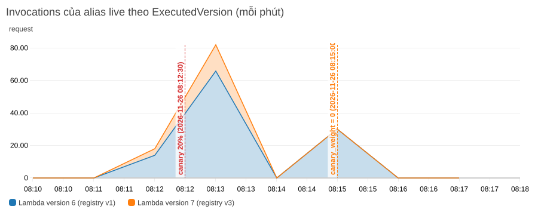
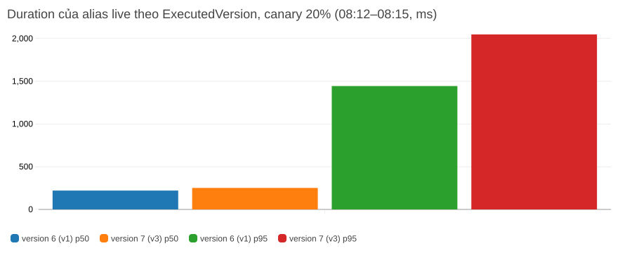

# Deploy strategy: canary trên Lambda alias

Khi có model mới, câu hỏi là đưa nó ra traffic thật thế nào để lỗi (nếu có) chạm ít user nhất và quay lại được nhanh nhất. Trang này so ba chiến lược, giải thích cách hiện thực canary trên Lambda alias, runbook của một lần phát hành, và kết quả lần canary registry v1 → v3. Cơ chế đóng hộp và `make aws-promote` ở [`deployment.md`](deployment.md).

## 1. Ba chiến lược

| Chiến lược | Cơ chế | Rủi ro | Chi phí | Dùng khi |
| --- | --- | --- | --- | --- |
| Blue-green | Dựng bản mới song song, chuyển 100% traffic một lần | Lỗi chạm mọi user cho tới lúc rollback, nhưng rollback tức thì | Gấp đôi hạ tầng trong lúc chuyển | Cần chuyển và quay lại nhanh; thay đổi không chia được theo tỉ lệ |
| **Canary** | Chuyển một phần traffic sang bản mới, theo dõi metric rồi mới chuyển hết | Chỉ phần traffic đó gặp lỗi | Thêm một ít compute, tốn thời gian theo dõi | Muốn kiểm chứng trên traffic thật với rủi ro nhỏ |
| Shadow | Bản mới nhận bản sao request, kết quả không trả cho user | Không chạm user | Gấp đôi compute suốt thời gian thử | Model mới chưa đủ tin để trả cho user; cần so output hai bản trên cùng input |

Trên Lambda, cả ba đều dựa trên Lambda version bất biến:

| Chiến lược | Hiện thực trên Lambda | Trong dự án |
| --- | --- | --- |
| Blue-green | Dán nhãn `live` từ hộp cũ sang hộp mới. Hộp cũ vẫn trên kệ nên rollback là dán lại. "Gấp đôi hạ tầng" không tốn gì: hộp không có request thì không tính tiền | Đây là việc `make aws-promote` làm khi không có `@challenger` |
| **Canary** | Alias `live` có trọng số: `routing_config` chia một phần số lần gọi sang hộp thứ hai | **Base** |
| Shadow | Handler gọi bất đồng bộ alias `challenger` với cùng request, chỉ ghi log để so | Không làm: gấp đôi số lần chạy Lambda, và so output hai model là bài toán đánh giá riêng |

**Chọn canary làm base.** Hai model của dự án cho kết quả khác nhau trên cùng user (`stay_point` và `dbscan`), nên cần quan sát version mới trên traffic thật trước khi chuyển hết. Blue-green vẫn có sẵn: đó là bước chốt canary.

## 2. Hiện thực canary: chọn cách nào

| Cách | Điểm mạnh | Điểm yếu |
| --- | --- | --- |
| **Trọng số của Lambda alias, đặt bằng biến Terraform** | Cơ chế gốc của Lambda; đổi trọng số có hiệu lực ngay; cắt traffic là đặt trọng số về 0; metric của Lambda tách theo version thực thi (`ExecutedVersion`) | Chia ngẫu nhiên theo từng lần gọi; chỉ chia giữa hai version; chuyển nấc bằng tay |
| CodeDeploy cho Lambda (`LambdaCanary10Percent5Minutes`…) | Tự dịch trọng số, tự rollback theo CloudWatch alarm, có hook kiểm tra trước khi nhận traffic | Nấc và thời gian cố định trong cấu hình, khó dừng lại quan sát; cơ chế nằm bên trong CodeDeploy |
| Canary của stage trong API Gateway REST API | Chia traffic ngay ở cổng | Chỉ có ở REST API (dự án dùng HTTP API); chia giữa hai deployment của cổng chứ không giữa hai version của function |

**Chọn trọng số của alias.** Tỉ lệ là một giá trị cố định trong config (`canary_weight`, 20%), không đi theo các nấc tăng dần: với hai model, câu hỏi là "version mới có lỗi hay chậm bất thường trên traffic thật không", và 20% đủ để có số đo sau vài chục request.

## 3. Thiết kế



| Thành phần | Vai trò |
| --- | --- |
| Nhãn `live` | API Gateway gọi nhãn này. Không có `@challenger`: 100% vào hộp của `@champion`. Có: chia `canary_weight` % sang hộp của `@challenger` |
| Nhãn `challenger` + Function URL `AWS_IAM` | Gọi thẳng hộp của `@challenger`, không qua chia ngẫu nhiên; chỉ credential trong tài khoản ký được. Không có `@challenger` thì trùng hộp của `live` |
| `canary_weight` trong `infra/app/canary.auto.tfvars` | Sửa tay; promote không đổi nó. Đổi xong chạy `make aws-deploy` |
| Registry | Nguồn sự thật của vai trò: `@champion`, `@challenger`. Promote chỉ đưa vai trò đó ra AWS |

Code mới (image mới, cùng model) không đi qua canary: promote đóng lại cả hai hộp với image mới và giữ nguyên tỉ lệ ([`deployment.md`](deployment.md) mục 4).

## 4. Runbook: một lần phát hành model

Ví dụ: registry v1 đang là `@champion`, muốn đưa v3 ra.

| Bước | Registry | Alias `live` | Việc |
| --- | --- | --- | --- |
| 0. Gọi thử (tuỳ chọn) | v1 `@champion`, v3 `@challenger` | 100% hộp v1 (khi `canary_weight = 0`) | Đặt `canary_weight = 0` trước, `make aws-promote`, rồi `make aws-call-challenger P=/v1/users/5/predictions` |
| 1. Bắt đầu canary | v1 `@champion`, v3 `@challenger` | 80% hộp v1, 20% hộp v3 | Gắn `@challenger` = v3, `make aws-promote` (hoặc đặt lại `canary_weight = 20`, `make aws-deploy` nếu đã làm bước 0) |
| 2. Quan sát | như trên | như trên | `make aws-canary-check`; metric của alias `live` theo `ExecutedVersion` |
| 3a. Chốt | v3 `@champion`, bỏ `@challenger` | 100% hộp v3 | Đổi alias trên registry, `make aws-promote` |
| 3b. Huỷ | v1 `@champion`, bỏ `@challenger` | 100% hộp v1 | Xoá `@challenger`, `make aws-promote` |

Version mới nhận 20% traffic ngay khi bước 1 xong. Bước 0 là cách gọi thử nó trước khi có user nào chạm vào.

**Điều kiện để chốt** (`make aws-canary-check` kiểm và in `ok` / `FAIL`):

| Điều kiện | Vì sao |
| --- | --- |
| Tỉ lệ request tới version mới sát `canary_weight`, trong ±3 sai số chuẩn của tỉ lệ nhị thức (±12 điểm % với 100 request ở 20%) | Kiểm alias đang chia đúng; lệch xa hơn là cấu hình sai |
| Version mới không có `5xx` | Lỗi phía server của version mới |
| Latency p95 phía client của các request **không cold start** của version mới không quá 1,5 lần version cũ | `dbscan` chậm hơn `stay_point` trên user lớn, nên không đòi bằng nhau. Phải bỏ request có cold start ([`knowledges.md`](knowledges.md) mục 17) |

**Cắt traffic tới version mới ngay** (đang canary, thấy lỗi): đặt `canary_weight = 0`, `make aws-deploy`. Alias đổi trong vài giây và không đóng hộp nào. Sau đó huỷ trên registry như bước 3b để trạng thái registry khớp với AWS.

**Rollback sau khi chốt:** chuyển `@champion` về v1 trên registry, `make aws-promote`. Hộp v1 còn trên kệ nên thường không phải đóng hộp mới (nếu image hiện tại đã khác image của hộp v1 thì promote đóng hộp v1 mới với image hiện tại).

## 5. Các trường hợp của `make aws-promote`

Trạng thái xuất phát chung:

```
Kệ:          [A: v1]  [B: v3]          (cùng image hiện tại)
live:        A 80% | B 20%
challenger:  B
Registry:    @champion = v1, @challenger = v3
```

| # | Đổi trên registry | Kết quả sau `make aws-promote` |
| --- | --- | --- |
| 1 | Đổi `@challenger` v3 → v4 | Đóng C (v4). `live`: A 80% \| C 20%; `challenger` → C. B không còn nhãn |
| 2 | `@champion` = v2, `@challenger` = v4 (cả hai chưa có hộp) | Đóng C (v2) rồi D (v4). `live`: C 80% \| D 20% |
| 3 | `@challenger` lên `@champion`, gắn `@challenger` mới: v3, v4 | Đóng C (v4). `live`: B 80% \| C 20% |
| 4 | `@challenger` lên `@champion`, không gắn `@challenger` mới: v3 (chốt canary) | Không đóng hộp. `live`: B 100%; `challenger` → B. A còn trên kệ để rollback |
| 5 | Xoá `@challenger`, giữ `@champion` = v1 (huỷ canary) | Không đóng hộp. `live`: A 100% |
| 6 | `@champion` = v2, giữ `@challenger` = v3 | Đóng C (v2), dùng lại B. `live`: C 80% \| B 20% |
| 7 | Rollback sau khi chốt (đang `live` = B 100%): `@champion` về v1 | Dùng lại A nếu A cùng image hiện tại, không thì đóng hộp mới. `live`: 100% vào hộp đó |
| 8 | `@challenger` trùng `@champion` | Như không có `@challenger` |
| 9 | Không đổi gì | Không đổi gì |
| 10 | Xoá `@champion` | Promote dừng và báo lỗi; AWS giữ nguyên |
| 11 | Không đổi alias, đã push image mới | Đóng hộp mới cho cả `@champion` và `@challenger` với image mới; tỉ lệ giữ theo `canary_weight` |

Cả 11 trường hợp có test trong [`tests/test_promote.py`](../../../tests/test_promote.py), chạy trên một kệ giả (không gọi AWS).

## 6. `canary_check`: đo một canary

```bash
make aws-canary-check N=100
```

[`scripts/canary_check.py`](../../../scripts/canary_check.py):

1. Đọc output của stack `app`: URL, hộp của `live` và `challenger`, `canary_weight` đang áp dụng.
2. Gọi tuần tự N request `POST /v1/users/{id}/predictions`, user cách đều trong danh sách user của `data/serving/v_1/manifest.json` trên S3. Gọi tuần tự nên mỗi hộp chỉ cần một environment; cold start chỉ rơi vào request đầu tiên tới mỗi environment mới.
3. Gắn Lambda version cho từng request. Response lỗi không có trường `model`, nên version lấy từ log thay vì response:

   ```
   header apigw-requestid ─► access log của HTTP API (requestId → lambdaRequestId)
                          ─► dòng platform.report của function (requestId) nằm trong log stream "…/[8]…"
   ```

   Access log có thể về CloudWatch trễ hơn một phút; script đọc lại mỗi 15 giây cho tới khi ghép đủ, tối đa 3 phút. Request bị từ chối trước khi vào function (`429` throttling, `503` reserved concurrency) không có version, ghi ở dòng `-`.
4. In bảng theo Lambda version (registry version, model trong response, số request, tỉ lệ, `5xx`, cold start, p50 / p95 khi ấm phía client, p95 `durationMs` khi ấm) rồi kiểm ba điều kiện ở mục 4.

Trường `model` trong response là thuật toán và version của nó (`stay_point v1`, `dbscan v1`), không phải số version trên registry; script lấy registry version từ output của Terraform.

## 7. Kết quả: canary registry v1 → v3

Đo ngày 2026-11-26. Hộp 6 (`stay_point` v1, registry v1) mang `live`; hộp 7 (`dbscan` v1, registry v3) mang `challenger`, cùng image `8a31e3ba7ab2`, 2 048 MB. `canary_weight = 20`. Sau lần đo, image đổi sang `c0f79ff285f0` nên hai nhãn chuyển sang hộp 9 (v1) và 8 (v3), cùng model và cùng tỉ lệ ([`deployment.md`](deployment.md) mục 2).

**100 request tuần tự, 100 user khác nhau:**

| Lambda version | Registry | Model | Request | `5xx` | Cold start | p50 khi ấm | p95 khi ấm | p95 `durationMs` khi ấm |
| --- | --- | --- | --- | --- | --- | --- | --- | --- |
| 6 | v1 | `stay_point` v1 | 80 (80%) | 0 | 1 | 0,43 s | 1,79 s | 1 444 ms |
| 7 | v3 | `dbscan` v1 | 20 (20%) | 0 | 0 | 0,46 s | 2,17 s | 1 987 ms |

```
ok   tỉ lệ tới version mới 20% so với 20% (cho phép ±12 điểm %)
ok   5xx của version mới: 0
ok   p95 khi ấm: mới 2.17 s, cũ 1.79 s (tối đa 1.5×)
```

Hộp 7 không có cold start vì nó đã có environment ấm từ lần gọi thử qua alias `challenger` ngay trước đó: hai alias trỏ cùng một Lambda version dùng chung environment của version đó.

**Cắt traffic:** đặt `canary_weight = 0` rồi `terraform apply` mất 7 giây (alias đổi trong chưa tới 1 giây), `RoutingConfig` của `live` thành rỗng. 30 request sau đó đều vào hộp 6. Sau đó đặt lại `canary_weight = 20`.

**Metric của alias `live` theo `ExecutedVersion`** (CloudWatch, giờ Việt Nam):



08:12–08:14 là 100 request của `canary_check`: hộp 6 nhận 80, hộp 7 nhận 20. Từ 08:15, sau khi `canary_weight = 0`, 30 request đều vào hộp 6.



Trong lúc canary, `Duration` p50 của hai hộp gần nhau (khoảng 220 và 250 ms); p95 của hộp 7 (khoảng 2 040 ms) cao hơn hộp 6 (khoảng 1 440 ms), khớp cột p95 `durationMs` ở bảng trên. Metric của CloudWatch không tách cold start; điều kiện chốt dùng bảng của `canary_check`.

Ảnh vẽ bằng `aws cloudwatch get-metric-widget-image`: metric `AWS/Lambda` `Invocations` (Sum, mỗi phút, phút trống điền 0) và `Duration` (p50, p95 trên cả khoảng 08:12–08:15), dimension `FunctionName = geolife-api`, `Resource = geolife-api:live`, `ExecutedVersion = 6 | 7`.

## 8. Giới hạn

- Alias chia ngẫu nhiên theo từng lần gọi. Trong lúc canary, cùng một user có thể nhận kết quả của hai model ở hai lần gọi; trường `model` trong response cho biết kết quả đến từ đâu.
- Với ít request, tỉ lệ thực tế có thể lệch khỏi `canary_weight`; điều kiện về tỉ lệ đã tính sai số theo N.
- Alias chỉ chia giữa hai Lambda version: một lúc chỉ thử được một model mới.
- Chuyển nấc, chốt và huỷ đều bằng tay; không có rollback tự động theo alarm.
