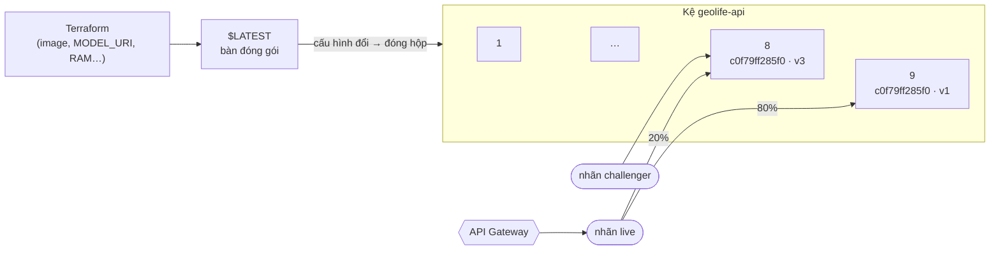
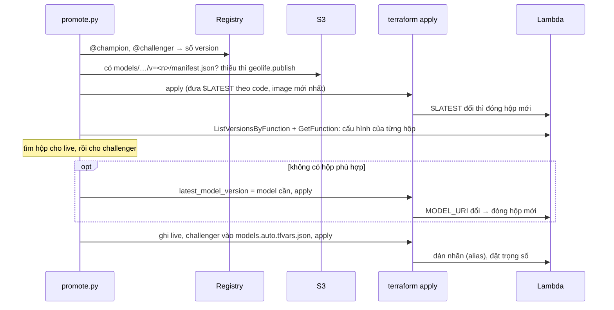

# Phát hành code và model

Trang này mô tả cách một thay đổi (code mới, model mới, cấu hình mới) đi từ máy dev tới traffic thật: thứ gì được đóng gói, ở đâu, bằng lệnh nào, và vì sao rollback không phải build lại. Chia traffic giữa hai model (canary) ở [`deploy_strategies.md`](deploy_strategies.md); giá trị cấu hình ở [`config_relation.md`](config_relation.md).

## 1. Hai thứ được phát hành

| | Code | Model |
| --- | --- | --- |
| Là gì | Image `geolife-api` (app FastAPI, handler, thư viện serve) | Một registry version: thư mục MLflow model chứa code thuật toán, `config.yaml`, signature |
| Đánh số | Tag = git SHA 12 ký tự; Lambda ghim theo digest | Số version trên registry (1 = `stay_point` v1, 3 = `dbscan` v1…) |
| Bất biến | ECR `IMMUTABLE`: không ghi đè tag | Bản sao trên S3 `models/<model>/v=<n>/`, `manifest.json` ghi sau cùng; không ghi lại một version đã phát hành |
| Lệnh | `make aws-push` | `geolife.register` (notebook tuning) → gắn alias → `make aws-promote` |

Image không chứa package `geolife`: code thuật toán đi kèm model, nên một image chạy được mọi registry version, và đổi model không phải build image.

## 2. Kệ, hộp, nhãn

Cách hình dung dùng trong mọi trang về deploy:

- Function `geolife-api` là một **kệ**.
- Mỗi **Lambda version** là một **hộp** đã đóng kín trên kệ: chứa một image và một registry version (`MODEL_URI`), cùng RAM, timeout và các cấu hình khác lúc đóng. Hộp đánh số 1, 2, 3… theo thứ tự đóng; không sửa được và không bị xoá.
- **Alias** là **nhãn** dán lên hộp. `live` là nhãn mà API Gateway gọi; `challenger` là nhãn của model đang thử.
- `$LATEST` là **bàn đóng gói**: cấu hình làm việc mà Terraform sửa. Mỗi lần cấu hình này đổi (image, `MODEL_URI`, RAM…), Lambda đóng một hộp mới (`publish = true`). Không nhãn nào dán lên `$LATEST`.

Vì hộp bất biến, rollback là dán nhãn lên hộp cũ: không build, không push, đổi có hiệu lực trong vài giây. Mỗi hộp có execution environment riêng, nên dán nhãn lên hộp khác thì request đầu tiên tới hộp đó có cold start ([`knowledges.md`](knowledges.md) mục 18).

**Các hộp hiện có:**

| Lambda version | Image | RAM | Registry version | Ghi chú |
| --- | --- | --- | --- | --- |
| 1 | `0194a06c8733` | 2 048 MB | v1 | Lần deploy đầu |
| 2 | `dce878c4e1e7` | 2 048 MB | v1 | Thêm log thời gian của pha init |
| 3 | `dce878c4e1e7` | 3 008 MB | v1 | Đo chọn RAM ([`sizing.md`](sizing.md) L6, L7) |
| 4 | `dce878c4e1e7` | 1 769 MB | v1 | Đo chọn RAM |
| 5 | `dce878c4e1e7` | 2 048 MB | v1 | Trở lại 2 048 MB; là hộp mới dù trùng cấu hình hộp 2 |
| 6 | `8a31e3ba7ab2` | 2 048 MB | v1 | Pha init có hạn giờ ([`sizing.md`](sizing.md) L8); hộp cũ trong canary v1 → v3 ([`deploy_strategies.md`](deploy_strategies.md) mục 7) |
| 7 | `8a31e3ba7ab2` | 2 048 MB | v3 | Hộp mới trong canary v1 → v3 |
| 8 | `c0f79ff285f0` | 2 048 MB | v3 | `servers` trong OpenAPI là URL tương đối (Swagger UI gọi đúng host). Nhãn `challenger`, nhận 20% của `live` |
| 9 | `c0f79ff285f0` | 2 048 MB | v1 | Nhãn `live` |

Hộp 5 cho thấy Lambda đóng hộp theo thay đổi của `$LATEST`, không tìm hộp cũ trùng cấu hình. Việc tìm hộp cũ để dùng lại là của `make aws-promote`.

## 3. `make aws-promote`

[`scripts/promote.py`](../../../scripts/promote.py) đưa alias trên registry ra function. Registry quyết định *model nào* đóng vai gì; promote quyết định *hộp nào* mang nhãn nào.

**Thao tác, từ registry tới AWS:**

| # | Ở đâu | Làm gì |
| --- | --- | --- |
| 0 | Máy dev | `aws login --profile geolife-dev`; `.env` có biến Databricks / MLflow (`MLFLOW_REGISTRY_URI`, `MLFLOW_MODEL_NAME`) |
| 1 | Databricks, Catalog Explorer → model `geolife_home_office` → version → *Add alias* | Gắn `champion` cho version chạy thật, `challenger` cho version muốn thử. AWS chưa đổi gì: function không gọi registry, registry chỉ được đọc từ máy dev lúc promote |
| 2 | `infra/app/canary.auto.tfvars` (tuỳ chọn) | Đặt `canary_weight`: 20 mặc định; 0 để gọi thử version mới trước khi nó nhận traffic |
| 3 | Máy dev | `make aws-promote`. Mỗi `terraform apply` in plan và hỏi `yes` (2–4 lần mỗi promote); `ARGS=--auto-approve` bỏ bước hỏi |
| 4 | Máy dev | Kiểm theo mục 6: `make aws-call-challenger P=/v1/health M=GET`, `make aws-canary-check` |
| 5 | Git | Commit `infra/app/models.auto.tfvars.json`: trạng thái mong muốn của hai nhãn, lần promote sau đọc lại |
| 6 | Databricks, rồi `make aws-promote` | Chốt: `champion` sang version mới, xoá `challenger`. Huỷ: xoá `challenger`. Cắt traffic ngay mà chưa đổi registry: `canary_weight = 0`, `make aws-deploy` ([`deploy_strategies.md`](deploy_strategies.md) mục 4) |

**Bên trong `make aws-promote`:**

**Các bước:**

1. Đọc `@champion` và `@challenger` thành số version. Không có `@champion` thì dừng, AWS giữ nguyên. `@challenger` trùng `@champion` coi như không có. `ARGS=--champion-only` bỏ qua `@challenger`.
2. Version nào chưa có `manifest.json` trên S3 thì phát hành (`geolife.publish`): tải thư mục MLflow model từ registry về máy dev, upload từng file lên `models/geolife_home_office/v=<n>/model/`, ghi `manifest.json` sau cùng bằng conditional write (không ghi đè), gắn tag `s3_uri` cho version trên registry.
3. `terraform apply` để `$LATEST` khớp code Terraform hiện tại (image mới nhất trong ECR, RAM, timeout…). Cấu hình đổi thì Lambda đóng một hộp.
4. **Nhãn `live` theo `@champion`.** Tìm hộp có cùng cấu hình với `$LATEST` (so mọi thứ trừ `MODEL_URI`) và chứa model của `@champion`, theo thứ tự: hộp đang mang `live` → hộp đang mang `challenger` → hộp mới nhất còn lại. Không có thì đóng hộp mới: đặt `latest_model_version` trong tfvars rồi apply.
5. **Nhãn `challenger`.** Không có `@challenger`: dán lên hộp của `live`, `live` nhận 100%. Có: tìm hoặc đóng hộp như bước 4; `live` chia `canary_weight` % sang hộp này.
6. Ghi hai nhãn vào `models.auto.tfvars.json`, apply: Terraform gọi `UpdateAlias` cho `live` (`FunctionVersion`, `AdditionalVersionWeights`) và `challenger`. Alias đổi trong vài giây; request đầu tới hộp mới có cold start.

**Vì sao so cả cấu hình, không chỉ image và model.** Đổi RAM hay timeout cũng phải tới được traffic thật. Nếu chỉ so image và model, promote sẽ dùng lại hộp cũ với RAM cũ.

**Thứ tự ưu tiên khi tìm hộp.** Hộp đang mang nhãn đã có environment ấm; dùng lại nó tránh cold start không cần thiết. Hộp cũ hơn chỉ dùng khi không có hộp đang mang nhãn nào phù hợp, vd. rollback.

Một lần promote có thể đóng hai hộp, khi cả `@champion` và `@challenger` đều chưa có hộp khớp cấu hình hiện tại. Nếu image không đổi, hộp của `@champion` đóng trước. Nếu image đổi, apply ở bước 3 đã đóng một hộp với image mới và model đang nằm ở `$LATEST` (`latest_model_version`), rồi bước 4–5 đóng hộp cho model còn lại. Hộp 8 và 9 là trường hợp này: `$LATEST` đang giữ v3, nên hộp 8 (v3) đóng ở bước 3, hộp 9 (v1) đóng ở bước 4 cho `live`. Mỗi hộp là một lần apply; `ARGS=--auto-approve` bỏ bước Terraform hỏi lại.

## 4. Các tình huống thường gặp

| Muốn | Làm | Kết quả |
| --- | --- | --- |
| Đưa code mới ra traffic | Commit → `make aws-push` → `make aws-promote` | Hộp mới cho mỗi nhãn với image mới, cùng model; tỉ lệ canary giữ nguyên. Code mới không đi qua canary |
| Đưa model mới ra traffic | Gắn alias trên registry → `make aws-promote` | Xem bảng trường hợp ở [`deploy_strategies.md`](deploy_strategies.md) mục 5 |
| Đổi RAM, timeout, biến môi trường | Sửa `variables.tf` → `make aws-promote` | `$LATEST` đổi nên Lambda đóng hộp mới; promote dán nhãn lên hộp có cấu hình mới. `make aws-deploy` một mình chỉ đóng hộp, nhãn vẫn ở hộp cũ |
| Đổi tỉ lệ canary | Sửa `canary.auto.tfvars` → `make aws-deploy` | Trọng số của `live` đổi ngay, không đóng hộp |
| Đổi reserved concurrency, throttling, retention | Sửa biến → `make aws-deploy` | Không phải cấu hình của hộp, không đóng hộp |
| Rollback model | Chuyển `@champion` về version cũ trên registry → `make aws-promote` | Dán `live` lên hộp cũ cùng image hiện tại; không có thì đóng hộp mới |
| Rollback code | Không có lệnh riêng: revert commit → `make aws-push` → `make aws-promote` | Hộp mới với image của code cũ |
| Chặn mọi request ngay | `make aws-pause` (`make aws-resume` để bật lại) | Reserved concurrency về 0; client nhận `503` |

**Giới hạn của rollback.** ECR chỉ giữ 5 image có tag gần nhất. Hộp nào dùng image đã bị xoá thì không chạy được nữa, nên dán nhãn lên hộp cũ chỉ an toàn khi image của nó còn trong ECR.

## 5. Dựng từ đầu

Thứ tự trên một tài khoản mới (mỗi bước cần bước trước):

| # | Lệnh | Tạo ra |
| --- | --- | --- |
| 1 | `aws login --profile geolife-dev`; `make aws-whoami` | Credential |
| 2 | `make tf-init S=bootstrap`, `make tf-apply S=bootstrap` | Bucket state |
| 3 | Điền `infra/foundation/terraform.tfvars` (`alert_email`); `make tf-init S=foundation`, `make tf-apply S=foundation` | Bucket artifacts, ECR, budget |
| 4 | `make aws-export-points` | `data/serving/v_1/` trên S3 (cần `data/preprocess/v_1/` ở local) |
| 5 | `make aws-push` | Image đầu tiên trong ECR |
| 6 | Gắn `@champion` trên registry; `make tf-init S=app`; `make aws-promote` | Function, hộp đầu tiên, alias, HTTP API. `models.auto.tfvars.json` chưa có thì promote tạo, đóng hộp đầu với model của `@champion` |
| 7 | `make aws-smoke`; `API_URL=$(make -s aws-url) uv run pytest -m integration` | Kiểm tra trên URL thật |

Không stack nào phải huỷ sau mỗi phiên: khi không có request, function, alias, HTTP API không tính tiền.

## 6. Kiểm tra sau khi phát hành

| Kiểm | Lệnh | Mong đợi |
| --- | --- | --- |
| Endpoint trả đúng mã | `make aws-smoke` | `200` health, `200` dự đoán, `404` user không tồn tại, `400` `start` sai, `404` path lạ |
| Contract và kết quả end-to-end | `API_URL=$(make -s aws-url) uv run pytest -m integration` | Schemathesis qua; kết quả khớp `results/` |
| Nhãn đang dán đúng hộp | `aws lambda get-alias --function-name geolife-api --name live` | `FunctionVersion` và `RoutingConfig` khớp `models.auto.tfvars.json`, `canary_weight` |
| Version mới chạy được trước khi nhận traffic | `make aws-call-challenger P=/v1/health M=GET` | `200`; `x-cold-start: 1` ở lần gọi đầu |
| Tỉ lệ chia, lỗi, latency theo hộp | `make aws-canary-check` | [`deploy_strategies.md`](deploy_strategies.md) mục 6 |

## 7. Lưu ở đâu trên AWS

| Thứ | Nơi lưu | Đặc điểm |
| --- | --- | --- |
| Model (registry version n) | S3 `geolife-<account_id>-artifacts/models/geolife_home_office/v=<n>/model/` + `manifest.json` | Bản sao bất biến của registry; có manifest mới coi là đã phát hành |
| Dữ liệu điểm | S3 `…/data/serving/v_1/points/user=<id>.parquet` | Đọc ở mỗi request ([`serving_data.md`](serving_data.md)) |
| Code | ECR `geolife-api:<git-sha>` | Tag không ghi đè; giữ 5 image có tag gần nhất; function ghim theo digest |
| `$LATEST` | Cấu hình của function `geolife-api` trong dịch vụ Lambda | Image (digest), RAM, timeout, `MODEL_URI`, `POINTS_URI` |
| Hộp (Lambda version) | Dịch vụ Lambda | Bản chụp bất biến của `$LATEST`. Hộp chứa *địa chỉ* model (`MODEL_URI`), không chứa file model |
| Nhãn `live`, `challenger` | Dịch vụ Lambda | Con trỏ tới hộp; `live` có thêm `RoutingConfig` (trọng số) |
| Trạng thái mong muốn | Git: `models.auto.tfvars.json`, `canary.auto.tfvars` | Promote hoặc người vận hành sửa |
| Trạng thái đã tạo | S3 `geolife-<account_id>-tfstate`, key `app/terraform.tfstate` | Terraform so với tfvars để biết cần đổi gì |

Khi một hộp nhận request lần đầu, environment mới khởi động container từ image theo digest của hộp, đọc `MODEL_URI` của hộp, tải model từ S3 và nạp vào RAM một lần cho environment đó; các request sau chỉ đọc file parquet của user ([`request_flow.md`](request_flow.md) bước 3).
