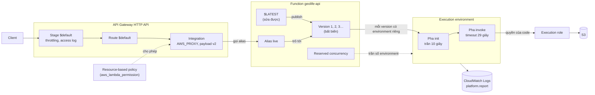

# Kiến thức nền: Lambda, container image, HTTP API, cold start

Tài liệu ghi lại các concept đứng sau API trên AWS Lambda. Mỗi mục theo thứ tự: **là gì → vì sao cần → ví dụ → dự án dùng thế nào**. Đường đi của một request qua từng khâu ở [request_flow.md](request_flow.md); số đo RAM và thời gian ở [sizing.md](sizing.md); Terraform state và IAM nói chung ở [../fargate/knowledges.md](../fargate/knowledges.md).

- Phần A (mục 1–4): chạy API dưới dạng handler Lambda, kiểm ở local.
- Phần B (mục 5–10): function, version, alias, HTTP API, giới hạn traffic, log trên AWS.
- Phần C (mục 11–14): cold start, và các cách giảm cold start (đọc khi cần tối ưu).

## Bản đồ liên hệ



Ba sợi dây xuyên suốt:

- **Version bất biến + alias** tách "code nào đang chạy" khỏi "code mới nhất": đổi alias là đổi traffic, rollback là trỏ alias về version cũ, không build lại.
- **Mỗi Lambda version có environment riêng**: mỗi lần alias chuyển sang version mới, mọi request đầu tiên phải chờ pha init. Vì vậy thời gian init quyết định trải nghiệm sau mỗi lần deploy.
- **Hai loại quyền**: execution role là quyền *của code* khi gọi AWS; resource-based policy là quyền *gọi vào* function.

---

# Phần A. Handler Lambda

## 1. Vòng đời của execution environment

**Là gì.** Execution environment là một micro-VM (Firecracker) chạy image của function. Nó đi qua bốn trạng thái:

| Pha | Chuyện gì xảy ra | Giới hạn |
| --- | --- | --- |
| **Init** | Lambda khởi động container, chạy `ENTRYPOINT`; runtime import module handler và chạy code ở cấp module. Kết thúc khi runtime hỏi event đầu tiên (`GET /runtime/invocation/next`) | Function on-demand: **10 giây**. Được tính tiền |
| **Invoke** | Runtime nhận một event, gọi handler, gửi kết quả về | Timeout của function (dự án: 29 giây) |
| **Freeze** | Giữa hai event, process bị đóng băng: không thread nào chạy, không tốn CPU | Không giới hạn; environment có thể bị huỷ bất cứ lúc nào |
| **Shutdown** | Sau một thời gian không có request (không công bố, thường vài phút tới vài giờ), Lambda huỷ environment | Runtime không có hook shutdown nếu không dùng extension |

Một environment xử lý **đúng một request tại một thời điểm**. Hai request đồng thời cần hai environment, mỗi cái có pha init riêng.

**Vì sao cần hiểu:**

- Code ở cấp module (nạp model, tạo boto3 client) chạy một lần ở pha init rồi được dùng lại cho mọi request sau của environment đó; code trong handler chạy mỗi request.
- Việc chạy nền sau khi trả response (thread, `asyncio.create_task`) bị freeze cùng process; nó chỉ chạy tiếp khi có request kế tiếp. Không dựa vào nó để ghi log hay gửi dữ liệu "sau".
- Lambda có thể dựng environment trước khi có request (*proactive initialization*), nên trong log có những pha init không đi kèm request nào.

**Ví dụ.** Log của một environment mới (định dạng log JSON, rút gọn; số minh hoạ):

```json
{"type": "platform.initStart", "record": {"initializationType": "on-demand", "phase": "init"}}
{"type": "platform.initRuntimeDone", "record": {"status": "success"}}
{"type": "platform.initReport", "record": {"status": "success", "metrics": {"durationMs": 9471.2}}}
{"type": "platform.start", "record": {"requestId": "…"}}
{"type": "platform.report", "record": {"metrics": {"durationMs": 236.4, "billedDurationMs": 9708,
    "memorySizeMB": 2048, "maxMemoryUsedMB": 651, "initDurationMs": 9471.2}}}
```

`initDurationMs` chỉ có trong `platform.report` của request đầu tiên của environment; các request sau không có trường này.

**Dự án dùng thế nào.** `lambda_handlers._init()` chạy ở pha init: đọc `Settings`, nạp model ở thread nền, dựng nguồn điểm và app FastAPI. Handler (`make_handler`) chỉ chuyển event cho Mangum. Response đầu tiên của mỗi environment có header `X-Cold-Start: 1` để script đo phía client tách request có cold start.

## 2. Event payload v2 của HTTP API

**Là gì.** Lambda không nhận HTTP. API Gateway đóng gói request thành một dict JSON (event) và nhận lại một dict (response). HTTP API có hai định dạng; dự án dùng **v2**:

| | Payload v1 (REST API, HTTP API cũ) | Payload v2 |
| --- | --- | --- |
| Path, query | `path`, `queryStringParameters`, `multiValueQueryStringParameters` | `rawPath`, `rawQueryString`, `queryStringParameters` (giá trị lặp ghép bằng dấu phẩy) |
| Method | `httpMethod` | `requestContext.http.method` |
| Header | `headers` + `multiValueHeaders` | `headers` (tên viết thường), cookie tách riêng ở `cookies` |
| Response | `statusCode`, `headers`, `multiValueHeaders`, `body`, `isBase64Encoded` | `statusCode`, `headers`, `cookies`, `body`, `isBase64Encoded`; trả về chuỗi trơn cũng được (API Gateway coi là body JSON với mã 200) |

**Vì sao cần.** Adapter (Mangum) phải đọc đúng định dạng để dựng lại request; test ở local phải tạo event đúng như API Gateway gửi thì mới có giá trị.

**Ví dụ.** `POST /v1/users/5/predictions?start=2009-01-01T00:00:00Z` thành event: `"rawPath": "/v1/users/5/predictions"`, `"rawQueryString": "start=2009-01-01T00:00:00Z"`, `"requestContext": {"http": {"method": "POST", …}, "stage": "$default"}`. Event đầy đủ ở [request_flow.md](request_flow.md), bước 2.

**Dự án dùng thế nào.** Integration của HTTP API đặt `payload_format_version = "2.0"`. `tests/api/test_lambda_handler.py` dựng event v2 (`http_api_event`) và gọi thẳng handler, kiểm mã trả về và body theo contract.

## 3. Container image cho Lambda

**Là gì.** Function dạng image: Lambda kéo image từ ECR và chạy nó như một environment. Image phải có một **runtime interface client** (RIC): chương trình gọi **Runtime API** (endpoint HTTP nội bộ `AWS_LAMBDA_RUNTIME_API`) để lấy event và gửi kết quả. Với Python, RIC là package `awslambdaric`.

| Thành phần | Vai trò | Ghi đè được ở |
| --- | --- | --- |
| `ENTRYPOINT` | Lệnh khởi động (`python -m awslambdaric`) | `image_config.entry_point` |
| `CMD` | Tham số: handler cần gọi (`geolife_api.lambda_handlers.api`) | `image_config.command` |
| Kiến trúc | `arm64` hoặc `x86_64`, phải khớp với `architectures` của function | Lúc build (`--platform`) |

Ràng buộc của môi trường chạy:

- **Chỉ `/tmp` ghi được** (512 MB mặc định). Thư viện nào ghi cache vào `$HOME` hay cạnh file `.py` sẽ lỗi.
- **Image chỉ một nền tảng.** Lambda không nhận manifest list / OCI index. `docker buildx` mặc định thêm attestation (provenance, SBOM), khiến kết quả thành index, nên phải tắt.
- Image tối đa 10 GB (chưa nén). Lambda đọc file của image theo khối và cache lại; lần đầu một image mới được chạy, việc đọc file chậm hơn hẳn các lần sau.

**Vì sao chọn image thay vì gói zip.** Gói zip giới hạn 250 MB sau giải nén. Thư viện của API (pandas, pyarrow, scikit-learn, scipy, numba, mlflow) vượt quá giới hạn này; image cũng cho chạy y hệt ở local bằng Docker.

**Ví dụ.** Build đúng cho Lambda:

```bash
docker buildx build --platform linux/arm64 --provenance=false --sbom=false -f docker/api.Dockerfile -t geolife-api:<sha> --load .
```

**Dự án dùng thế nào** ([`docker/api.Dockerfile`](../../../docker/api.Dockerfile)):

- Base `python:3.12-slim` (không phải base image của AWS), nên image ở local và trên Lambda giống nhau; `awslambdaric` cài qua nhóm phụ thuộc `lambda`.
- `compileall` lúc build vì Python không ghi được `.pyc` vào `/app` khi chạy; `HOME=/tmp`, `NUMBA_CACHE_DIR=/tmp/numba` cho cache của numba.
- Image không chứa package `geolife`: code thuật toán đi kèm model version (thư mục MLflow model trên S3).

## 4. Vì sao lifespan của ASGI không khớp vòng đời Lambda

**Là gì.** Lifespan là cơ chế của ASGI để chạy code một lần khi server khởi động (startup) và khi tắt (shutdown). Với uvicorn, startup chạy một lần cho cả process.

**Vì sao không dùng được trên Lambda.**

- Mangum chạy chu trình lifespan **quanh mỗi lần gọi handler**: startup, xử lý request, shutdown. Nạp model trong lifespan nghĩa là nạp lại model mỗi request.
- Lambda không báo cho runtime trước khi huỷ environment, nên phần shutdown không có chỗ để chạy đúng nghĩa.

**Dự án dùng thế nào.**

- Trên Lambda: `Mangum(app, lifespan="off")`; model và nguồn điểm dựng ở pha init, gắn vào app qua `create_app(state=…)`.
- Ở local (`make api`): `create_app()` không có `state`, lifespan dựng nguồn điểm và nạp model ở thread nền như trước.
- `api` là thuộc tính lười của module (`__getattr__`): `awslambdaric` lấy `api` thì `_init()` mới chạy, nên test import được `lambda_handlers` mà không nạp model.

---

# Phần B. Function, version, alias, HTTP API

## 5. Lambda version, alias và `publish`

**Là gì.**

| Khái niệm | Bản chất |
| --- | --- |
| `$LATEST` | Cấu hình làm việc của function: image (theo digest), RAM, timeout, biến môi trường, role. Sửa được |
| Version (`1`, `2`, `3`…) | Bản chụp **bất biến** của `$LATEST` tại lúc publish. Số tăng dần, không dùng lại kể cả khi version bị xoá |
| Alias (`live`) | Tên trỏ tới một version; gọi `geolife-api:live` là gọi version đó. Đổi version của alias là thao tác tức thời |

Mỗi version có các environment của riêng nó. Alias chuyển sang version mới thì request sau đó rơi vào environment mới, tức là có cold start; environment của version cũ bị bỏ dần.

**Vì sao cần.**

- Gọi thẳng `$LATEST` thì mỗi lần `terraform apply` đổi cấu hình là traffic thật đổi theo ngay, không có bước kiểm và không quay lại được.
- Với version + alias: deploy là tạo version mới; đưa vào traffic là đổi alias; rollback là trỏ alias về version cũ đã có sẵn, không build hay apply lại image.

**`publish = true` trong Terraform.** Mỗi lần code hoặc cấu hình của `$LATEST` đổi, provider gọi `PublishVersion` và `aws_lambda_function.api.version` trả về số version mới. Không đổi gì thì không có version mới.

**Ví dụ.** Các version đã tạo khi đo ở L2.1:

| Version | Image | RAM | Registry version |
| --- | --- | --- | --- |
| 1 | `0194a06c8733` | 2 048 MB | v1 |
| 2 | `dce878c4e1e7` (thêm log thời gian init) | 2 048 MB | v1 |
| 3 | `dce878c4e1e7` | 3 008 MB | v1 |
| 4 | `dce878c4e1e7` | 1 769 MB | v1 |
| 5 | `dce878c4e1e7` | 2 048 MB | v1 |

Version 5 giống hệt version 2 nhưng vẫn là version mới: Lambda publish theo thay đổi của `$LATEST` (1 769 → 2 048 MB), không tìm version cũ trùng cấu hình.

**Dự án dùng thế nào.** `make aws-promote` ([`scripts/promote.py`](../../../scripts/promote.py)) quyết định alias `live` trỏ vào version nào:

1. `terraform apply` để `$LATEST` khớp code Terraform hiện tại.
2. Đọc cấu hình của `$LATEST` (image, RAM, timeout, role, biến môi trường trừ `MODEL_URI`, …) và tìm version có cùng cấu hình **và** cùng `MODEL_URI` của `@champion`; ưu tiên version alias đang trỏ tới.
3. Không có thì đặt `latest_model_version` = `@champion` và apply để Lambda đóng version mới.
4. Ghi `live = {lambda_version, model_version}` vào `models.auto.tfvars.json` và apply.

So cả cấu hình chứ không chỉ image và model, vì đổi RAM hay timeout cũng phải tới được traffic thật.

## 6. Hai loại quyền: execution role và resource-based policy

**Là gì.**

| | Execution role | Resource-based policy |
| --- | --- | --- |
| Trả lời câu hỏi | Code của function được gọi API nào của AWS? | Ai được gọi function này? |
| Gắn ở | IAM role mà function assume (trust `lambda.amazonaws.com`) | Chính function / alias (`aws lambda add-permission`) |
| Terraform | `aws_iam_role` + `aws_iam_role_policy` | `aws_lambda_permission` |

**Vì sao cần.** API Gateway là một dịch vụ AWS khác; nó chỉ gọi được function khi function cho phép principal `apigateway.amazonaws.com`, giới hạn theo `source_arn` của đúng API đó. Thiếu permission thì API Gateway trả `500` và access log ghi lỗi integration; code của function không chạy.

Permission gắn theo **qualifier**. Integration gọi ARN của alias (`…:function:geolife-api:live`), nên permission phải có `qualifier = "live"`; permission cho function không qualifier không áp dụng cho lần gọi qua alias.

**Dự án dùng thế nào** ([`infra/app/function.tf`](../../../infra/app/function.tf), [`infra/app/api.tf`](../../../infra/app/api.tf)):

- Execution role `geolife-api`: `s3:GetObject` trên `data/serving/*` và `models/geolife_home_office/*`; `s3:ListBucket` có điều kiện `s3:prefix` trên hai prefix đó (thiếu quyền này S3 trả `403` thay vì `404` cho file không tồn tại, xem [serving_data.md](serving_data.md)); ghi log vào log group của function.
- Permission `apigw-invoke-live`: principal API Gateway, `source_arn = <execution_arn>/*`, qualifier `live`.

## 7. HTTP API: route, integration, stage

**Là gì.**

| Thành phần | Vai trò | Dự án |
| --- | --- | --- |
| Integration | Đích của request: Lambda (AWS_PROXY), HTTP, dịch vụ AWS khác | Alias `live`, payload v2, timeout 30 giây (tối đa của HTTP API) |
| Route | Khớp `METHOD /path` với một integration | Một route `$default`: mọi method, mọi path |
| Stage | Bản triển khai có URL riêng; mang throttling, access log, biến stage | Stage `$default`, `auto_deploy = true` |

Stage tên `$default` cho URL không có tiền tố stage: `https://<api-id>.execute-api.ap-southeast-1.amazonaws.com/v1/...`. `invoke_url` của stage kết thúc bằng `/`, nên output `url` của stack bỏ dấu này để ghép được `$(url)/v1/...`.

**Vì sao một route `$default`.** Route, kiểm tham số và định dạng lỗi đã nằm trong FastAPI theo `docs/openapi.yaml`. Khai báo lại từng route ở API Gateway là lặp contract, và path lạ sẽ nhận `404` của API Gateway thay vì `404` đúng định dạng của app.

**Ngoại lệ đã gặp.** Method `TRACE` không bao giờ tới Lambda: HTTP API tự trả `405` (body HTML, không có header `Allow`). Test contract (schemathesis) bỏ check `unsupported_method` cho đúng trường hợp này.

**Access log.** Mỗi request một dòng JSON ở log group `/aws/apigateway/geolife-api`, gồm `status`, `latencyMs` (`$context.responseLatency`: tổng thời gian ở API Gateway), `integrationMs` (`$context.integrationLatency`: thời gian chờ Lambda), `integrationError` (lỗi khi gọi Lambda, vd. thiếu permission) và `lambdaRequestId` để nối sang log của function. Request bị chặn ở API Gateway (429, 405) chỉ có ở log này, không có ở log của function.

## 8. Throttling của stage

**Là gì.** Thuật toán token bucket: xô chứa tối đa `burst` token, được nạp `rate` token mỗi giây; mỗi request lấy một token, xô rỗng thì API Gateway trả `429 Too Many Requests` mà không gọi Lambda.

**Vì sao cần.** URL của HTTP API là công khai (HTTP API không lọc theo IP). Throttling giới hạn số request tới được Lambda, tức giới hạn chi phí khi URL bị gọi tràn.

**Ví dụ.** `rate = 10`, `burst = 20`, xô đầy. Một script bắn 50 request cùng lúc: 20 request đầu qua, 30 request còn lại nhận `429`. Sau đó mỗi giây thêm 10 request qua được.

**Dự án dùng thế nào.** Stage `$default`: `throttle_rate = 10`, `throttle_burst = 20` (biến Terraform, nâng lên khi load test). Mỗi tài khoản còn một giới hạn chung cho mọi API trong region, cao hơn nhiều so với giá trị này.

## 9. Reserved concurrency

**Là gì.** Concurrency là số environment đang xử lý request cùng lúc. Tài khoản có một hạn mức chung cho cả region (tài khoản này: 1 000). Reserved concurrency của một function vừa **giữ chỗ** (function khác không lấy được phần đó) vừa là **trần** (function không vượt quá).

Ước lượng concurrency cần: **concurrency ≈ số request mỗi giây × thời gian một request**. Ví dụ request của user 153 mất khoảng 4,5 giây; trần 10 thì chịu được khoảng 2 request user 153 mỗi giây.

**Vì sao cần.** Throttling của stage giới hạn số request mỗi giây, nhưng request dài vẫn có thể chồng lên nhau. Reserved concurrency giới hạn số environment chạy cùng lúc, tức trần GB-giây bị tính tiền mỗi giây. Request vượt trần bị Lambda từ chối ngay, không chạy code.

**Reserved concurrency = 0** là cách tạm dừng function: mọi request bị từ chối, HTTP API trả `503 {"message":"Service Unavailable"}`.

**Dự án dùng thế nào.**

- `api_reserved_concurrency = 10`.
- `make aws-pause` đặt về 0 bằng `aws lambda put-function-concurrency` (có hiệu lực ngay), đồng thời ghi `paused = true` vào `infra/app/pause.auto.tfvars` (không commit) để lần `terraform apply` sau không bật lại. `make aws-resume` làm ngược lại.

## 10. Đọc log của function

**Là gì.** Function đặt `logging_config.log_format = "JSON"`: mỗi dòng log là một object JSON, gồm log của code (`logging` của Python, kèm các trường `extra`) và các dòng `platform.*` của Lambda.

| Dòng | Trường cần đọc | Dùng để |
| --- | --- | --- |
| `platform.report` | `durationMs`, `billedDurationMs`, `maxMemoryUsedMB`, `initDurationMs` (chỉ request đầu) | Thời gian request, RAM, cold start |
| `platform.initReport` | `status` (`success`, `error`, `timeout`), `phase` | Phát hiện init quá trần 10 giây |
| Log của handler | `importS`, `initS`, `modelReady`, `downloadS`, `loadS`, `warmUpS`, `modelWaitS` | Tách thời gian từng phần của pha init |

**Ví dụ.** CloudWatch Logs Insights, tìm environment có init quá trần trong một giờ qua:

```
fields @timestamp, @logStream
| filter type = "platform.initReport" and record.status = "timeout"
| sort @timestamp desc
```

**Dự án dùng thế nào.** [`scripts/measure_lambda_latency.py`](../../../scripts/measure_lambda_latency.py) gửi request rồi đọc đúng các dòng trên trong khoảng thời gian đó (`filter_log_events`, chờ 20 giây vì log tới CloudWatch trễ vài giây). Log group `/aws/lambda/geolife-api` tạo bằng Terraform trước function để đặt được retention (30 ngày); nếu để Lambda tự tạo, log giữ vô thời hạn.

---

# Phần C. Cold start và tối ưu

## 11. Cold start gồm những gì

**Là gì.** Cold start là thời gian request phải chờ một environment mới chạy xong pha init. Nó xảy ra ở request đầu tiên sau khi alias chuyển sang version mới, khi số request đồng thời tăng vượt số environment đang có, hoặc sau một thời gian không có request.

**Số đo trên Lambda** (2 048 MB, [sizing.md](sizing.md) L6):

| Phần | Thời gian | Thuộc về |
| --- | --- | --- |
| Khởi động Python, `awslambdaric` | ~0,3 s | Trước khi import handler |
| Import `geolife_api` (FastAPI, Mangum, MLflow, pyarrow, pandas, boto3) | 2,2–3,3 s | Thư viện của API |
| Tải model từ S3 | 0,8–1,0 s | Dữ liệu |
| Nạp model: import code thuật toán (sklearn, scipy, numba, …), unpickle | 3,1–4,6 s | Thư viện của thuật toán |
| Chạy thử (numba biên dịch) | 0,6–1,0 s | |
| **Tổng (`initDurationMs`)** | **7–10 s** | |

Hai điều rút ra khi tối ưu:

- **Khoảng 6–7 trên 9 giây là import Python**, không phải dữ liệu. Tải model chỉ khoảng 1 giây.
- **Thêm RAM không giúp.** 1 769 / 2 048 / 3 008 MB cho cùng thời gian init: import chạy trên một luồng, và phần lớn là đọc file thư viện từ image.

## 12. Trần 10 giây của pha init

**Là gì.** Function on-demand có pha init tối đa 10 giây. Quá trần, Lambda dừng init đó, rồi khi có request thì **chạy lại toàn bộ init bên trong pha invoke của request đó**. Lần chạy lại tính vào timeout của function (29 giây) và tính tiền như thời gian invoke.

**Vì sao nguy hiểm.** 10 giây của lần init đầu bị bỏ phí hoàn toàn:

```
Init xong trong trần:   [init 9,5 s][request 0,3 s]                          client chờ ≈ 10 s
Init quá trần:          [init 10 s → bị dừng][init lại 6–7 s][request 0,3 s]  client chờ ≈ 17–18 s
Image vừa push lần đầu: [init 10 s → bị dừng][init lại > 29 s → timeout]      client nhận 503
```

Lần init lại nhanh hơn lần đầu (6–7 giây) vì file của image đã được đọc và cache một lần.

**Ví dụ (L2.1).** Ở 2 048 MB, lần đo thứ nhất có 3 trên 6 environment quá trần, client chờ 17,3–18,4 giây; lần đo thứ hai cùng cấu hình thì 0 trên 6. Vì init dao động sát trần, không có mức RAM nào tránh chắc chắn được.

## 13. Init có hạn giờ

**Ý tưởng.** Không để việc nạp model quyết định lúc pha init kết thúc. Pha init tự kết thúc trước trần; phần nạp model còn dở được chuyển sang request đầu tiên.

```
Pha init (luồng chính):  import ──► mở thread nạp model ──► dựng nguồn điểm, app ──► chờ thread tới hạn 8,5 s ──► kết thúc init
Thread nền:                          tải ──► nạp ──► chạy thử ───────────────────────────────────────────────►┐
Request đầu tiên:                                                                                    chờ thread xong ──► dự đoán
```

| Trường hợp | Kết quả |
| --- | --- |
| Model nạp xong trong hạn | Giống nạp tuần tự: request đầu chạy ngay |
| Hết hạn, model chưa xong | Init vẫn thành công (không quá trần, không chạy lại). Request đầu chờ phần còn lại, thường 1–2 giây |
| Nạp lỗi | Thread nạp lại ngay. Request đang chờ đúng lúc lỗi xảy ra nhận `503 model_unavailable`; request sau chờ lần nạp mới |

**Vì sao chạy được.**

- Kết thúc pha init không huỷ thread: process vẫn sống. Với request on-demand, Lambda giao event ngay sau init, nên thread tiếp tục chạy trong lúc handler chờ nó.
- Với proactive init (environment dựng sẵn, chưa có request), environment bị freeze sau init; thread dừng theo và chạy tiếp khi request tới. Model vẫn được nạp phần lớn trong init, lợi thế này mất đi nếu nạp hẳn ở request đầu.
- GIL: luồng chính và thread nền tranh nhau một nhân, nhưng luồng chính chỉ dựng app (nhẹ) rồi đứng chờ, nên gần như không làm chậm thread nạp.

**Chọn hạn 8,5 giây.** Hạn tính từ lúc import module handler. Cộng khoảng 0,3 giây trước đó (khởi động Python, `awslambdaric`) là khoảng 8,8 giây, còn dư hơn 1 giây so với trần cho dao động giữa các lần init. Hạn đặt qua biến môi trường `INIT_BUDGET_S`.

**Giới hạn.** Cách này không làm cold start ngắn hơn tổng thời gian init (vẫn khoảng 10 giây); nó chỉ loại bỏ trường hợp init hai lần (17–18 giây, hoặc 503).

**Dự án dùng thế nào.** `ModelLoader` và `_init()` trong [`src/geolife_api/lambda_handlers.py`](../../../src/geolife_api/lambda_handlers.py); test ở [`tests/api/test_lambda_handler.py`](../../../tests/api/test_lambda_handler.py) cho ba trường hợp trên. Log của handler có `modelReady` (model xong trong hạn hay chưa) và `modelWaitS` (request đầu chờ bao lâu).

## 14. Các cách giảm cold start khác

Đây là các hướng khi cần cold start ngắn hơn khoảng 10 giây. Mỗi hướng ghi: làm gì, được gì theo số đo hiện có, cái giá.

### 14.1 Giảm thời gian import

**Làm gì.** Đo module nào import chậm, ngay trong image (để giống điều kiện trên Lambda):

```bash
docker run --rm --entrypoint python geolife-api:<sha> -X importtime -c "import geolife_api.lambda_handlers" 2> importtime.log
```

Mỗi dòng của `importtime.log` có thời gian riêng (`self`) và thời gian cộng dồn (`cumulative`) của một module, tính bằng micro giây. Sort theo cột `cumulative` để thấy package nào nặng nhất (công cụ `tuna` vẽ được thành cây).

**Các cách giảm thường gặp:**

- Import muộn: chuyển `import` của thư viện chỉ dùng ở một đường code (vd. chỉ khi nạp model) vào trong hàm đó.
- Không dùng `mlflow.pyfunc` lúc serve: nạp thẳng đối tượng model đã pickle, bỏ được phần import của MLflow (MLflow kéo theo nhiều thư viện).
- Bỏ phụ thuộc không dùng ở image serve.

**Được gì.** Import chiếm khoảng 6–7 giây trên Lambda, nên đây là hướng có tiềm năng lớn nhất; cần đo `-X importtime` trước để biết con số cụ thể.

### 14.2 Đóng model vào image

**Làm gì.** Copy thư mục MLflow model vào image lúc build thay vì tải từ S3 ở pha init.

**Được gì.** Chỉ bỏ được phần tải model: khoảng 1 giây.

**Cái giá.** Mỗi registry version cần một image riêng. Promote phải build và push image mới thay vì chỉ đổi `MODEL_URI`; image không còn dùng chung cho mọi model version. Với số đo hiện tại, cái giá lớn hơn lợi ích.

### 14.3 Provisioned concurrency

**Là gì.** Lambda giữ sẵn N environment đã init xong cho một version hoặc alias. Request rơi vào các environment này không có cold start.

**Cái giá và lưu ý:**

- Tính tiền theo thời gian bật × RAM (GB-giây), kể cả khi không có request; cộng phí invoke theo giá riêng. Tra giá arm64 của region trước khi bật; với 2 GB, cỡ vài cent mỗi giờ cho mỗi environment.
- Gắn với một version cụ thể (qua alias). Alias đổi version thì Lambda phải dựng lại N environment cho version mới, mất vài phút.
- Request đồng thời vượt N rơi về environment on-demand, vẫn có cold start như bình thường.
- Bật theo lịch bằng Application Auto Scaling (scheduled action) để không quên tắt; hoặc chỉ bật trong khoảng thời gian cần.

**Khi nào dùng.** Khi cần chắc chắn không có cold start trong một khoảng thời gian ngắn (demo, load test).

### 14.4 Những cách không áp dụng được

| Cách | Vì sao không |
| --- | --- |
| Tăng RAM để có thêm CPU | Đã đo: 1 769 / 2 048 / 3 008 MB cho cùng thời gian init (L6) |
| SnapStart (chụp environment sau init, khôi phục thay vì init lại) | Với Python, SnapStart chỉ hỗ trợ function dạng gói zip trên managed runtime, không hỗ trợ container image; thư viện của API vượt giới hạn 250 MB của gói zip (mục 3) |
| Gọi function định kỳ để "giữ ấm" | Chỉ giữ được số environment bằng số lần gọi đồng thời; không giúp khi alias đổi version hay khi tải tăng; vẫn là cold start với request vượt số đó |

### 14.5 Quy trình khi tối ưu

1. Đo hiện trạng: `uv run python scripts/measure_lambda_latency.py --url $(make -s aws-url)` ngay sau khi alias chuyển sang version mới (pha cold start chỉ đo được lúc này).
2. Xác định phần lớn nhất trong bảng ở mục 11 (log `importS`, `downloadS`, `loadS`, `warmUpS`).
3. Với import: đo `-X importtime` trong image, sửa, đo lại ở local trước khi push.
4. Deploy, đo lại bằng bước 1, ghi số vào [sizing.md](sizing.md).
