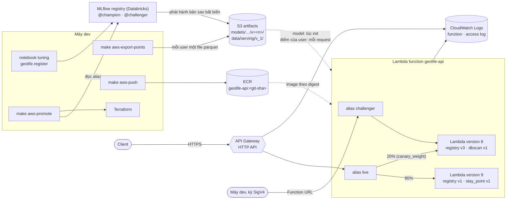
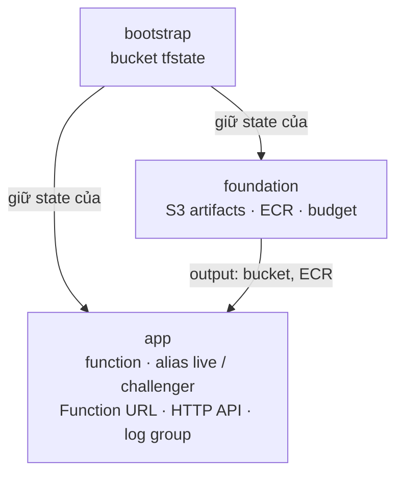

# Hạ tầng AWS Lambda: tổng quan

API dự đoán home / office (`docs/openapi.yaml`) chạy trên AWS Lambda sau API Gateway. Mỗi request đọc điểm GPS của một user từ S3 và chạy một model version đã phát hành từ registry. Trang này vẽ các thành phần, nói mỗi thành phần làm gì và các luồng chính; chi tiết nằm ở các trang khác trong thư mục này.

| Trang | Nội dung |
| --- | --- |
| **overview.md** (trang này) | Kiến trúc, thành phần, các quyết định chính, chi phí, lệnh theo vòng đời |
| [`config_relation.md`](config_relation.md) | Giá trị cấu hình của từng stack Terraform: tài nguyên, biến, quyền, output, lệnh `make` |
| [`request_flow.md`](request_flow.md) | Một request đi qua API Gateway, Lambda, handler, FastAPI: từng khâu nhận gì, trả gì |
| [`serving_data.md`](serving_data.md) | Dữ liệu điểm cho API: bố cục mỗi user một file parquet trên S3, cách dựng, cách đọc |
| [`deployment.md`](deployment.md) | Phát hành code và model: Lambda version, alias, `make aws-promote` |
| [`deploy_strategies.md`](deploy_strategies.md) | Blue-green, canary, shadow; runbook canary trên Lambda alias và kết quả đo |
| [`sizing.md`](sizing.md) | Số đo RAM, pha init, thời gian request dùng để chọn cỡ function |
| [`knowledges.md`](knowledges.md) | Kiến thức nền: parquet trên S3, execution environment, version / alias, HTTP API, canary, cold start |

Phương án trước đó (ECS Fargate + RDS) ở [`../fargate/`](../fargate/overview.md), code ở nhánh `fargate`.

## 1. Kiến trúc



Trạng thái trong sơ đồ là trạng thái đang deploy: alias `live` chạy registry v1 và chia 20% request sang registry v3 (canary), alias `challenger` trỏ vào registry v3.

## 2. Thành phần

| Thành phần | Làm gì | Tạo bởi |
| --- | --- | --- |
| **API Gateway HTTP API** | URL HTTPS công khai; throttling 10 request/giây (burst 20); access log; chuyển mọi request tới alias `live` dưới dạng event JSON (payload v2) | Stack `app`, `api.tf` |
| **Function `geolife-api`** | Chạy image của API (arm64, 2 048 MB, timeout 29 giây). Trần 10 request chạy cùng lúc (reserved concurrency) | Stack `app`, `function.tf` |
| **Lambda version** | Bản chụp bất biến của function: một image (theo digest) và một `MODEL_URI` (một registry version). Đánh số tăng dần, không sửa, không xoá | Lambda đóng mỗi khi cấu hình của function đổi (`publish = true`) |
| **Alias `live`** | Tên mà API Gateway gọi. Trỏ vào Lambda version của `@champion`; khi có `@challenger`, chia `canary_weight` % số lần gọi sang version của nó | Stack `app`; version do `make aws-promote` chọn |
| **Alias `challenger` + Function URL** | Trỏ vào Lambda version của `@challenger` (không có thì trùng `live`). Function URL dùng `AWS_IAM`: chỉ request ký SigV4 bằng credential trong tài khoản mới gọi được | Stack `app` |
| **Image `geolife-api`** | Python 3.12 slim + thư viện serve + `geolife_api`; `awslambdaric` nhận event, Mangum chuyển event thành request cho app FastAPI | `docker/api.Dockerfile`, `make aws-push` |
| **S3 `models/<model>/v=<n>/`** | Bản sao bất biến của registry version n (thư mục MLflow model, có code thuật toán) + `manifest.json`. Function nạp model từ đây, không gọi Databricks | `geolife.publish`, tự chạy trong `make aws-promote` |
| **S3 `data/serving/v_1/`** | Điểm GPS, mỗi user một file parquet sort theo thời gian + `manifest.json` | `make aws-export-points` |
| **Registry trên Databricks** | Nơi đăng ký model version; alias `@champion` / `@challenger` quyết định version nào được deploy | Notebook tuning |
| **CloudWatch Logs** | `/aws/lambda/geolife-api` (log JSON của function, 30 ngày) và `/aws/apigateway/geolife-api` (access log, 14 ngày); metric của Lambda tách theo `ExecutedVersion` | Stack `app` |
| **Bucket state, ECR, budget** | Terraform state; kho image; email khi chi phí tháng vượt 50% / 100% của 20 USD | Stack `bootstrap`, `foundation` |

Không có VPC, load balancer, database hay thành phần nào chạy theo giờ: khi không có request, hệ thống chỉ tốn tiền lưu trữ.

## 3. Code nằm đâu, chạy ở đâu

| Thư mục / file | Vai trò | Chạy ở đâu |
| --- | --- | --- |
| `src/geolife_api/` | App FastAPI (`main`, `service`, `schemas`, `errors`), nạp model (`model`), nguồn điểm (`points.S3PointStore`), handler Lambda (`lambda_handlers`), dựng dữ liệu điểm (`export_points`) | Trong image trên Lambda; `make api` ở local |
| `src/geolife/` | Code thuật toán; `register` (đăng ký vào registry), `publish` (sao sang S3) | Máy dev. Code thuật toán lên Lambda bên trong thư mục MLflow model, không nằm trong image |
| `docker/api.Dockerfile` | Image của API | `make aws-build` / `aws-push` |
| `scripts/promote.py` | Đọc alias registry, phát hành lên S3, chọn Lambda version cho alias `live` / `challenger` | Máy dev |
| `scripts/canary_check.py` | Gửi request qua HTTP API, thống kê theo Lambda version, kiểm điều kiện chốt canary | Máy dev |
| `scripts/measure_lambda_memory.py`, `measure_lambda_latency.py` | Đo RAM của image dưới giới hạn của function; đo cold start và thời gian request trên Lambda | Máy dev |
| `infra/bootstrap`, `infra/foundation`, `infra/app` | Ba stack Terraform | Máy dev |
| `Makefile` | Lối vào của mọi lệnh: `make <lệnh>` cho local, `make aws-*` / `make tf-*` cho AWS | Máy dev |

## 4. Các stack Terraform



| Stack | Tính phí | Vòng đời |
| --- | --- | --- |
| `bootstrap` | ~0 | Tạo một lần; state ở local |
| `foundation` | Lưu trữ S3 / ECR | Luôn bật |
| `app` | Theo request (Lambda, API Gateway) và theo dung lượng log | Luôn bật; không phải dựng / huỷ mỗi phiên |

## 5. Các luồng chính

**Phục vụ một request** ([`request_flow.md`](request_flow.md)):

```
Client ─► API Gateway (throttling) ─► alias live ─► chọn Lambda version theo trọng số
      ─► environment đang rảnh của version đó (không có thì dựng mới: pha init nạp model từ S3)
      ─► handler ─► FastAPI ─► đọc file parquet của user trên S3 ─► model ─► JSON
```

**Phát hành** ([`deployment.md`](deployment.md)):

```
code mới:  git commit ─► make aws-push ─► make aws-promote   (đóng Lambda version mới với image mới, cùng model)
model mới: gắn alias trên registry ─► make aws-promote        (phát hành lên S3 nếu thiếu, chọn / đóng Lambda version, dán alias)
```

**Canary** ([`deploy_strategies.md`](deploy_strategies.md)): gắn `@challenger` → `make aws-promote` → alias `live` chia `canary_weight` % sang version mới → `make aws-canary-check` → chốt (`@challenger` lên `@champion`) hoặc huỷ (xoá `@challenger`), rồi `make aws-promote`.

**Tạm dừng:** `make aws-pause` đặt reserved concurrency của function về 0, mọi request nhận `503` ngay; `make aws-resume` bật lại.

## 6. Các quyết định chính

| Quyết định | Chọn | Thay cho | Lý do |
| --- | --- | --- | --- |
| Compute | Lambda, container image arm64, ngoài VPC | ECS Fargate | Không tính tiền khi không có request, không phải dựng / huỷ mỗi phiên; mỗi environment xử lý một request nên request nặng không tranh RAM của nhau. Image vì thư viện vượt 250 MB của gói zip |
| Dữ liệu điểm | Mỗi user một file parquet trên S3 | RDS Postgres | Lambda nối RDS phải vào VPC, kéo theo VPC endpoint hoặc NAT. User lớn nhất nhanh hơn khoảng 3 lần (61 MB parquet thay cho 173 MB CSV từ RDS, [`sizing.md`](sizing.md) L7) |
| Cổng HTTP | API Gateway HTTP API | Function URL, ALB | Có throttling, access log, trỏ được vào alias; không tính theo giờ như ALB. Giới hạn 30 giây mỗi request, xa request nặng nhất (~4,5 giây) |
| Chạy FastAPI | Mangum + `awslambdaric` | Lambda Web Adapter, base image của AWS | Handler Python tường minh, cùng app FastAPI ở local và trên Lambda; image ở local và trên AWS giống nhau |
| Deploy model | Lambda version bất biến + alias, trọng số canary đặt bằng biến Terraform | CodeDeploy | Thấy rõ cơ chế, dừng quan sát bao lâu tuỳ ý, rollback là dán lại alias lên version cũ |
| RAM | 2 048 MB | 1 769 / 3 008 MB | Request lớn nhất dùng 1,5 GB; thêm RAM không làm request hay pha init nhanh hơn ([`sizing.md`](sizing.md)) |

## 7. Chi phí

Đơn giá ước tính ở Singapore, chưa trừ hạn mức miễn phí; kiểm lại bằng AWS Pricing Calculator.

| Thành phần | Đơn giá | Ví dụ |
| --- | --- | --- |
| Lambda arm64 | ~0,0000134 USD/GB-giây + 0,2 USD/triệu request; pha init cũng tính | Request của user trung vị (2 GB × ~0,3 giây) ≈ 0,000008 USD; của user lớn nhất (2 GB × ~4,5 giây) ≈ 0,00012 USD |
| API Gateway HTTP API | ~1–1,3 USD/triệu request | |
| CloudWatch Logs | ~0,7 USD/GB ghi vào | |
| S3, ECR | ~0,025 USD/GB/tháng; ~0,1 USD/GB/tháng | Dữ liệu điểm ~0,63 GB, model, vài image |

**Trần chi phí khi URL bị gọi liên tục:** reserved concurrency 10 × 2 GB × 3 600 giây ≈ 1 USD/giờ. Budget 20 USD/tháng ở `foundation` gửi email ở 50% và 100%.

Bẫy chi phí đã chặn trong cấu hình:

- Log group do Lambda tự tạo giữ log vĩnh viễn: hai log group được tạo trước bằng Terraform với retention.
- URL của HTTP API là công khai (chưa có xác thực): throttling của stage, reserved concurrency và `make aws-pause` giới hạn thiệt hại. URL không ghi vào repo.

## 8. Lệnh theo vòng đời

| Khi nào | Lệnh |
| --- | --- |
| Một lần | `make tf-init S=<stack>` → `make tf-apply S=<stack>` cho `bootstrap`, `foundation`; `make tf-init S=app`; `make aws-export-points` |
| Đầu phiên | `aws login --profile geolife-dev` |
| Có code mới | Commit → `make aws-push` → `make aws-promote` |
| Có model mới / đổi alias trên registry | `make aws-promote` |
| Đổi RAM, timeout, biến môi trường | Sửa `variables.tf` → `make aws-promote` |
| Đổi tỉ lệ canary, throttling, reserved concurrency | Sửa tfvars / biến → `make aws-deploy` |
| Kiểm tra | `make aws-smoke`; `API_URL=$(make -s aws-url) uv run pytest -m integration`; `make aws-canary-check` |
| Gọi thẳng version mới | `make aws-call-challenger P=/v1/users/5/predictions` |
| Chặn mọi request / bật lại | `make aws-pause` / `make aws-resume` |
