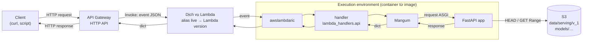

# Một request đi qua API Gateway, Lambda và FastAPI

Trang này theo một request cụ thể từ lúc client gửi tới lúc nhận kết quả, nói rõ mỗi khâu nhận gì, làm gì, trả gì. Code: [`src/geolife_api/lambda_handlers.py`](../../../src/geolife_api/lambda_handlers.py) (handler), [`docker/api.Dockerfile`](../../../docker/api.Dockerfile) (image), [`src/geolife_api/main.py`](../../../src/geolife_api/main.py) (app FastAPI). Function, alias và API Gateway được tạo bằng Terraform ở stack `infra/app`.

## 1. Lambda và FastAPI làm hai việc khác nhau

Lambda là **nơi chạy code**, FastAPI là **code được chạy**. Hai thứ không thay thế nhau.

- **Lambda** là dịch vụ tính toán: khi có việc, nó bật một môi trường chạy (execution environment) từ image, gọi một hàm Python với dữ liệu đầu vào là một dict, rồi lấy dict trả về. Lambda không biết HTTP, không biết route `/v1/users/{id}/predictions`, không kiểm tham số, không biết định dạng lỗi của contract.
- **FastAPI** là app HTTP của dự án: khớp route, kiểm `user_id`, `start`, `end`, gọi `service.predict_user`, trả lỗi theo `docs/openapi.yaml`. FastAPI không biết nó đang chạy ở đâu.

So với lúc chạy ở local, Lambda và các khâu đi kèm đóng đúng vai trò của uvicorn:

| Vai trò | Local (`make api`) | AWS |
| --- | --- | --- |
| Nhận kết nối HTTP từ client | uvicorn | API Gateway |
| Bật process Python, giữ nó sống giữa các request | uvicorn | Lambda (execution environment) |
| Đổi request HTTP thành request ASGI cho app | uvicorn | API Gateway đổi HTTP thành event JSON, Mangum đổi event thành request ASGI |
| Xử lý request: route, kiểm tham số, đọc điểm, chạy model, định dạng lỗi | **FastAPI** | **FastAPI** (cùng code) |

Vì vậy "gọi Lambda" nghĩa là nhờ AWS chạy code; code đó chính là app FastAPI, được bọc trong một hàm (`handler`) mà Lambda gọi được. Giữ FastAPI thay vì viết route bằng tay trong handler cho phép dùng chung một app cho local và AWS, và chạy được cùng bộ test contract (schemathesis) trên cả hai.

## 2. Các khâu



| Khâu | Là gì | Ai cấu hình / viết |
| --- | --- | --- |
| API Gateway (HTTP API) | Dịch vụ AWS: URL HTTPS công khai, giới hạn tốc độ, đổi HTTP ↔ event | Terraform `infra/app/api.tf` |
| Dịch vụ Lambda | Phần điều phối của AWS: chọn Lambda version theo alias, chọn hoặc tạo environment, giao event | Terraform `infra/app/function.tf` (function, alias, RAM, timeout, biến môi trường) |
| Execution environment | Một container chạy image của API; xử lý một request tại một thời điểm, được giữ lại để dùng cho request sau | Image: `docker/api.Dockerfile` |
| `awslambdaric` | Runtime interface client: vòng lặp trong container hỏi Lambda có event mới không, gọi handler, gửi kết quả về | Thư viện (nhóm `lambda`); `ENTRYPOINT` của image |
| `handler` | Hàm `geolife_api.lambda_handlers.api(event, context)` | Code của dự án |
| Mangum | Adapter: event của API Gateway ↔ request / response ASGI | Thư viện (nhóm `lambda`) |
| FastAPI app | Route, kiểm tham số, `service.predict_user`, định dạng lỗi | Code của dự án (`main.py`, `service.py`) |

## 3. Ví dụ: `POST /v1/users/5/predictions?start=2009-01-01T00:00:00Z`

### Bước 1. Client gửi HTTP

```bash
curl -X POST "https://abc123.execute-api.ap-southeast-1.amazonaws.com/v1/users/5/predictions?start=2009-01-01T00:00:00Z"
```

`abc123` là id của HTTP API. Client chỉ thấy một endpoint HTTPS; nó không biết phía sau là Lambda.

### Bước 2. API Gateway đổi request thành event và gọi Lambda

1. Kết thúc TLS, kiểm giới hạn tốc độ (vượt thì trả `429` ngay, request không tới Lambda).
2. Khớp route `$default` (mọi method, mọi path); route này nối với alias `live` của function `geolife-api`.
3. Đóng gói request thành event JSON (payload format 2.0):

```json
{
  "version": "2.0",
  "routeKey": "$default",
  "rawPath": "/v1/users/5/predictions",
  "rawQueryString": "start=2009-01-01T00:00:00Z",
  "queryStringParameters": {"start": "2009-01-01T00:00:00Z"},
  "headers": {"host": "abc123.execute-api.ap-southeast-1.amazonaws.com", "user-agent": "curl/8.7.1"},
  "requestContext": {
    "http": {"method": "POST", "path": "/v1/users/5/predictions", "sourceIp": "203.0.113.7"},
    "requestId": "Xyz123=",
    "stage": "$default"
  },
  "isBase64Encoded": false
}
```

4. Gọi Lambda **đồng bộ**, một lần, với event nằm trong lời gọi (`Invoke`, function `geolife-api`, qualifier `live`), rồi chờ kết quả tối đa 30 giây.

### Bước 3. Dịch vụ Lambda chọn environment

Dịch vụ Lambda giữ event trong lúc:

1. Đổi alias `live` thành một Lambda version (bản chụp bất biến của image + cấu hình, gồm `MODEL_URI` của một registry version). Khi đang chạy canary, alias chia traffic theo trọng số giữa hai Lambda version.
2. Tìm một execution environment đang rảnh của Lambda version đó.
   - **Có (warm):** dùng luôn, sang bước 4.
   - **Không có (cold start):** tạo environment mới và chạy **pha init** trước:

```
Lambda khởi động container từ image trong ECR, đặt biến môi trường của Lambda version:
  MODEL_URI  = s3://geolife-<account_id>-artifacts/models/geolife_home_office/v=1/model
  POINTS_URI = s3://geolife-<account_id>-artifacts/data/serving/v_1
ENTRYPOINT: python -m awslambdaric geolife_api.lambda_handlers.api
  awslambdaric import geolife_api.lambda_handlers rồi lấy thuộc tính `api` → lambda_handlers._init():
    1. Settings() đọc MODEL_URI, POINTS_URI
    2. ModelLoader(MODEL_URI) mở thread nền: tải thư mục MLflow model từ S3, nạp, chạy thử một lần (numba biên dịch)
    3. Trong lúc đó, ở luồng chính: S3PointStore(POINTS_URI) tạo boto3 client;
       create_app(state=State(store)) dựng app FastAPI; Mangum(app, lifespan="off") bọc trong handler
    4. Chờ thread nạp model tới INIT_BUDGET_S = 8,5 giây kể từ lúc import module, rồi kết thúc pha init
       (model xong thì gắn vào State; chưa xong thì request đầu tiên chờ phần còn lại)
```

Pha init chạy **một lần cho mỗi environment**; model ở lại trong RAM cho mọi request sau của environment đó.

Pha init của function on-demand có trần 10 giây. Quá trần thì Lambda bỏ init đó và chạy lại toàn bộ init trong request đầu tiên, tính vào timeout 29 giây của request. Đo trên Lambda, init mất 7–10 giây ([`sizing.md`](sizing.md), L6), nên handler không để việc nạp model quyết định lúc init kết thúc: hạn 8,5 giây cộng khoảng 0,3 giây trước khi import (khởi động Python, `awslambdaric`) còn dư hơn 1 giây so với trần.

Nạp model lỗi (vd. không đọc được S3) thì thread nạp lại ngay; request đang chờ lúc lỗi xảy ra nhận `503 model_unavailable`, request sau chờ lần nạp mới.

### Bước 4. Environment nhận event, gọi handler

`awslambdaric` chạy một vòng lặp gọi Runtime API của Lambda (một endpoint HTTP nội bộ trong mỗi environment):

```
awslambdaric                                   Dịch vụ Lambda
  GET /2018-06-01/runtime/invocation/next  ──►
                                           ◄──  event (bước 2) + request id + hạn chót
  handler(event, context)
  POST /2018-06-01/runtime/invocation/<id>/response  ──►  dict kết quả (bước 6)
  GET /2018-06-01/runtime/invocation/next  ──►  (environment bị freeze tới khi có event mới)
```

Event được trao khi environment hỏi, nên thứ tự luôn là: environment sẵn sàng (init xong) → nhận event → gọi handler.

`handler` là hàm do `make_handler` tạo. Nó đưa event và `context` (request id, thời gian còn lại) cho Mangum.

### Bước 5. Mangum đổi event thành request ASGI, FastAPI xử lý

Mangum dựng request ASGI, cùng loại uvicorn đưa cho FastAPI ở local:

```python
scope = {
    "type": "http", "method": "POST",
    "path": "/v1/users/5/predictions",
    "query_string": b"start=2009-01-01T00:00:00Z",
    "headers": [(b"host", b"abc123.execute-api.ap-southeast-1.amazonaws.com"), ...],
}
```

FastAPI xử lý như khi chạy bằng uvicorn:

1. Khớp route `POST /v1/users/{user_id}/predictions`; `user_id = 5` là số nguyên không âm.
2. `service.parse_time("start", …)` → `2009-01-01 00:00 UTC`.
3. `store.user_exists(5)` → `HEAD s3://…/data/serving/v_1/points/user=5.parquet` → `200`.
4. `store.fetch_points(5, start)`:
   - GET `Range` 64 KB cuối file: footer, có min / max `ts_utc` của từng row group.
   - Giữ các row group có điểm từ `start` trở đi; GET `Range` phần dữ liệu của chúng.
   - Lọc từng dòng `ts_utc >= start` → DataFrame điểm của user 5.
5. `model.predict(points)`: stay → place → home / office.
6. Response `200`, body JSON theo schema `UserPrediction`.

Chi tiết đường đọc S3: [`serving_data.md`](serving_data.md), mục 5.

### Bước 6. Mangum đổi response thành dict

(Số liệu trong body là minh hoạ.)

```json
{
  "statusCode": 200,
  "headers": {"content-type": "application/json", "x-cold-start": "1"},
  "body": "{\"user_id\":5,\"n_points\":41230,\"time_range\":{...},\"model\":{\"name\":\"stay_point\",\"version\":1},\"home\":{...},\"office\":{...}}",
  "isBase64Encoded": false
}
```

`x-cold-start: 1` do `handler` gắn vào response đầu tiên của mỗi environment, để phía client tách được request có cold start khi đo latency. `awslambdaric` gửi dict này về dịch vụ Lambda (bước 4). Lambda ghi một dòng `REPORT` vào CloudWatch Logs: `Duration`, `Billed Duration`, `Memory Size`, `Max Memory Used`, và `Init Duration` nếu là cold start.

### Bước 7. API Gateway trả HTTP cho client

```
HTTP/2 200
content-type: application/json
x-cold-start: 1

{"user_id":5,"n_points":41230,...}
```

Request tiếp theo tới cùng environment (warm) bắt đầu thẳng từ bước 4: không có init, response không có `x-cold-start`.

## 4. Các trường hợp khác

| Tình huống | Khâu xử lý | Client nhận |
| --- | --- | --- |
| Vượt giới hạn tốc độ của API Gateway | API Gateway (bước 2) | `429`, body của AWS |
| `user_id` không phải số, `start` sai định dạng | FastAPI (bước 5.1–5.2) | `400 invalid_request` theo contract |
| User không có file trên S3 | FastAPI (bước 5.3) | `404 user_not_found` |
| S3 trả lỗi quyền, mất kết nối | `S3PointStore` báo `DataUnavailable` (bước 5.3–5.4) | `503 data_unavailable` |
| Path không có trong contract | FastAPI | `404` |
| Nạp model lỗi (không tải được model) | Handler (bước 3) | `503 model_unavailable` theo contract; thread nạp lại, request sau chờ lần nạp mới |
| Init lỗi vì lý do khác (vd. thiếu biến môi trường) | Dịch vụ Lambda (bước 3) | `500 Internal Server Error` của API Gateway; request sau thử init lại |
| Function chạy quá timeout của nó hoặc vượt RAM | Dịch vụ Lambda | `500 Internal Server Error` của API Gateway |
| Không có kết quả sau 30 giây (giới hạn của API Gateway) | API Gateway | `503 Service Unavailable` của API Gateway |

Ba dòng cuối không đi qua code của dự án, nên không có định dạng lỗi của contract. RAM và timeout của function phải đủ cho request lớn nhất; số đo để chọn ở [`sizing.md`](sizing.md).

## 5. Kiểm tra handler ở local

Handler được kiểm mà không cần AWS: test tạo event giống bước 2 rồi gọi thẳng `handler(event, context)` với nguồn điểm và model giả ([`tests/api/test_lambda_handler.py`](../../../tests/api/test_lambda_handler.py)). Test kiểm mã trả về và body theo contract (health, dự đoán, user không tồn tại, `start` sai định dạng, khoảng thời gian ngược, path lạ) và header `x-cold-start` chỉ có ở response đầu tiên.

Image được kiểm bằng `scripts/measure_lambda_memory.py`: chạy container từ image, nạp model thật từ S3 và gọi handler bằng event HTTP API v2 (cách chạy và kết quả ở [`sizing.md`](sizing.md)).
