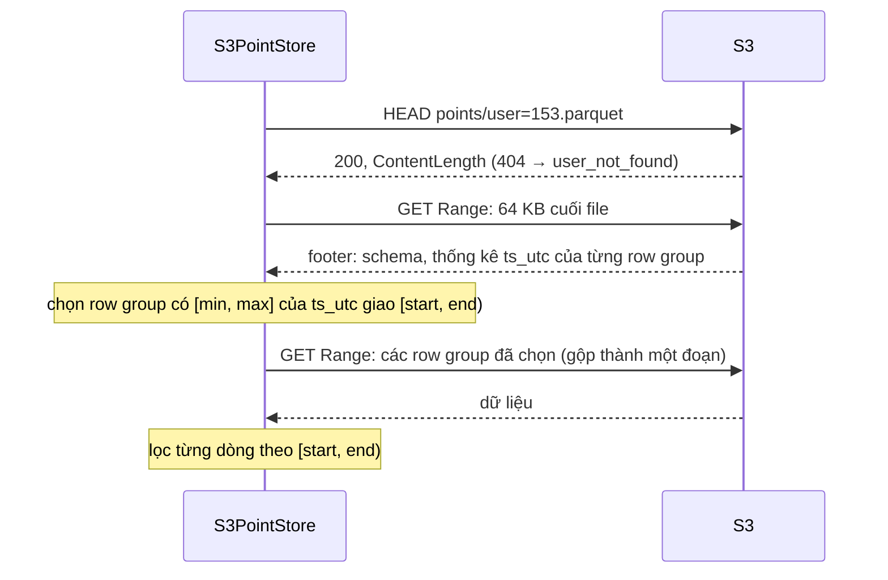

# Dữ liệu điểm GPS cho API

API chạy model trên điểm GPS của một user, nên mỗi request cần đọc nhanh điểm của đúng user đó, có thể lọc theo khoảng thời gian. Trang này mô tả bố cục dữ liệu trên S3, cách dựng và upload, cách API đọc, và số đo dùng để chọn bố cục. Chạy API ở local với dữ liệu này: README, mục "API ở local".

Code: [`src/geolife_api/export_points.py`](../../../src/geolife_api/export_points.py) dựng và upload, [`src/geolife_api/points.py`](../../../src/geolife_api/points.py) đọc (`S3PointStore`).

## 1. API cần gì

| Yêu cầu | Chi tiết |
| --- | --- |
| Đơn vị đọc | Điểm của một user, lọc theo `[start, end)` của `ts_utc` nếu request có `start` / `end` |
| Thứ tự | Sort theo `ts_utc`: thuật toán tìm stay giả định điểm liên tiếp theo thời gian (`geolife.models.base.check_points`) |
| Cột và kiểu | `POINT_COLS` = `user`, `ts_utc`, `ts_local`, `lat`, `lon`, `tz`; khớp signature của model trên registry |
| Phân biệt lỗi | User không tồn tại (`404`) phải khác với không đọc được nguồn (`503`) |

Nguồn là `data/preprocess/v_1/points.parquet`: 24 091 430 điểm của 182 user, sort theo `(user, ts_utc)`, 23 row group (~1 triệu dòng mỗi row group, ~26 MB nén).

## 2. Chọn bố cục

| Cách | Điểm mạnh | Điểm yếu |
| --- | --- | --- |
| Đọc thẳng `points.parquet`, lọc theo thống kê `user` của row group | Không tạo dữ liệu mới | Row group ~1 triệu dòng: user trung vị (35 nghìn điểm) vẫn phải tải và giải nén cả một row group ~26 MB; user lớn nhất trải trên 3 row group |
| **Mỗi user một file parquet, row group nhỏ** | Chỉ tải dữ liệu của user (0,96 MB với user trung vị). Row group 131 072 dòng có thống kê `ts_utc`, nên request có `start` / `end` chỉ đọc các row group liên quan. Đường dẫn suy ra từ `user_id`, không cần chỉ mục | Thêm một bước dựng dữ liệu; 182 file |
| Athena hoặc DuckDB truy vấn S3 | SQL linh hoạt | Athena: mỗi truy vấn trễ vài giây, tính tiền theo dữ liệu quét. DuckDB: thêm thư viện, không lợi hơn pyarrow khi chỉ lọc theo một khoá |

**⇒ Chọn mỗi user một file.**

## 3. Bố cục

Cùng một bố cục ở thư mục local và trên S3; `data_version` trùng với version của preprocess.

```
s3://geolife-<account_id>-artifacts/data/serving/v_1/      (local: data/serving/v_1/)
  points/user=<id>.parquet
  manifest.json
```

**File của một user:**

| Cột | Kiểu | Ghi chú |
| --- | --- | --- |
| `user` | `int16` | Như nguồn; signature của model khai báo `long` nên nhận mọi kiểu số nguyên |
| `ts_utc`, `ts_local` | `timestamp[us]` | Không mang múi giờ; `ts_utc` là UTC |
| `lat`, `lon` | `double` | |
| `tz` | `string` | Nguồn lưu dạng dictionary; signature của model không nhận category nên ghi dạng chuỗi (parquet vẫn mã hoá dictionary khi lưu) |

- Nén zstd, row group 131 072 dòng, có thống kê min / max của từng cột.
- Thứ tự dòng giữ nguyên như trong `points.parquet`. Bước dựng kiểm tra nguồn đã sort theo `(user, ts_utc)` và dừng với lỗi nếu không, nên mỗi file sort theo `ts_utc`, còn các điểm trùng `ts_utc` giữ đúng thứ tự như khi chạy hàng loạt (`results/`). Nhờ vậy kết quả của API khớp chính xác `results/`.

**`manifest.json`:**

| Trường | Nội dung |
| --- | --- |
| `data_version` | Version của preprocess nguồn |
| `source` | Đường dẫn và SHA-256 của `points.parquet` nguồn |
| `format` | `compression`, `row_group_size` |
| `schema` | Kiểu của từng cột |
| `n_users`, `n_points` | Tổng số user, tổng số điểm |
| `users[]` | Mỗi user: `user`, `n_points`, `first_ts`, `last_ts`, `size`, `sha256` của file |
| `built_at` | Thời điểm dựng (UTC) |

## 4. Dựng và upload

```bash
make serving-points       # dựng data/serving/v_1/ từ data/preprocess/v_1/ ở local
make aws-export-points    # dựng (nếu chưa có) rồi upload lên S3
```

Bản dựng được ghi một lần, như bản phát hành model trên S3: các file của user ghi trước, `manifest.json` ghi sau cùng. Có manifest thì bản dựng mới hoàn chỉnh. Một lần chạy bị ngắt giữa chừng (vd. mất kết nối khi upload) để lại các file nhưng không có manifest; chạy lại thì ghi lại các file từ đầu rồi mới ghi manifest.

| Lệnh | Trạng thái đích | Hành vi |
| --- | --- | --- |
| `build` | Chưa có `manifest.json` | Dựng toàn bộ, ghi manifest sau cùng (mở file ở mode `x`: hai lần dựng song song thì lần sau báo lỗi) |
| `build` | Có manifest, cùng SHA-256 nguồn và cùng định dạng | Báo đã có, không ghi gì |
| `build` | Có manifest, khác nguồn hoặc định dạng | Dừng với lỗi: dữ liệu khác thì dùng data version mới |
| `upload` | Trên S3 chưa có manifest | Kiểm SHA-256 từng file ở local với manifest, upload 8 file song song kèm `ChecksumSHA256` (S3 kiểm lại phía server), rồi ghi manifest bằng conditional write (`If-None-Match: *`) |
| `upload` | Trên S3 đã có manifest, cùng SHA-256 mọi file | Báo đã có, không ghi gì |
| `upload` | Trên S3 đã có manifest, khác nội dung | Dừng với lỗi |

## 5. Cách API đọc

`S3PointStore(uri)` nhận `s3://<bucket>/<prefix>` hoặc một thư mục local, chọn bằng biến `POINTS_URI`. Hai trường hợp dùng chung một đường đọc; chỉ khác lớp lấy byte.



- **Đọc theo `Range`.** `S3ObjectFile` là file object có `seek`, mỗi lần pyarrow đọc là một GET có `Range`; `pre_buffer=True` gộp các column chunk liền nhau, nên mỗi request tốn 2–3 GET. Đọc bằng boto3 thay cho `pyarrow.fs.S3FileSystem` vì lý do credential ([`knowledges.md`](knowledges.md) mục 2).
- **Phụ thuộc.** `geolife_api.points` không import `geolife`: image của API chỉ chứa `geolife_api`. Bố cục (`MANIFEST`, `user_file`) định nghĩa ở đây, `export_points` dùng lại.

**Lỗi và mã trả về:**

| Tình huống | `S3PointStore` | API |
| --- | --- | --- |
| Không có file của user | `user_exists` trả `False` | `404 user_not_found` |
| Có file, không có điểm trong `[start, end)` | DataFrame rỗng | `404 no_points` |
| S3 trả lỗi khác 404 (thiếu quyền, `403`), mất kết nối, file hỏng | `DataUnavailable` | `503 data_unavailable` |
| `GET /v1/health` | `ping`: đọc và parse được `manifest.json` | `data_available` |

Phân biệt được `404` với `503` cần `s3:ListBucket` trên prefix `data/serving/` ([`knowledges.md`](knowledges.md) mục 3).

## 6. Số đo

Đo ngày 2026-11-25, Mac Apple Silicon, pyarrow 26.0.0.

### D1. Bản dựng

| | |
| --- | --- |
| Số file | 182 (một file mỗi user) |
| Tổng số điểm | 24 091 430, bằng nguồn |
| Tổng kích thước | 633,7 MB (nguồn `points.parquet`: 604,8 MB) |
| Kích thước một file | Nhỏ nhất 2,5 KB, trung vị 0,90 MB, lớn nhất 61,0 MB (user 153) |
| Thời gian dựng ở local | 6,2 giây |
| RAM đỉnh khi dựng | 1,85 GB (đọc cả bảng nguồn vào RAM rồi cắt theo user, không copy) |

### D2. Byte và số GET mỗi request

**Cách đo:** `S3PointStore` với một S3 giả đọc từ thư mục `data/serving/v_1/` trên đĩa, đếm số lần `get_object` và tổng byte trả về. Không qua mạng, nên chỉ dùng số GET và số byte; thời gian đọc thật trên S3 phụ thuộc đường mạng. "1 tháng" là `[first_ts, first_ts + 1 tháng)` của user.

| User | Khoảng | Số điểm trả về | Row group đọc / tổng | GET | Byte tải | Kích thước file |
| --- | --- | --- | --- | --- | --- | --- |
| 83 (trung vị) | Toàn bộ | 34 960 | 1 / 1 | 2 | 0,96 MB | 0,90 MB |
| 83 | 1 tháng | 14 888 | 1 / 1 | 2 | 0,96 MB | |
| 14 (phân vị 90) | Toàn bộ | 388 211 | 3 / 3 | 2 | 9,92 MB | 9,9 MB |
| 14 | 1 tháng | 106 334 | 1 / 3 | 2 | 3,34 MB | |
| 153 (lớn nhất) | Toàn bộ | 2 156 929 | 17 / 17 | 3 | 61,0 MB | 61,0 MB |
| 153 | 1 tháng | 1 523 | 1 / 17 | 2 | 3,49 MB | |

**Output cho thấy:**

- Mỗi request tốn 2–3 GET bất kể số row group: một GET lấy footer, phần dữ liệu được gộp thành một hoặc hai đoạn.
- Byte tải xấp xỉ kích thước file khi đọc toàn bộ; với user nhỏ, lần đọc footer (64 KB cuối file) đã phủ gần hết file nên tổng byte nhỉnh hơn kích thước file.
- Lọc theo khoảng thời gian giảm byte tải theo số row group: user 153 đọc 1 tháng chỉ tải 1 trên 17 row group (3,5 MB thay vì 61 MB). Đơn vị nhỏ nhất là một row group (~3,5 MB với user 153), nên user nhỏ hơn một row group không lợi gì từ lọc thời gian.
