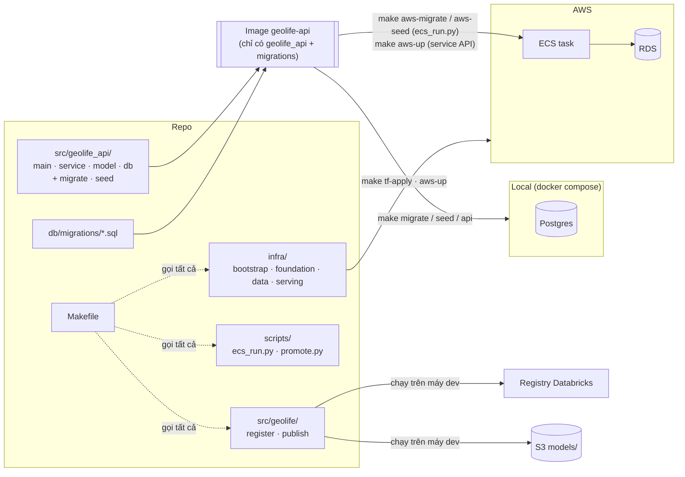
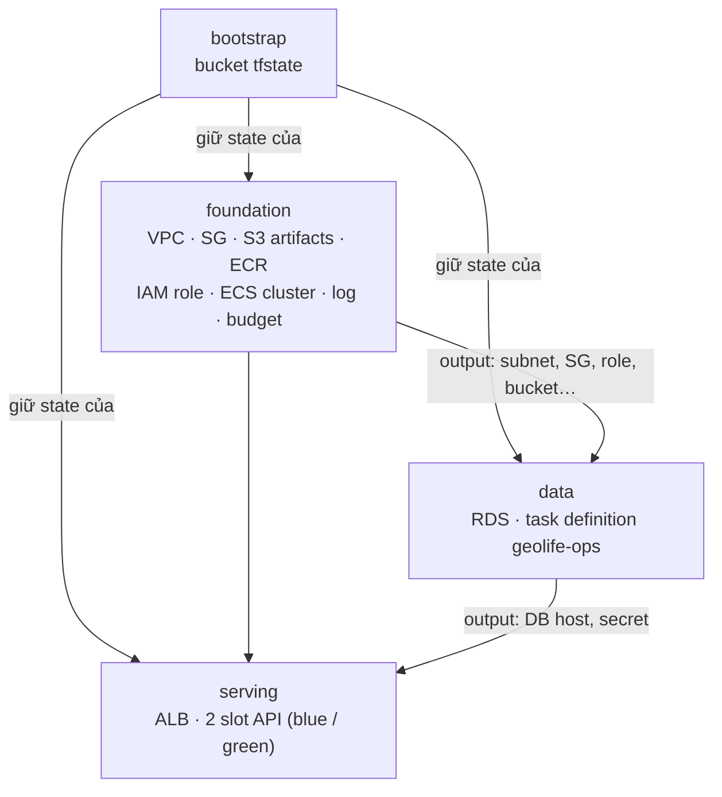
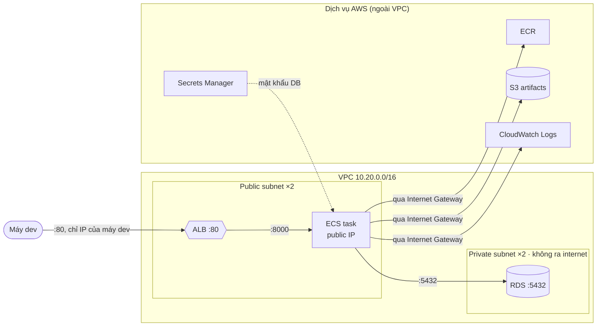
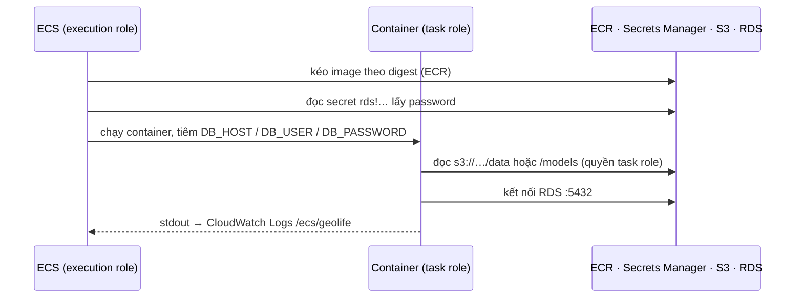
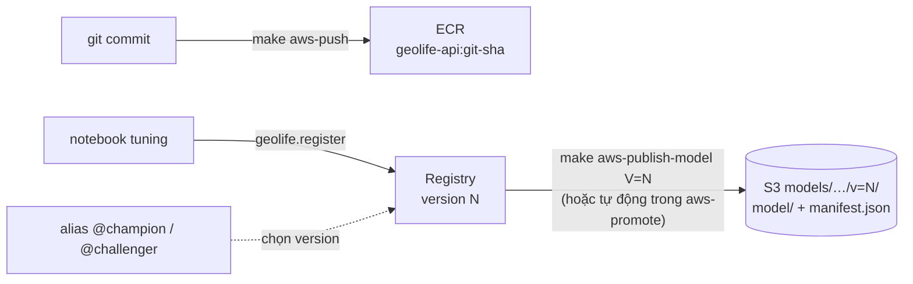
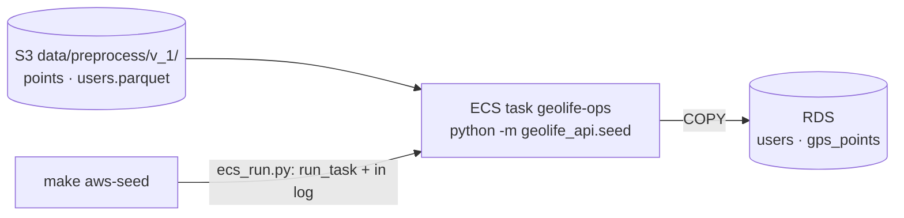
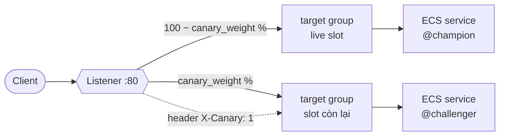
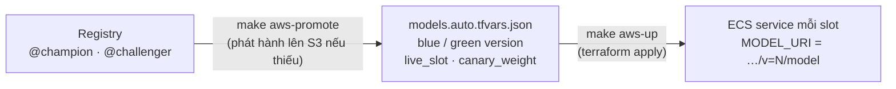

# Hạ tầng AWS: tổng quan

Trang này vẽ các thành phần và quan hệ giữa chúng. Giá trị cấu hình của từng stack (CIDR, quyền IAM, cỡ RDS, health check…) ở [`config_relation.md`](config_relation.md); số đo RAM / thời gian ở [`../task_sizing.md`](../task_sizing.md); các concept nền (state, IAM role, S3 versioning, SQS, health check, rolling update…) ở [`knowledges.md`](knowledges.md).

## 1. Code nằm đâu, chạy ở đâu

Cùng một code Python chạy ở hai nơi; chỉ khác **cái khởi chạy nó**.

| Thư mục / file | Vai trò | Chạy ở đâu |
| --- | --- | --- |
| `src/geolife_api/` | API (`main`, `service`, `model`, `db`) và hai lệnh DB (`migrate`, `seed`) | Trong image: compose ở local, ECS trên AWS |
| `db/migrations/` | Schema Postgres | Được `migrate` đọc, có trong image |
| `src/geolife/register.py`, `publish.py` | Đăng ký model vào registry; sao một version sang S3 | Máy dev (cần code thuật toán + token Databricks) |
| `scripts/ecs_run.py` | Chạy một lệnh bất kỳ của image thành ECS task một lần, in log | Máy dev, điều khiển AWS |
| `scripts/promote.py` | Đọc alias `@champion` / `@challenger`, ghi version của từng slot vào `infra/serving/models.auto.tfvars.json` | Máy dev |
| `infra/<stack>/` | Terraform, mỗi thư mục một stack | Máy dev |
| `Makefile` | Lối vào duy nhất: `make <lệnh>` cho local, `make aws-*` / `make tf-*` cho AWS | Máy dev |

`migrate` và `seed` nằm trong package API vì chúng phải có trong image để chạy được bên trong VPC (RDS không mở ra internet).

## 2. Các stack Terraform

Chia theo **vòng đời và chi phí**. Stack sau đọc output của stack trước qua `terraform_remote_state`.

| Stack | Tính phí | Vòng đời |
| --- | --- | --- |
| `bootstrap` | ~0 | Tạo một lần; state ở local |
| `foundation` | ~0 (lưu trữ S3 / ECR) | Luôn bật |
| `data` | RDS theo giờ khi chạy, ổ đĩa luôn tính | Stop RDS sau mỗi phiên |
| `serving` | ALB + task theo giờ | Destroy sau mỗi phiên, dựng lại khi cần |

`serving` được dựng và huỷ theo từng phiên nên không giữ dữ liệu gì: mọi thứ nó cần (image, model, DB) nằm ở các stack trước.

## 3. Mạng và ai nói chuyện với ai

Chuỗi security group: `alb` → `task` → `rds`; mỗi nhóm chỉ nhận từ nhóm đứng trước. Rule cho traffic vào ALB nằm ở stack `serving` (nguồn là IP của máy chạy `make aws-up`, đổi theo mạng). Không có NAT: task ra internet bằng public IP của chính nó.

## 4. Một task khởi động như thế nào

Hai role, hai việc khác nhau:

- **Execution role:** quyền của ECS *trước khi* code chạy (image, secret, log).
- **Task role:** quyền của code *trong* container (S3). Không ghi được `models/`.
- Không có access key nào nằm trong image hay biến môi trường.

## 5. Phát hành và nạp dữ liệu

**Phát hành**: chạy trên máy dev, tạo ra thứ bất biến có số version.

**Nạp dữ liệu**: `make aws-seed`.

## 6. Phục vụ: hai slot blue / green

Stack `serving` có hai **slot**, `blue` và `green`. Mỗi slot là một target group của ALB, cộng một ECS service chạy đúng một model version. Task nạp model từ `s3://…/models/<model>/v=<N>/model` lúc khởi động, rồi mỗi request đọc điểm GPS từ RDS.

- **Live slot** (`live_slot`) phục vụ `@champion`. Slot còn lại chạy `@challenger` nếu có; không có thì slot đó không có service.
- **Canary**: listener chia traffic theo `canary_weight`. Request có header `X-Canary: 1` luôn tới slot còn lại, nên gọi thử được version mới khi trọng số còn bằng 0.
- **Task chạy theo số version, không theo alias.** Đổi alias trên registry không ảnh hưởng task đang chạy cho tới lần promote sau. Số version của từng slot nằm trong `infra/serving/models.auto.tfvars.json`, file này được commit nên git log của nó là lịch sử deploy.

Từ alias tới task:

Khi canary lên 100% và alias được chuyển (`@challenger` thành `@champion`), `aws-promote` đổi `live_slot` sang slot đó và dừng slot cũ. Quy tắc đầy đủ ở docstring của [`scripts/promote.py`](../../scripts/promote.py).

## 7. Lệnh theo vòng đời

| Khi nào | Lệnh |
| --- | --- |
| Một lần | `make tf-init S=<stack>` → `make tf-apply S=<stack>` (bootstrap → foundation → data); `make tf-init S=serving` |
| Có code mới | `make aws-push` (từ chối khi còn thay đổi chưa commit) |
| Có model mới | Gắn alias trên registry → `make aws-promote` (hoặc `ARGS=--champion-only`) |
| Lần đầu có RDS | `make aws-migrate`, `make aws-seed` |
| Đầu phiên | `aws login --profile geolife-dev`, `make aws-up` (start RDS, dựng ALB + service, in URL) |
| Kiểm tra | `make aws-smoke`, `API_URL=$(make -s aws-url) uv run pytest -m integration` |
| Cuối phiên | `make aws-down` (destroy serving rồi stop RDS) |
| Kiểm nhanh | `make aws-whoami`, `make aws-db-count`, `make aws-url` |
