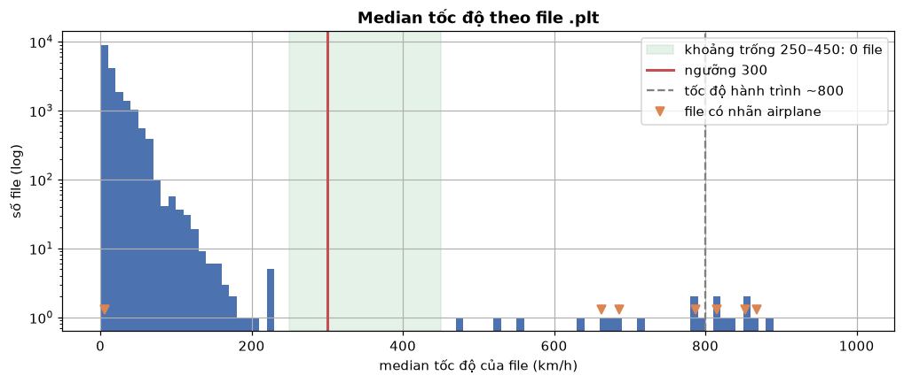

# Preprocess v_1: quy tắc làm sạch và bằng chứng

Tài liệu này ghi lại các quy tắc của preprocess v_1. Mỗi quy tắc gồm bốn phần:
1. **Vấn đề:** dữ liệu sai ở đâu.
2. **Quy tắc và ngưỡng:** xử lý thế nào.
3. **Bằng chứng:** vì sao chọn ngưỡng đó, có số liệu tái lập được.
4. **Tác động:** bao nhiêu dữ liệu bị ảnh hưởng.

Nguồn số liệu:

| Ký hiệu | Nguồn |
| ---     | ---   |
| EDA mục n | Mục n của [Tổng kết EDA](eda_findings.md) |
| PP-n | Bước n của [`preprocess/v_1/preprocess.ipynb`](../preprocess/v_1/preprocess.ipynb). Mỗi bước gồm: hàm được định nghĩa ngay trong notebook, bằng chứng chọn ngưỡng, áp dụng quy tắc, rồi in mẫu kiểm tra |

Tham số nằm ở [`preprocess/v_1/config.yaml`](../preprocess/v_1/config.yaml). Quy ước đánh giá và các giả định nằm ở [evaluation_protocol.md](evaluation_protocol.md).

**Nguyên tắc chung:** mục tiêu là tìm **nơi dừng lâu** (home/office), không phải tái tạo chính xác quỹ đạo. Vì vậy:
- chỉ xoá những điểm chắc chắn sai hoặc chắc chắn không thể là một lần dừng (đang bay);
- một ngưỡng chỉ được chọn khi kết quả **không nhạy** với việc dịch ngưỡng quanh giá trị đó;
- những gì còn mơ hồ thì **đánh dấu, không xoá**.

---

## 1. Tóm tắt pipeline

| Bước | Quy tắc | Tham số | Tác động (PP) |
| --- | --- | --- | --- |
| 1 | Đọc raw, tìm file trùng giữa các user | khoá: tên file + số điểm + điểm đầu + thời điểm cuối | 1.679 file trùng, 52 user thuộc 18 nhóm |
| 2 | Bỏ toạ độ và năm không hợp lệ; bỏ trùng `(user, ts_utc)`, giữ điểm đầu | `lat ∈ [−90, 90]`, năm ≥ 2007 | −4 điểm; −698.900 điểm trùng (2,81%) |
| 3 | Loại file chuyến bay | median tốc độ của file > **300 km/h** | −19 file, −72.863 điểm |
| 4 | Loại file lỗi nặng | spike ≥ 1% **VÀ** ≥ 10 spike | −1 file, −8.091 điểm |
| 5 | Xoá spike A → B → A | v_in, v_out > **150 km/h** và d(A, C) < **0,3** · d(A, B) | −133 điểm |
| 6a | Xoá điểm quá tốc độ ở cả hai phía | v_in, v_out > **400 km/h** | −5.252 điểm |
| 6b | Đánh dấu bước nhảy một phía, không xoá | v_in > 400 km/h | 1.443 điểm có `jump_in = True` |
| 7 | Giờ local theo timezone chính xác của toạ độ, có DST; lịch làm việc chính thức của Trung Quốc | làm tròn toạ độ 4 chữ số (~11 m) | 26 timezone; 9,15% điểm có `is_workday` khác quy tắc T2–T6 |
| 8 | Xếp tier, chia dev/holdout theo nhóm user, chọn mẫu đánh giá thủ công | holdout 30%, seed 42 | 131 / 51 user; mẫu thủ công 28 user |

**Kết quả:**
- Từ 24.876.978 điểm còn **24.091.735 điểm (96,84%)**.
- Từ 18.670 file còn 18.649 file. Đủ 182 user.
- Thời gian chạy khoảng 65 giây.

---

## 2. Quy tắc làm sạch và bằng chứng

### 2.1 Bỏ trùng timestamp (PP-2)

- **Vấn đề:** 698.900 điểm (2,81%) trùng giây với điểm khác. Chỉ 0,59% trùng cả toạ độ (EDA mục 3). Với dt = 0, tốc độ thành vô hạn và làm hỏng mọi quy tắc theo tốc độ ở các bước sau.
- **Quy tắc:** với mỗi `(user, ts_utc)`, giữ điểm xuất hiện đầu tiên.
- **Lý do giữ điểm đầu:** 99,5% điểm trùng giây cách điểm đầu tiên cùng giây dưới 10 m, median 0,5 m (EDA mục 3). Với mục tiêu tìm nơi dừng, chọn điểm nào cũng không đổi kết quả. Giữ điểm đầu là cách đơn giản và tất định.
- **Khoá theo user, không theo file:** hai file của cùng user không bao giờ chồng lấn thời gian (EDA mục 2), nên khoá `(user, ts)` tương đương khoá theo file và còn an toàn hơn.
- **Kiểm tra:** sau bước này không còn dt ≤ 0 (PP-2).

Các lỗi giá trị khác:

| Lỗi | Bằng chứng | Xử lý |
| --- | --- | --- |
| 1 điểm có `lat = 400,17` | Ngoài miền xác định của vĩ độ (PP-2) | Xoá |
| 3 điểm năm 2000 của user 163 | Lỗi đồng hồ thiết bị. Toàn bộ dữ liệu khác nằm trong 2007–2012 (EDA mục 3). Cả file `163_20000101231219` chỉ có 3 điểm này | Xoá. File trở nên rỗng và được ghi `dropped_empty` |
| Altitude | Giá trị −777 xuất hiện ở 0,22% điểm; max 32.767 là tràn kiểu `int16`; p99 khoảng 1 km trong khi Bắc Kinh cao 40–60 m (EDA mục 3) | **Bỏ cột.** Bài toán không cần độ cao, và cột này không đáng tin |

### 2.2 Loại file chuyến bay: tại sao 300 km/h mà không phải 800 km/h (PP-3)



- **Vấn đề:** phần lớn điểm > 300 km/h nằm trong các file bay không có nhãn (EDA mục 15). Điểm GPS lúc đang bay không bao giờ là nơi dừng. Nếu giữ lại, chúng tạo ra spike và tốc độ ảo cho các bước sau.
- **Quy tắc:** loại cả file khi **median tốc độ của file** > 300 km/h.

**Bằng chứng:**

1. **800–900 km/h là tốc độ hành trình, không phải median của một file bay.** Một file bay còn chứa lúc lăn bánh, cất/hạ cánh và thời gian chờ dưới mặt đất, nên median thấp hơn tốc độ hành trình. Ví dụ: file `144_20090324004422` dài 46 giờ có median 677 km/h.
2. **Phân bố median có một khoảng trống tự nhiên.** Không có file nào có median trong khoảng 250–450 km/h (PP-3):
   - phía mặt đất: file cao nhất có median 225 km/h; file có nhãn `train` có median tối đa 206 km/h (p99 = 184);
   - phía chuyến bay: file thấp nhất có median 474 km/h.
3. **Mọi ngưỡng trong khoảng 250–450 cho cùng một kết quả: 19 file.** Vì vậy kết quả không nhạy với việc chọn chính xác 300.
4. **So sánh với nhãn airplane:**

| Ngưỡng | Số file bắt được | Số file có nhãn airplane bắt được |
| --- | --- | --- |
| 300 | 19 | 6/7 |
| 800 | 8 | 3/7, bỏ sót các file có median 663, 686, 787 |

   File có nhãn airplane thứ 7 có median chỉ 6 km/h: phần lớn file là thời gian dưới mặt đất. Đoạn bay của nó được xử lý ở bước 6a (xem 2.5).

### 2.3 Loại file lỗi nặng: điều kiện AND, không phải OR (PP-4)

- **Vấn đề:** spike tập trung trong vài file; riêng một file của user 62 chứa 81% số spike (EDA mục 15). Khi spike dày như vậy, toàn bộ file không còn đáng tin.
- **Quy tắc:** loại cả file khi tỉ lệ spike ≥ 1% **và** số spike ≥ 10.

**Bằng chứng (PP-4):**
- Phân bố số spike trên mỗi file:
  - 99 file có 1 spike;
  - 6 file có 2 spike;
  - 2 file có 3–5 spike;
  - **0** file có 6–10 spike;
  - 2 file có > 10 spike.
- File `62_20080926000623` tách hẳn khỏi phần còn lại: 577 spike trên 8.091 điểm (7,1%).

| Điều kiện | Số file bị loại | Vấn đề |
| --- | --- | --- |
| ≥ 1% **HOẶC** ≥ 10 | 6 | Loại nhầm 4 file ngắn chỉ có 1–3 spike, ví dụ `153_20091129234104`: 3 spike / 252 điểm = 1,19%, và `167_20080512103623`: 1 spike / 5 điểm. Loại nhầm cả `62_20081003000004`: 16 spike nhưng chỉ chiếm 0,37% |
| ≥ 1% **VÀ** ≥ 10 | 1 | Chỉ loại đúng file `62_20080926000623` |

**Lý do dùng AND:**
- Chỉ dùng tỉ lệ thì sẽ phạt file ngắn: 1 spike trong 5 điểm đã là 20%.
- Chỉ dùng số đếm thì sẽ phạt file dài: 16 spike trong 4.271 điểm.
- Một file chỉ được coi là hỏng khi lỗi **vừa nhiều vừa dày**. Các file còn lại chỉ cần xoá điểm spike ở bước 5.

### 2.4 Xoá spike A → B → A (PP-4, PP-5)

- **Vấn đề:** GPS thỉnh thoảng nhảy tới một điểm B ở xa rồi quay về ngay. Ví dụ ở PP-5: điểm B cách A 478 m, 5 giây sau điểm C đã quay về cách A 67 m.
- **Quy tắc:** B là spike khi:
  - tốc độ A→B > 150 km/h;
  - tốc độ B→C > 150 km/h;
  - d(A, C) < 0,3 · d(A, B), tức là C quay về gần A.
- Lặp tối đa 3 lần. Thực tế lần thứ 2 không còn spike nào.
- **Số điểm bị xoá:** ở ngưỡng đã chọn có 710 spike (bảng dưới, khớp EDA mục 15). 577 spike nằm trong file `62_20080926000623` đã bị loại cả file ở bước 4, nên bước 5 chỉ còn xoá 710 − 577 = **133** điểm.

**Bằng chứng (PP-4), độ nhạy của số điểm bị coi là spike:**

| v \ ratio | 0,1 | 0,3 | 0,5 |
| --- | --- | --- | --- |
| 100 km/h | 677 | 951 | 1.196 |
| **150 km/h** | 624 | **710** | 767 |
| 200 km/h | 604 | 620 | 630 |
| 300 km/h | 594 | 595 | 595 |

- **Phần lõi khoảng 600 spike không đổi** dù tăng ngưỡng từ 150 lên 300 km/h. Đây là các cú nhảy lớn, chắc chắn là lỗi.
- Hạ ngưỡng xuống 100 km/h làm số file bị ảnh hưởng tăng vọt (293 file so với 109), tức là bắt đầu chạm vào chuyển động thật.
- **Kiểm tra chéo bằng nhãn:** ở 150/0,3, chỉ có 2 điểm spike rơi vào đoạn có nhãn `train` hoặc `airplane`.
- **Lựa chọn:** 150/0,3 nằm ở vùng ổn định và bắt thêm khoảng 100 cú nhảy cỡ vừa. Phương án chặt hơn là 200/0,3: không có false positive nào theo nhãn, đổi lại bỏ sót 90 điểm.

### 2.5 Điểm quá tốc độ: xoá điểm lạc hai phía, chỉ đánh dấu bước nhảy một phía (PP-6)

- **Vấn đề:** sau bước 5 còn 6.697 điểm có tốc độ vào > 400 km/h, nằm ở 1.039 file. Trong đó 5.252 điểm vượt ngưỡng ở cả hai phía, 1.445 điểm còn lại chỉ vượt ở tốc độ vào.

**Bằng chứng cho ngưỡng 400 (PP-6):** tàu là phương tiện mặt đất nhanh nhất, p99 khoảng 210 km/h (EDA mục 13). Trên dữ liệu đã bỏ spike:

| Phương tiện có nhãn | p99,9 tốc độ | % điểm > 400 |
| --- | --- | --- |
| train | 242 km/h | 0,003% |
| car | 200 km/h | 0,004% |
| subway | 166 km/h | 0,010% |

| Ngưỡng | Số điểm vượt | Trong đó điểm có nhãn `train` |
| --- | --- | --- |
| 250 | 9.277 | 80 |
| 300 | 8.024 | 51 |
| 400 | 6.697 | 17 |

Ngưỡng càng thấp thì càng xoá nhầm nhiều điểm tàu thật. Ở 400, phần điểm tàu thật bị đụng tới gần như bằng 0.

**Lý do xử lý hai loại khác nhau (PP-6):**

| Loại | Số điểm | Đặc điểm | Xử lý |
| --- | --- | --- | --- |
| Hai phía (v_in **và** v_out > 400) | 5.252 | **5.205 điểm thuộc các chuỗi > 20 điểm liên tiếp, chỉ nằm trong 10 file.** Đây là đoạn bay nằm trong file hỗn hợp (mặt đất + bay) mà median của file chưa tới 300. Các điểm này không có nhãn | **Xoá.** Điểm đang bay không thể là nơi dừng |
| Một phía (chỉ v_in > 400) | 1.443 sau khi xoá điểm hai phía và tính lại tốc độ (2 trong 1.445 điểm hết vượt ngưỡng vì điểm hai phía đứng trước chúng đã bị xoá) | Chủ yếu là một điểm đơn lẻ: dt 1–5 s, quãng nhảy median 777 m. Thường là fix đầu tiên sau một gap, bị lệch (ví dụ ở PP-6: sau gap 1.408 s, điểm nhảy 1,28 km trong 8 s rồi đứng yên) | **Đánh dấu `jump_in = True`** và đặt tốc độ của điểm đó thành NaN. Giữ lại vị trí |

**Tại sao không xoá cả bước nhảy một phía:** phiên bản đầu của notebook xoá mọi điểm > 400 rồi lặp lại. Kết quả là **xoá dây chuyền**:
- mỗi lần xoá một điểm, điểm kế tiếp lại thành "quá tốc độ";
- số điểm bị xoá qua 3 vòng là 6.697 → 702 → 444;
- sau 3 vòng vẫn còn tốc độ 57.654 km/h.

Vị trí sau bước nhảy là vị trí đúng, nên chỉ cần cắt liên kết tốc độ tại điểm đó. Sau khi sửa, tốc độ lớn nhất còn lại là 400 km/h.

### 2.6 Giờ local theo timezone chính xác của toạ độ (PP-7)

- **Vấn đề:** timestamp gốc là UTC. Khoảng 2,5% số điểm nằm ngoài UTC+8, có cả timezone có DST như `America/Los_Angeles` (−7/−8). Tra timezone trên lưới thô thì sai offset ở vùng biên giới (EDA mục 7).
- **Quy tắc:**
  - tra timezone bằng `timezonefinder` cho **từng toạ độ duy nhất**, sau khi làm tròn 4 chữ số (~11 m), giống cách làm của EDA;
  - tính offset theo đúng thời điểm của điểm (có DST);
  - `ts_local = ts_utc + offset`.
- **Kiểm tra (PP-7):**
  - 4,66 triệu toạ độ duy nhất, tra mất khoảng 3 giây;
  - 26 timezone, 0 điểm không xác định được timezone;
  - các điểm ở `America/Los_Angeles` có cả hai offset −7 và −8, tức là DST được xử lý đúng.

### 2.7 Lịch làm việc chính thức của Trung Quốc (PP-7)

- **Vấn đề:** Trung Quốc có ngày làm bù, nên quy tắc "T2–T6 là ngày làm việc" sai ở cả hai chiều. Lịch của thư viện `holidays.China` khớp với thông báo chính thức của Quốc khánh 2008 và 2009 (EDA mục 11).
- **Quy tắc:**
  - với điểm thuộc timezone Trung Quốc: `is_workday` lấy theo lịch chính thức, gồm ngày nghỉ lễ và ngày cuối tuần làm bù;
  - với điểm ngoài Trung Quốc: dùng T2–T6.
- **Kiểm tra (PP-7):** in lại lịch quanh hai kỳ Quốc khánh để đối chiếu.
- **Tác động:** 9,15% số điểm có `is_workday` khác với quy tắc T2–T6.

### 2.8 File trùng giữa các user: giữ lại, đánh dấu, và chia tập theo nhóm (PP-1, PP-8)

- **Vấn đề:** 1.679 file (2,97 triệu điểm, khoảng 12% dữ liệu) xuất hiện **y hệt nhau** trong thư mục của nhiều user. Chúng nối 52 user thành 18 nhóm; 11 user có 100% dữ liệu là bản sao (EDA mục 4). PP-1 tìm lại đúng các con số này và in một ví dụ: `0/20090330005208` và `3/20090330005208` có cùng 1.328 điểm, cùng điểm đầu và cùng thời điểm cuối.
- **Quy tắc:**
  - **giữ file ở cả hai user**, vì không xác định được ai là chủ thật (giả định G6);
  - ghi `is_cross_dup` vào `trajectories.parquet` và `dup_share` vào `users.parquet`;
  - chia dev/holdout **theo nhóm** (connected component).
- **Kiểm tra (PP-8):** 0 nhóm nằm ở cả hai phía.
- Chi tiết về cách chia tập ở [evaluation_protocol.md mục 2](evaluation_protocol.md#2-tập-dữ-liệu-dùng-cho-đánh-giá).

---

## 3. Coverage, tier và chia tập (PP-8)

**Coverage của mỗi user:**
- `nights`: số đêm khác nhau có ít nhất một điểm trong khung 22–06 local; đêm được gán cho ngày bắt đầu.
- `workdays`: số ngày làm việc chính thức có ít nhất một điểm trong khung 09–18.

Định nghĩa này giống EDA mục 12.

| Tier | Điều kiện | Số user | Lý do |
| --- | --- | --- | --- |
| A | ≥ 10 đêm **và** ≥ 10 ngày làm việc | 64 | Với 10 đêm, home tìm được trùng kết quả dùng toàn bộ dữ liệu 76%; thêm tới 20 đêm chỉ tăng lên 81% (EDA mục 23) |
| B | ≥ 3 đêm và ≥ 3 ngày làm việc | 43 | Từ 3 đêm, home tìm được trùng đáp án quá nửa số lần (60%), nhưng còn thấp (EDA mục 23) |
| C | còn lại | 75 | Với 1–2 đêm, chỉ trùng 41–52% (EDA mục 23) |

Số user A và A + B khớp đúng bảng coverage của EDA mục 12 (64 và 107 user có ≥ 10 và ≥ 3 ở cả hai chiều): các bước làm sạch không làm user nào đổi tier.

| Split | User | Nhóm | Điểm | A / B / C |
| --- | --- | --- | --- | --- |
| dev | 131 | 103 | 19,08 triệu (79,2%) | 50 / 27 / 54 |
| holdout | 51 | 45 | 5,01 triệu (20,8%) | 14 / 16 / 21 |

- Holdout có 30% số user nhưng chỉ 20,8% số điểm, vì nhóm lớn nhất (15 user, 25,8% số điểm, gồm các power user) bị ép vào dev.
- Mẫu đánh giá thủ công gồm 28 user holdout: 14 tier A + 14 tier B, không có user nào có > 50% dữ liệu là bản sao.

**Giới hạn:** `nights` chỉ đếm đêm **có điểm GPS**, nên chưa tính các đêm nằm trọn trong gap giữa hai file. Đây là cận dưới của số đêm thực tế. Đổi lại, con số này tính được ngay ở preprocess, trước khi có stay-point, và EDA mục 23 đo bằng đúng đơn vị này.

---

## 4. Output `data/preprocess/v_1/`

| File | Nội dung |
| --- | --- |
| `points_clean.parquet` | 24,09 triệu điểm, sort theo `(user, ts_utc)`. Các cột: `user, traj_key, ts_utc, ts_local, utc_offset_h, tz, in_china, is_workday, lat, lon, dt_s, dist_m, speed_kmh, jump_in, mode` |
| `trajectories.parquet` | 18.670 file: `n_raw`, `n_clean`, `is_cross_dup`, `status` (`kept` / `dropped_flight` / `dropped_corrupted` / `dropped_empty`) |
| `users.parquet` | 182 user: `n_points, n_trajs, days, nights, workdays, dup_share, group, group_size, tier, split, manual_eval` |
| `labels.parquet` | Nhãn phương tiện gốc, chỉ dùng để kiểm tra chéo |
| `calendar_cn.parquet` | Lịch 2007–2012 đã dùng: `holiday_name`, `is_workday`, `is_swapped_workday` |
| `split.json` | Danh sách user của `dev`, `holdout`, `manual_eval` |
| `report.json` | Số lượng ở từng bước |
| `config.yaml` | Bản sao config đã dùng để tạo output |

**Quản lý version:**
- Mỗi version có code và config riêng trong `preprocess/v_*/`, output riêng trong `data/preprocess/v_*/`.
- Đổi bất kỳ tham số nào thì tạo version mới, không ghi đè output cũ. Biến `FORCE` ở cell đầu notebook chặn việc ghi đè.
- Chạy lại:

```bash
uv run jupyter nbconvert --to notebook --execute --inplace preprocess/v_1/preprocess.ipynb
```

## 5. Những gì v_1 cố ý không làm

| Không làm | Lý do |
| --- | --- |
| Làm mượt toạ độ (moving average, Kalman) | Khi đứng yên, 95% cửa sổ có 90% số điểm nằm trong 149 m (EDA mục 16). Bán kính stay D = 200 m đã chứa được mức dao động này, nên làm mượt không thêm được gì cho việc tìm nơi dừng, mà còn có thể dịch vị trí hoặc làm mất một lần dừng ngắn |
| Resample về tần suất cố định, nội suy điểm thiếu | Tần suất ghi khác nhau giữa user và giữa các năm (EDA mục 5). Các bước sau tính theo **thời lượng**, không đếm số điểm, nên không cần đưa về cùng tần suất. Nội suy qua khoảng không ghi sẽ tạo ra điểm không có thật |
| Cắt trajectory tại các gap dài | Phần lớn thời gian dừng nằm trong khoảng không ghi giữa hai lần ghi (EDA mục 6, mục 17). Cắt tại gap sẽ làm mất đúng phần thời gian cần tìm. Giới hạn độ dài gap được đặt ở bước stay-point (max_gap, EDA mục 21) |
| Lọc theo khu vực Bắc Kinh | 31 user có < 50% số điểm ở Bắc Kinh (EDA mục 8). Home/office của họ nằm ở nơi khác |
| Map-matching vào mạng đường | Chỉ có ích cho phân tích lộ trình. Nơi dừng thì không nằm trên đường |
| Xoá file trùng giữa các user | Không xác định được chủ thật của file (mục 2.8) |

## 6. Giới hạn đã biết của v_1

1. **Đoạn bay ngắn nằm trong file hỗn hợp mà tốc độ chưa tới 400 km/h** (lúc cất và hạ cánh) vẫn còn trong dữ liệu. Các đoạn này di chuyển nhanh nên không tạo stay, và không ảnh hưởng home/office.
2. **Bước nhảy một phía** chỉ được đánh dấu. Nếu fix đầu tiên sau gap bị lệch khoảng 1 km, nó có thể làm một stay bắt đầu trễ một điểm. Ảnh hưởng nhỏ: 1.443 điểm trên 24 triệu.
3. **File trùng** được giữ ở cả hai user, nên các user bản sao sẽ có cùng home/office.
4. **Lịch nghỉ lễ** chỉ áp cho Trung Quốc. Điểm ở nước khác dùng T2–T6.
5. Bảng `holidays.China` liệt kê đầy đủ các kỳ nghỉ, nhưng mới được đối chiếu tay hai kỳ Quốc khánh 2008 và 2009 (EDA mục 11), là hai kỳ nằm trong giai đoạn dữ liệu dày nhất (10/2008 – 7/2009).

## Nguồn

- Zheng, Y., Xie, X., Ma, W.-Y. (2010). [GeoLife: A Collaborative Social Networking Service among User, Location and Trajectory](https://www.microsoft.com/en-us/research/publication/geolife-a-collaborative-social-networking-service-among-user-location-and-trajectory/). IEEE Data Engineering Bulletin.
- [NDRC – lịch nghỉ lễ năm 2008](https://www.ndrc.gov.cn/xwdt/xwfb/200712/t20071218_957836.html)
- [China Briefing – China Announces 2009 Holiday Schedule](https://www.china-briefing.com/news/china-announces-2009-holiday-schedule/)
- [Thư viện `holidays`, lịch Trung Quốc](https://github.com/vacanza/holidays)
